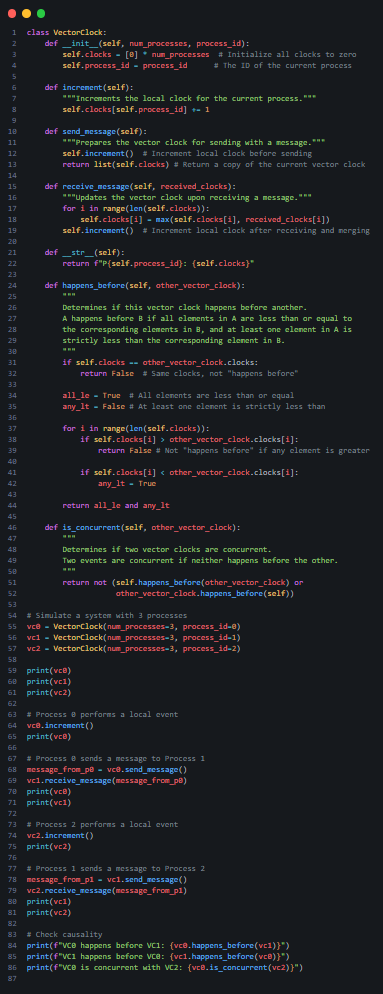
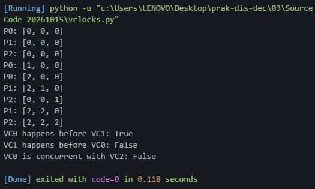
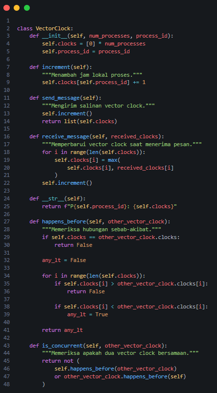
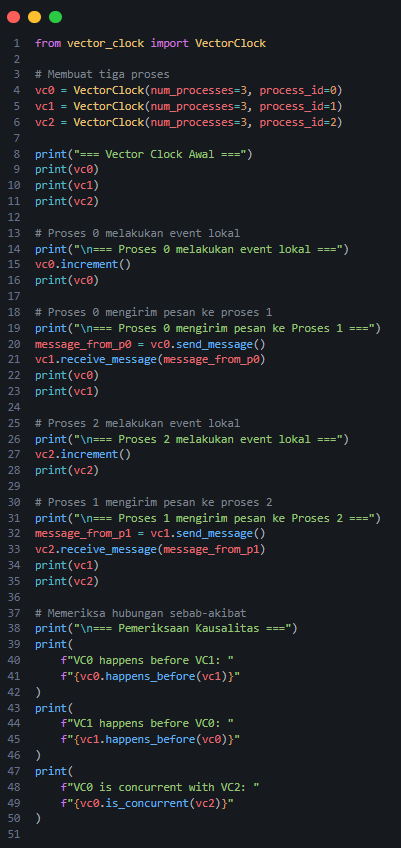
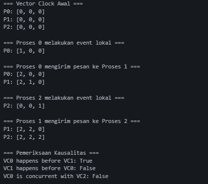
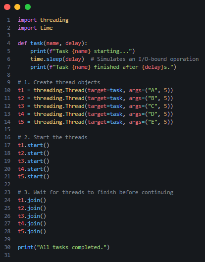
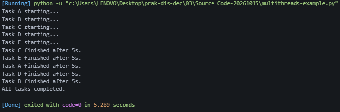
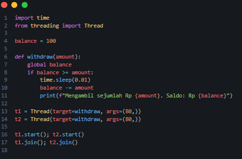

# Praktikum Minggu 03 - Sinkronisasi pada Sistem Terdistribusi

**Mata Kuliah:** Praktikum Sistem Terdistribusi dan Terdesentralisasi
**Topik:** Sinkronisasi pada Sistem Terdistribusi

---

# 📚 Tujuan Praktikum

---

# 📚 Dasar Teori

---

# ⏩ PEMBAHASAN PRAKTIKUM

## PRAKTIK 1 - Sinkronisasi Waktu

### 1. Install NetTime (Windows)

- ...

#### Pembahasan

---

- ...

#### Pembahasan

---

- ...

#### Pembahasan

---

- ...

#### Pembahasan

---

- ...

#### Pembahasan

---

- ...

#### Pembahasan

---

- ...

#### Pembahasan

---

### 2. Proses Sinkronisasi

#### Pembahasan

---

## PRAKTIK 2 - Vector Clock

- File vclocks.py

#### Pembahasan

---

- Jalankan Program

#### Pembahasan

---

- Buat modul Python untuk class VectorClock

Class: vector_clock.py

#### Pembahasan

---

Class:main.py dan Output

#### Pembahasan

---

## PRAKTIK 3 - Problem Tanpa Sinkronisasi

Class: multithreads-example.py

#### Pembahasan

---

Jalankan program

#### Pembahasan

---

- Data Race / Race Conditions

#### Pembahasan

---

- Jalankan Program

# ⏩ PEMBAHASAN TUGAS

---

# 📝 Kesimpulan

---

## 🗒️ Referensi
