# Praktikum Minggu 03 - Sinkronisasi pada Sistem Terdistribusi

**Mata Kuliah:** Praktikum Sistem Terdistribusi dan Terdesentralisasi
**Topik:** Sinkronisasi pada Sistem Terdistribusi

---

# 📚 Tujuan Praktikum

---

# 📚 Dasar Teori

---

# ⏩ PEMBAHASAN PRAKTIKUM

## PRAKTIK 1 - Sinkronisasi Waktu

### 1. Install NetTime (Windows)

- ...

#### Pembahasan

---

- ...

#### Pembahasan

---

- ...

#### Pembahasan

---

- ...

#### Pembahasan

---

- ...

#### Pembahasan

---

- ...

#### Pembahasan

---

- ...

#### Pembahasan

---

### 2. Proses Sinkronisasi

#### Pembahasan

---

## PRAKTIK 2 - Vector Clock

- File vclocks.py

#### Pembahasan

---

- Jalankan Program

#### Pembahasan

---

- Buat modul Python untuk class VectorClock

Class: vector_clock.py

#### Pembahasan

---

Class:main.py dan Output

#### Pembahasan

---

## PRAKTIK 3 - Problem Tanpa Sinkronisasi

Class: multithreads-example.py

#### Pembahasan

---

Jalankan program

#### Pembahasan

---

- **Data Race / Race Conditions**

Class: race-conditions-01.py

#### Pembahasan

---

- Jalankan Program

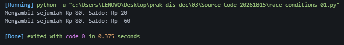

#### Pembahasan

---

- Visualisasi gambar dengan pensil/ballpoint, dan mengapa terjadi data race / race conditions

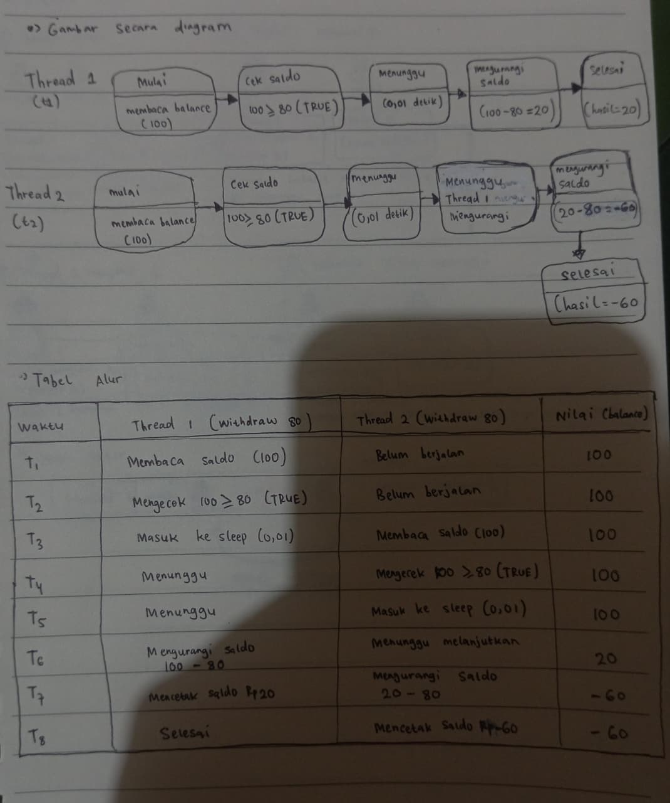

#### Pembahasan

---

- **Supaya tidak terjadi race conditions**

Class: race-conditions-02.py

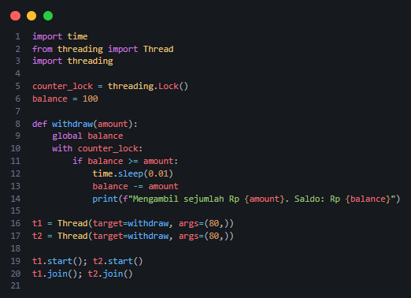

#### Pembahasan

---

- Jalankan Program

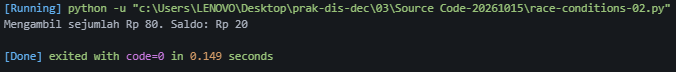

#### Pembahasan

---

- **Deadlock**

Class: deadlock-01.py

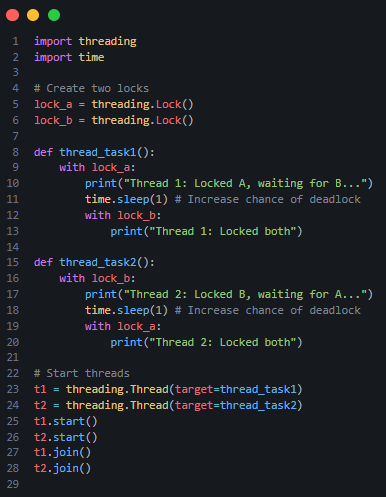

#### Pembahasan

---

- Jalankan program

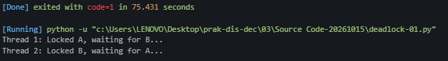

#### Pembahasan

---

- Visualisasi gambar dengan pensil/ballpoint, dan mengapa terjadi deadlock

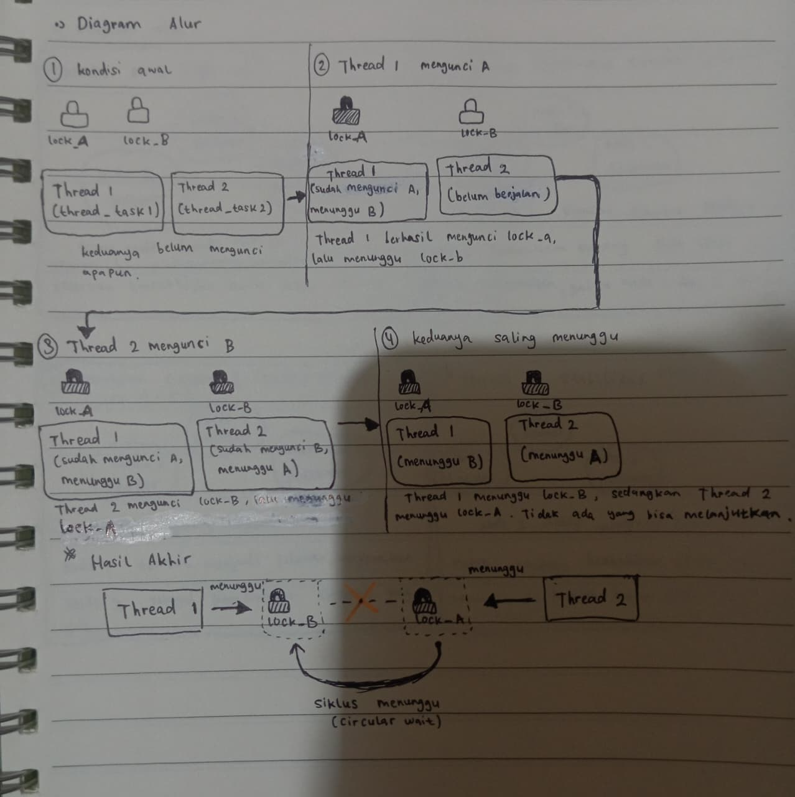

#### Pembahasan

---

- **Supaya deadlock tersebut tidak terjadi**

Class: deadlock-02.py

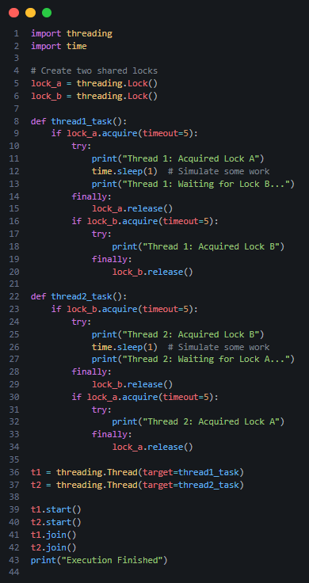

#### Pembahasan

---

- Jalankan program

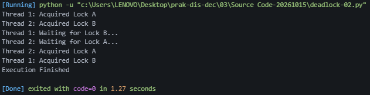

#### Pembahasan

---

## PRAKTIK 4 - Algoritma Raft

Class: raft.py

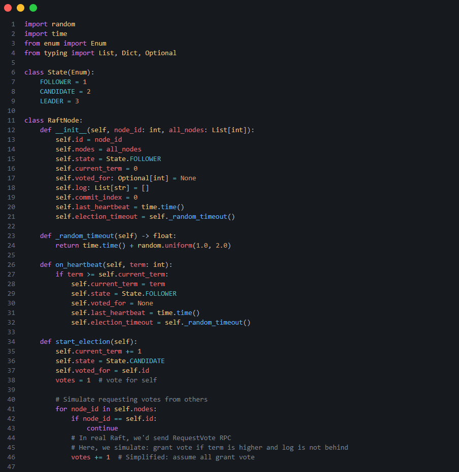
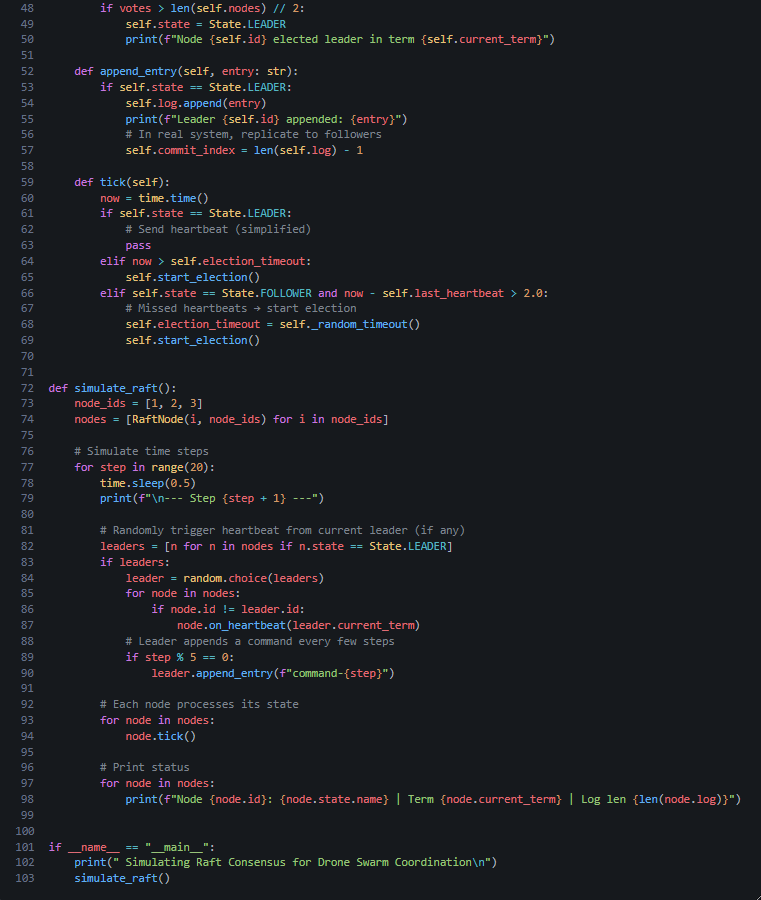

#### Pembahasan

---

- Jalankan program

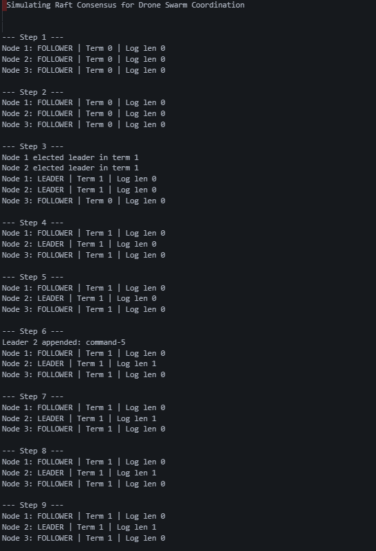
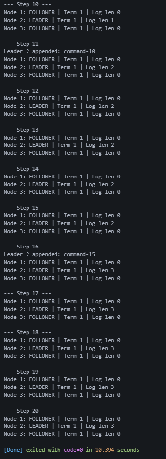

#### Pembahasan

---

- Visualisasi sederhana Algoritma Raft

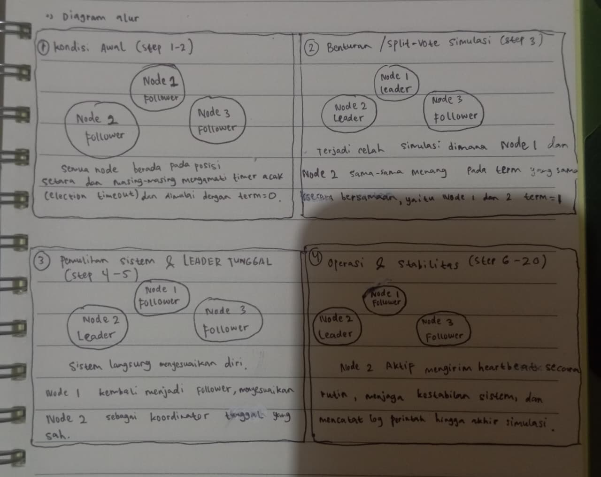

#### Pembahasan

---

- Membuat program tersebut menjadi modul Python dan simulasinya menggunakan modul Python tersebut

dari praktik sebelumnya, ditambahkan file : main.py pada folder Algoritma Raft

File : main.py

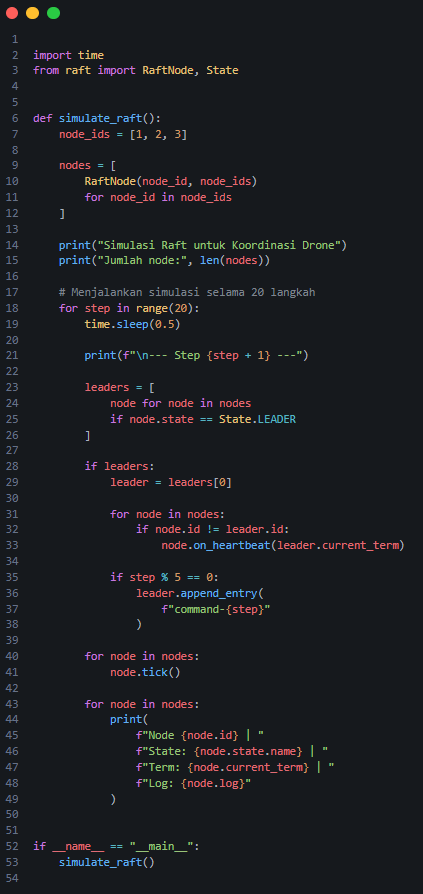

#### Pembahasan

---

- Jalankan program

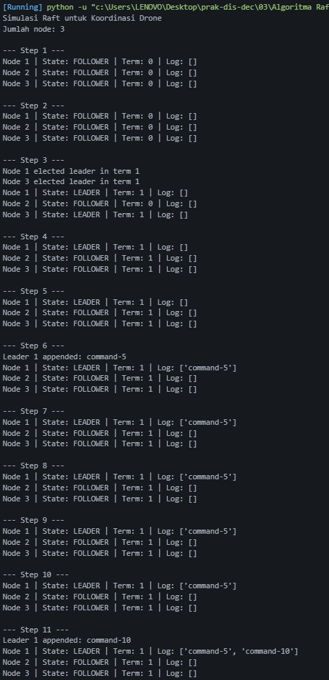
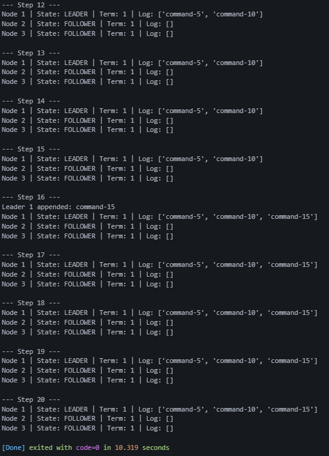

#### Pembahasan

---

# ⏩ PEMBAHASAN TUGAS

---

# 📝 Kesimpulan

---

## 🗒️ Referensi
