# Praktikum Minggu 04 - Konsistensi dan Replikasi pada Sistem Terdistribusi

**Mata Kuliah:** Praktikum Sistem Terdistribusi dan Terdesentralisasi
**Topik:** Konsistensi dan Replikasi pada Sistem Terdistribusi

---

# 📚 Tujuan Praktikum

1. ...
2. ...
3. ...
4. ...
5. ...

---

# 📚 Dasar Teori

---

# ⏩ PEMBAHASAN PRAKTIKUM

## PRAKTIK 1 - Streaming Replication Menggunakan PostgreSQL

**Prasyarat**

1. Install Docker

...


#### Pembahasan

---

...

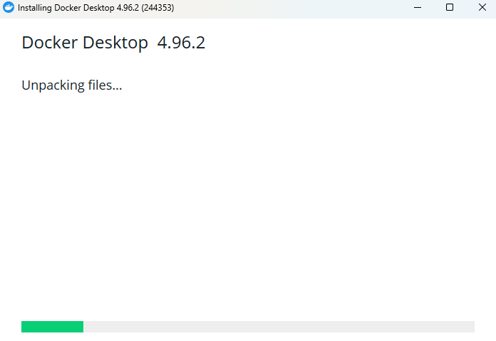

#### Pembahasan

---

...

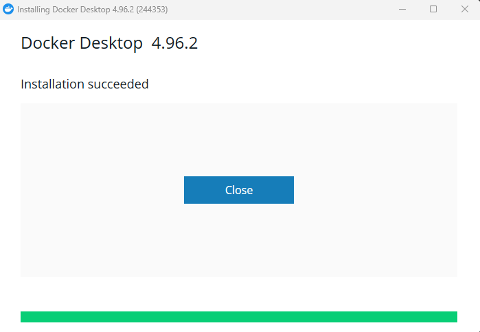

#### Pembahasan

---

2. Cek versi Docker & Compose

**_Versi Docker_**

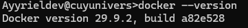

#### Pembahasan

---

**_Versi Compose_**

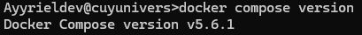

#### Pembahasan

---

**_Cek info Docker_**

Gunakan perintah:

```
docker info
```

Contoh penggunaan:

```
Ayyrieldev@cuyunivers>docker info
Client:
 Version:    29.9.2
 Context:    desktop-linux
 Debug Mode: false
 Plugins:
  agent: Docker AI Agent Runner (Docker Inc.)
    Version:  v1.152.0
    Path:     C:\Users\LENOVO\.docker\cli-plugins\docker-agent.exe
  ai: Docker AI Agent - Ask Gordon (Docker Inc.)
    Version:  v1.33.0
    Path:     C:\Users\LENOVO\.docker\cli-plugins\docker-ai.exe
  buildx: Docker Buildx (Docker Inc.)
    Version:  v0.38.1
    Path:     C:\Users\LENOVO\.docker\cli-plugins\docker-buildx.exe
  compose: Docker Compose (Docker Inc.)
    Version:  v5.6.1
    Path:     C:\Users\LENOVO\.docker\cli-plugins\docker-compose.exe
  debug: Get a shell into any image or container (Docker Inc.)
    Version:  0.0.47
    Path:     C:\Users\LENOVO\.docker\cli-plugins\docker-debug.exe
  desktop: Docker Desktop commands (Docker Inc.)
    Version:  4.96.2
    Path:     C:\Users\LENOVO\.docker\cli-plugins\docker-desktop.exe
  dhi: CLI for managing Docker Hardened Images (Docker Inc.)
    Version:  v0.0.9
    Path:     C:\Users\LENOVO\.docker\cli-plugins\docker-dhi.exe
  extension: Manages Docker extensions (Docker Inc.)
    Version:  v0.2.32
    Path:     C:\Users\LENOVO\.docker\cli-plugins\docker-extension.exe
  init: Creates Docker-related starter files for your project (Docker Inc.)
    Version:  v1.4.0
    Path:     C:\Users\LENOVO\.docker\cli-plugins\docker-init.exe
  mcp: Docker MCP Plugin (Docker Inc.)
    Version:  v0.44.1
    Path:     C:\Users\LENOVO\.docker\cli-plugins\docker-mcp.exe
  model: Docker Model Runner (Docker Inc.)
    Version:  v1.2.6
    Path:     C:\Users\LENOVO\.docker\cli-plugins\docker-model.exe
  offload: Docker Offload (Docker Inc.)
    Version:  v0.7.16
    Path:     C:\Users\LENOVO\.docker\cli-plugins\docker-offload.exe
  pass: Docker Pass Secrets Manager Plugin (beta) (Docker Inc.)
    Version:  v0.3.2
    Path:     C:\Users\LENOVO\.docker\cli-plugins\docker-pass.exe
  sandbox: "docker sandbox" is deprecated, use Docker Sandboxes instead (Docker Inc.)
    Version:  v0.13.0
    Path:     C:\Users\LENOVO\.docker\cli-plugins\docker-sandbox.exe
  scout: Docker Scout (Docker Inc.)
    Version:  v1.27.0
    Path:     C:\Users\LENOVO\.docker\cli-plugins\docker-scout.exe

Server:
 Containers: 0
  Running: 0
  Paused: 0
  Stopped: 0
 Images: 0
 Server Version: 29.9.2
 Storage Driver: overlayfs
  driver-type: io.containerd.snapshotter.v1
 Logging Driver: local
 Cgroup Driver: cgroupfs
 Cgroup Version: 2
 Plugins:
  Volume: local
  Network: bridge host ipvlan macvlan null overlay
  Log: awslogs fluentd gcplogs gelf journald json-file local splunk syslog
 CDI spec directories:
  /etc/cdi
  /var/run/cdi
 Discovered Devices:
  cdi: docker.com/gpu=webgpu
 Swarm: inactive
 Runtimes: io.containerd.runc.v2 nvidia runc
 Default Runtime: runc
 Init Binary: docker-init
 containerd version: b7a25261e029d68978bbf290df0a62fc819b3c51
 runc version: v1.5.2-0-g29dd3dc2
 init version: de40ad0
 Security Options:
  seccomp
   Profile: builtin
  cgroupns
 Kernel Version: 6.18.33.2-microsoft-standard-WSL2
 Operating System: Docker Desktop
 OSType: linux
 Architecture: x86_64
 CPUs: 12
 Total Memory: 7.606GiB
 Name: docker-desktop
 ID: e91a3552-1c19-41d2-8504-94998f188362
 Docker Root Dir: /var/lib/docker
 Debug Mode: false
 HTTP Proxy: http.docker.internal:3128
 HTTPS Proxy: http.docker.internal:3128
 No Proxy: hubproxy.docker.internal
 Labels:
  com.docker.desktop.address=npipe://\\.\pipe\docker_cli
 Experimental: false
 Insecure Registries:
  hubproxy.docker.internal:5555
  127.0.0.0/8
  ::1/128
 Live Restore Enabled: false
 Firewall Backend: iptables
```

#### Pembahasan

---

**Struktur Direktori pada File**

File yang diperlukan adalah sebagai berikut:

```
streaming-replication/
├── 00_init.sql
├── docker-compose.yaml
└── env.sh
1 directory, 3 files
```

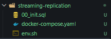

#### Pembahasan

---

_File: 00_init.sql_

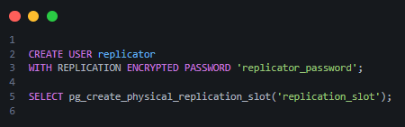

#### Pembahasan

---

_File: docker-compose.yaml_

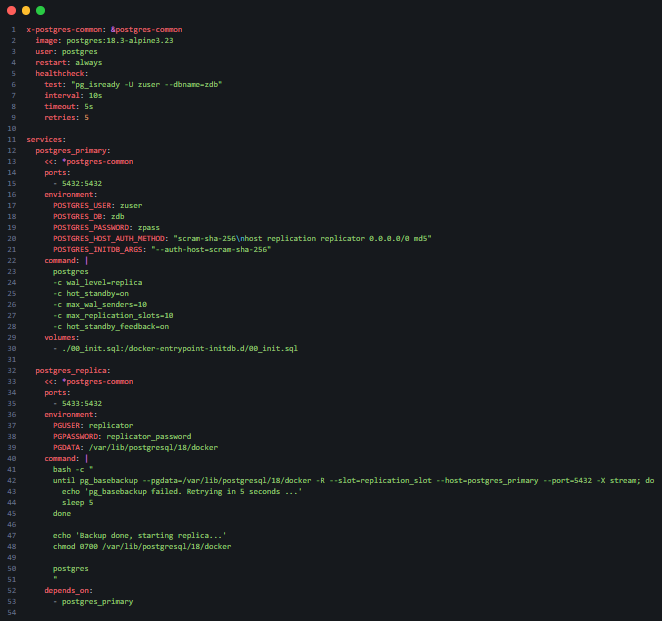

#### Pembahasan

---

_File: env.sh_

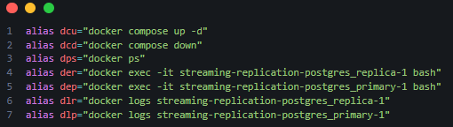

#### Pembahasan

---

**Menjalankan docker-compose**

1. Masuk ke direktori streaming-replication terlebih dahulu karena pada saat ini folder masih berada pada folder 04

Gunakan perintah:

```
cd 04\streaming-replication
```

Kemudian periksa direktori di streaming-replication

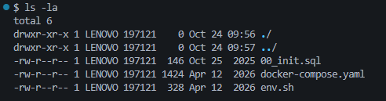

#### Pembahasan

---

Lalu muat alias di file env.sh terlebih dahulu

Gunakan Perintah:

```
source env.sh
```

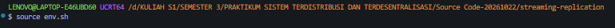

#### Pembahasan

---

Lalu jalankan docker compose

Gunakan perintah:

```
docker compose up -d
```

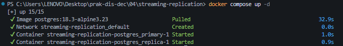

atau

```
dcu
```

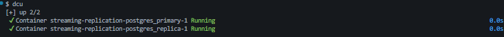

#### Pembahasan

---

Selanjutnya periksa apakah kedua image untuk PostgreSQL 18 di Alpine Linux tersebut telah berhasil diaktifkan:

Gunakan Perintah:

```
dps
```

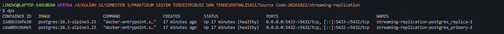

Jika status Healthy tidak muncul, bisa di trace menggunakan log dari Docker

Gunakan perintah:

```
dlr
```

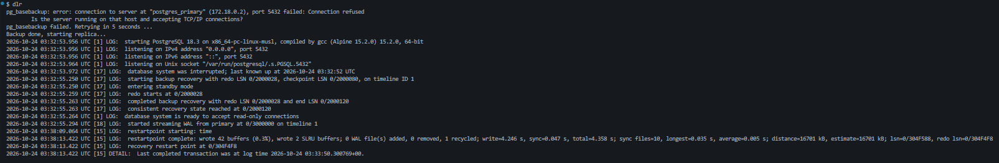

Atau bisa juga menggunakan

```
docker logs streaming-replication-postgres_replica-1
```

Contoh penggunaan:

```
$ docker logs streaming-replication-postgres_replica-1
pg_basebackup: error: connection to server at "postgres_primary" (172.18.0.2), port 5432 failed: Connection refused
        Is the server running on that host and accepting TCP/IP connections?
pg_basebackup failed. Retrying in 5 seconds ...
Backup done, starting replica...
2026-10-24 02:40:41.600 UTC [1] LOG:  starting PostgreSQL 18.3 on x86_64-pc-linux-musl, compiled by gcc (Alpine 15.2.0) 15.2.0, 64-bit
2026-10-24 02:40:41.601 UTC [1] LOG:  listening on IPv4 address "0.0.0.0", port 5432
2026-10-24 02:40:41.601 UTC [1] LOG:  listening on IPv6 address "::", port 5432
2026-10-24 02:40:41.611 UTC [1] LOG:  listening on Unix socket "/var/run/postgresql/.s.PGSQL.5432"
2026-10-24 02:40:41.624 UTC [17] LOG:  database system was interrupted; last known up at 2026-10-24 02:40:40 UTC
2026-10-24 02:40:42.570 UTC [17] LOG:  starting backup recovery with redo LSN 0/2000028, checkpoint LSN 0/2000080, on timeline ID 1
2026-10-24 02:40:42.570 UTC [17] LOG:  entering standby mode
2026-10-24 02:40:42.581 UTC [17] LOG:  redo starts at 0/2000028
2026-10-24 02:40:42.585 UTC [17] LOG:  completed backup recovery with redo LSN 0/2000028 and end LSN 0/2000120
2026-10-24 02:40:42.586 UTC [17] LOG:  consistent recovery state reached at 0/2000120
2026-10-24 02:40:42.586 UTC [1] LOG:  database system is ready to accept read-only connections
2026-10-24 02:40:42.619 UTC [18] LOG:  started streaming WAL from primary at 0/3000000 on timeline 1
2026-10-24 02:45:56.725 UTC [15] LOG:  restartpoint starting: time
2026-10-24 02:46:01.014 UTC [15] LOG:  restartpoint complete: wrote 42 buffers (0.3%), wrote 2 SLRU buffers; 0 WAL file(s) added, 0 removed, 1 recycled; write=4.243 s, sync=0.022 s, total=4.290 s; sync files=10, longest=0.010 s, average=0.003 s; distance=16701 kB, estimate=16701 kB; lsn=0/304F5C0, redo lsn=0/304F530
2026-10-24 02:46:01.014 UTC [15] LOG:  recovery restart point at 0/304F530
2026-10-24 02:46:01.014 UTC [15] DETAIL:  Last completed transaction was at log time 2026-10-24 02:41:37.715678+00.
2026-10-24 03:11:48.981 UTC [18] LOG:  replication terminated by primary server
2026-10-24 03:11:48.981 UTC [18] DETAIL:  End of WAL reached on timeline 1 at 0/304F6E8.
2026-10-24 03:11:48.981 UTC [18] FATAL:  could not send end-of-streaming message to primary: server closed the connection unexpectedly
                This probably means the server terminated abnormally
                before or while processing the request.
        invalid socket
        no COPY in progress
2026-10-24 03:11:48.982 UTC [17] LOG:  invalid record length at 0/304F6E8: expected at least 24, got 0
2026-10-24 03:11:48.995 UTC [1321] FATAL:  streaming replication receiver "walreceiver" could not connect to the primary server: connection to server at "postgres_primary" (172.18.0.2), port 5432 failed: FATAL:  the database system is shutting down
2026-10-24 03:11:48.995 UTC [17] LOG:  waiting for WAL to become available at 0/304F700
2026-10-24 03:11:54.010 UTC [1322] LOG:  started streaming WAL from primary at 0/3000000 on timeline 1
2026-10-24 03:11:57.252 UTC [15] LOG:  restartpoint starting: time
2026-10-24 03:11:57.283 UTC [15] LOG:  restartpoint complete: wrote 0 buffers (0.0%), wrote 0 SLRU buffers; 0 WAL file(s) added, 0 removed, 0 recycled; write=0.003 s, sync=0.001 s, total=0.031 s; sync files=0, longest=0.000 s, average=0.000 s; distance=0 kB, estimate=15031 kB; lsn=0/304F670, redo lsn=0/304F670
2026-10-24 03:11:57.283 UTC [15] LOG:  recovery restart point at 0/304F670
2026-10-24 03:11:57.283 UTC [15] DETAIL:  Last completed transaction was at log time 2026-10-24 02:41:37.715678+00.
```

#### Pembahasan

---

**Pengujian**

melihat dari berbagai informasi di tabel diagnostik PostgreSQL 18.3 maupun dengan melakukan percobaan manipulasi data tabel

Gunakan perintah:

```
dep
```

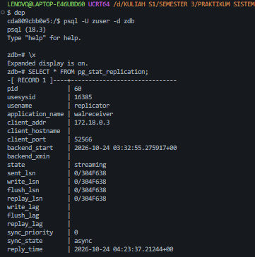
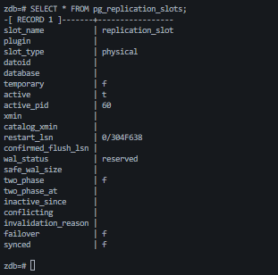

#### Pembahasan

---

Untuk melihat status pada server replica

Gunakan perintah:

```
der
```

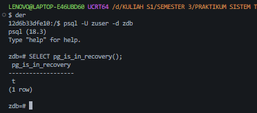

#### Pembahasan

---

Untuk melihat efek dari replikasi ini pada kedua server, dibuat tabel dan kemudian mengisi data tabel tersebut di server utama (primary). Setelah itu melihat kondisi di server replica.

**-Sebelum Pembuatan Tabel**

_Primary_

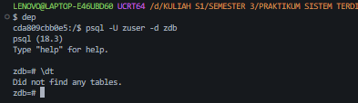

#### Pembahasan

---

_Replica_

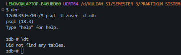

#### Pembahasan

---

**-Memanipulasi Data Pada _Primary_**

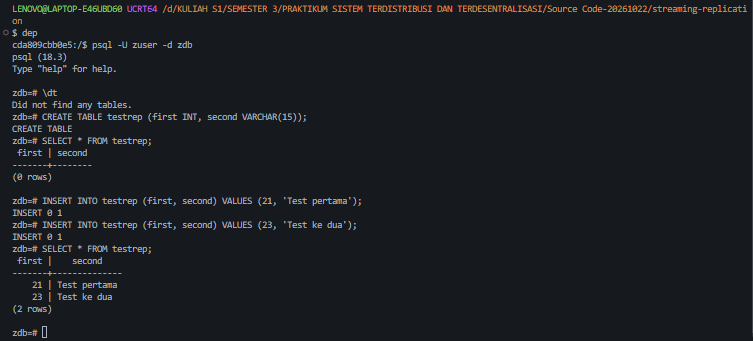

#### Pembahasan

---

Secara otomatis, manipulasi data tersebut akan direplikasi ke server replica:

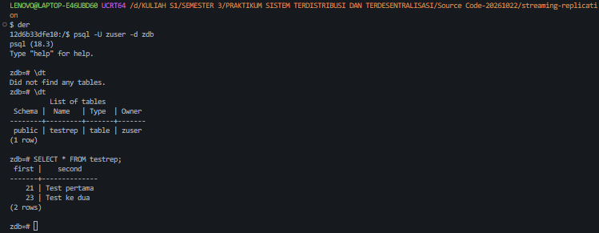

#### Pembahasan

---

**High-Availability**

_Primary server mati_

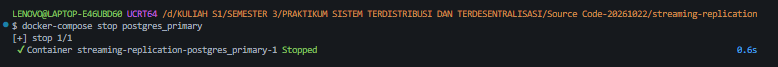

#### Pembahasan

---

Setelah kita mengetahui bahwa primary server dalam kondisi down, maka kita bisa mempromosikan salah satu replica server untuk menjadi primary - dari kondisi hanya bisa menyediakan akses read menjadi primary server yang bisa menyediakan akses read-write. Berikut adalah perintah pg_promote() untuk mempromosikan replica menjadi primary:


#### Pembahasan

---

**Untuk mematikan semua primary dan replika**

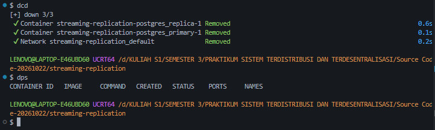

#### Pembahasan

---

## PRAKTIK 2 - Replikasi Master-Master Menggunakan Apache Ignite

**Struktur direktori dan file**

```
src--ApacheIgnite/
├── sql/
│   ├── current_catalog.sql
│   ├── ee_and_cust.sql
│   ├── invoices.sql
│   ├── media_and_genre.sql
│   ├── schema.sql
│   └── tracks.sql
├── docker-compose.yaml
└── env.sh
```


untuk file docker-compose.yaml
serta sekumpulan file perintah-perintah SQL yang bisa diperoleh dari:
https://ignite.apache.org/docs/ignite3/latest/quick-start/explore-sql.

#### Pembahasan

---

Kemudian buat file bernama env.sh untuk keperluan shortcut dan isi dengan perintah:

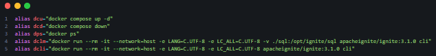

#### Pembahasan

---

**Menjalankan docker-compose**

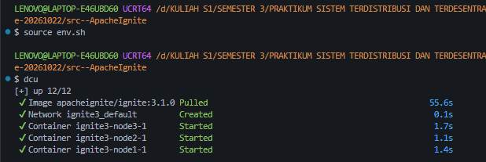

#### Pembahasan

---

Setelah proses pull selesai dan docker-compose telah up, maka akan muncul sebagai berikut:

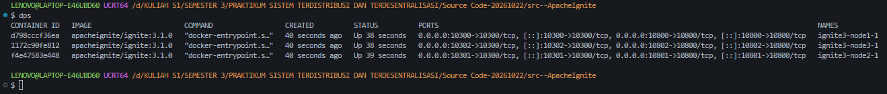

#### Pembahasan

---

Setiap container yang berjalan di dalam network Docker memiliki IP internal. Untuk mengecek IP dari masing-masing node, gunakan perintah

```
docker inspect -f '{{range .NetworkSettings.Networks}}{{.IPAddress}}{{end}}' <CONTAINER_ID_ATAU_NAMA>
```

Contoh

```
docker inspect -f '{{range .NetworkSettings.Networks}}{{.IPAddress}}{{end}}' ignite3-node1-1
```

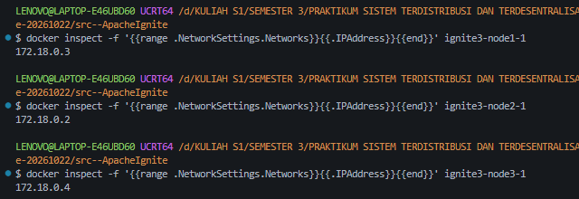

#### Pembahasan

---

**Inisialisasi Cluster**

Jalankan Apache Ignite cli (atau menggunakan env var dcli) dengan perintah:

```
docker run --rm -it --network=host -e LANG=C.UTF-8 -e LC_ALL=C.UTF-8 apacheignite/ignite:3.1.0 cli
```

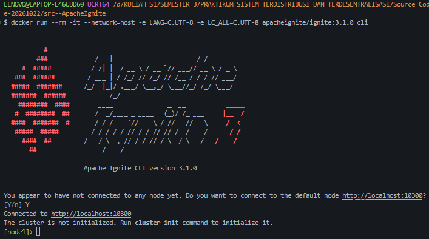

#### Pembahasan

---

Lalu menginisialisasi Cluster dengan perintah:

```
cluster init --name=ignite3 --metastorage-group=node1,node2,node3
```

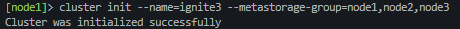

#### Pembahasan

---

Kemudian cek status cluster dengan perintah

```
cluster status
```

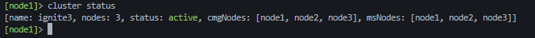

#### Pembahasan

---

Kemudian jika ingin masuk lagi ke cli dengan perintah yang sama, maka tidak memerlukan inisialisasi lagi.

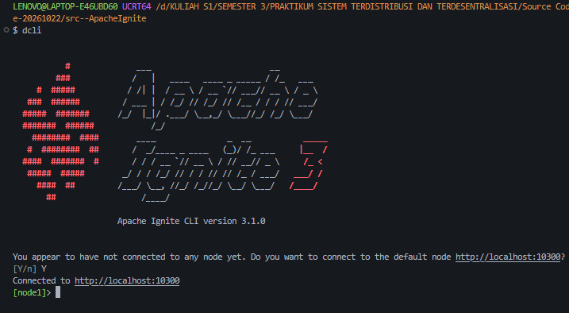

#### Pembahasan

---

**Eksekusi perintah-perintah SQL**

_Memuat dan Mengeksekusi File Skema SQL_

Gunakan perintah

```
sql --file=/opt/ignite/sql/schema.sql
```

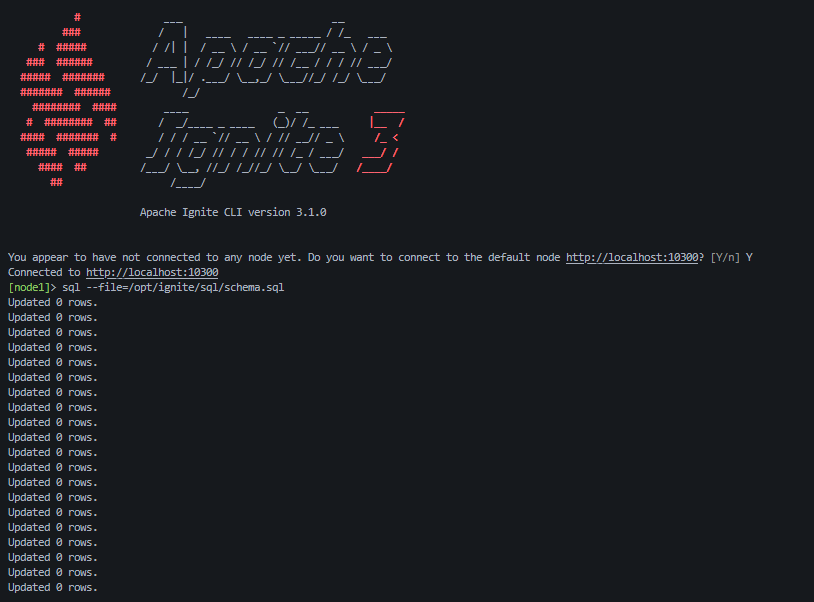

#### Pembahasan

---

Masuk ke mode SQL dengan perintah:

```
sql
```

kemudian gunakan perintah:

```
SELECT * FROM system.tables WHERE schema = 'PUBLIC';
```

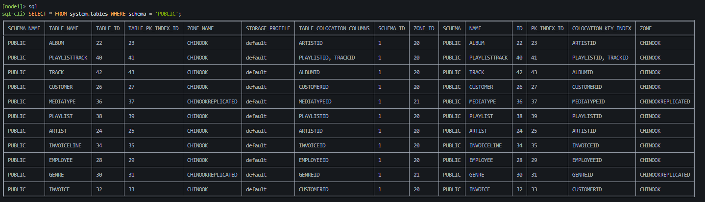
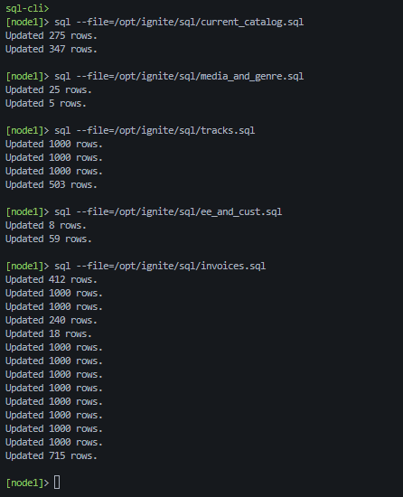

#### Pembahasan

---

Untuk memeriksa apakah perubahan pada http://localhost:10300 tersebut telah dipropagasi
ke node-node lainnya, kita bisa memeriksa dengan melakukan koneksi ke node-node
lainnya. Berikut adalah node di http://localhost:10301:

Gunakan perintah:

```
connect http://localhost:10301
```

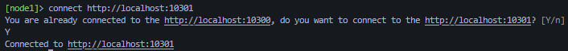

#### Pembahasan

---

Kemudian cek propagasi tabel

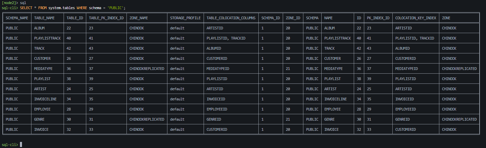

#### Pembahasan

---

Contoh query untuk analytics:

```
SELECT
    CAST(EXTRACT(YEAR FROM i.InvoiceDate) AS VARCHAR) || '-' ||
    CASE
        WHEN EXTRACT(MONTH FROM i.InvoiceDate) < 10
        THEN '0' || CAST(EXTRACT(MONTH FROM i.InvoiceDate) AS VARCHAR)
        ELSE CAST(EXTRACT(MONTH FROM i.InvoiceDate) AS VARCHAR)
    END AS YearMonth,
    COUNT(DISTINCT i.InvoiceId) AS InvoiceCount,
    COUNT(DISTINCT i.CustomerId) AS CustomerCount,
    SUM(i.Total) AS MonthlyRevenue,
    AVG(i.Total) AS AverageOrderValue
FROM
    Invoice i
GROUP BY
    EXTRACT(YEAR FROM i.InvoiceDate), EXTRACT(MONTH FROM i.InvoiceDate)
ORDER BY
    YearMonth DESC;
```

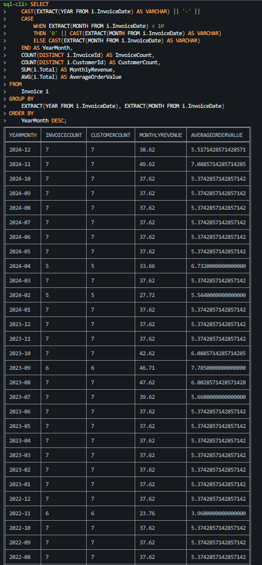
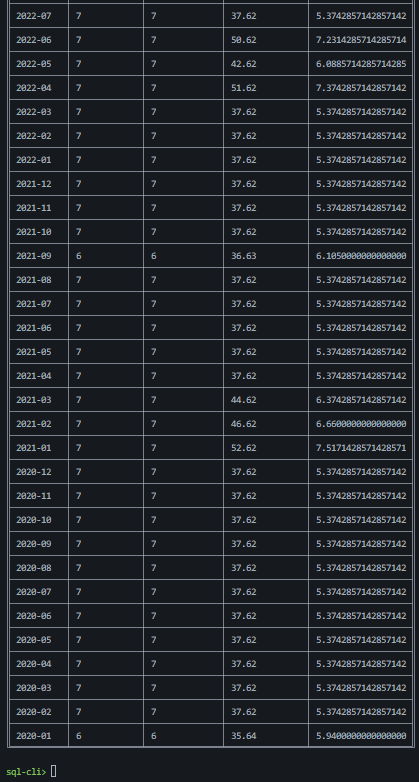

#### Pembahasan

---

Mari memeriksa http://localhost:10302:

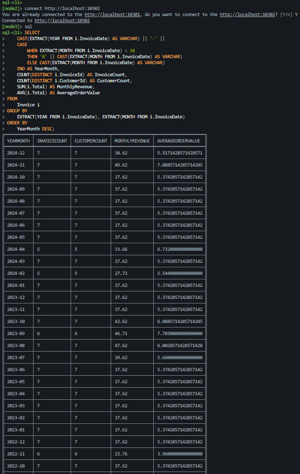
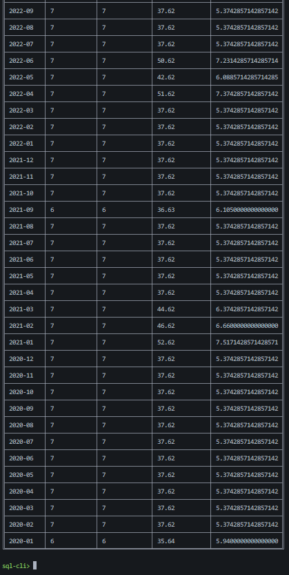

#### Pembahasan

---

Matikan semua node

Gunakan perintah:

```
dcd
```

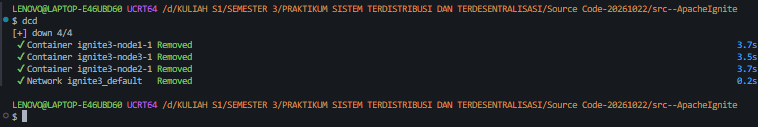

#### Pembahasan

---

# 📝 Kesimpulan

---

## 🗒️ Referensi
