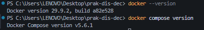
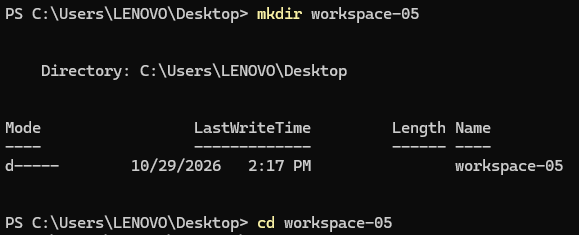
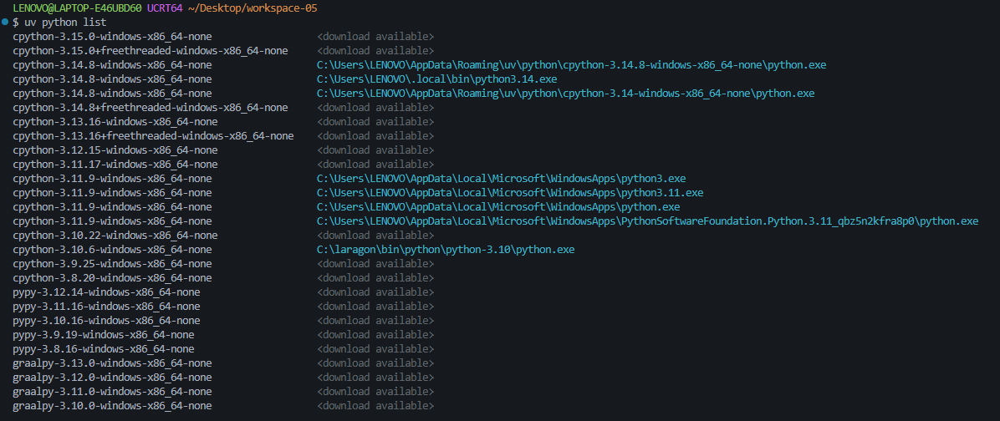
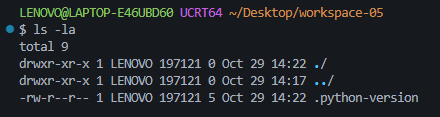
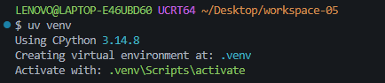
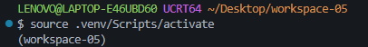
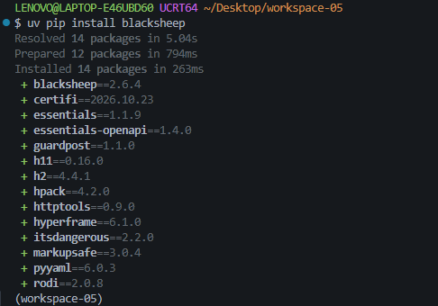
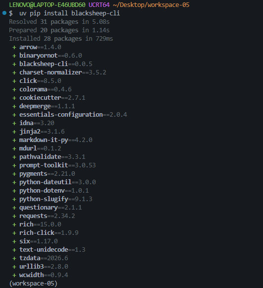

# Praktikum Minggu 05 - Fault Tolerance

**Mata Kuliah:** Praktikum Sistem Terdistribusi dan Terdesentralisasi

**Topik:** Fault Tolerance

---

## 🎯 Tujuan Praktikum

1.
2.
3.
4.
5.

---

## 📚 Dasar Teori

---

# ⏩ PEMBAHASAN PRAKTIKUM

### 4.1 Load Balancing Aplikasi

#### 4.1.1 Persiapan

#### Install Docker

Menginstall Docker Dekstop terlebih dahulu, karena pada praktikum sebelumnya sudah menginstall docker, maka cukup cek versi saja:



#### Pembahasan

---

#### Buat Folder Kerja



#### Pembahasan

---

#### Cek List Versi Python yang tersedia



#### Pembahasan

---

#### Menyematkan Versi Python


#### Pembahasan

---

#### Menampilkan daftar seluruh berkas dan folder secara rinci, termasuk yang tersembunyi



#### Pembahasan

---

#### Membuat lingkungan virtual Python (virtual environment) baru.



#### Pembahasan

---

#### Mengaktifkan lingkungan virtual (virtual environment) Python di sistem operasi Windows

Untuk mengaktifkan virtual environment Python di windows dapat menggunakan perintah:

```bash
source .venv/Scripts/activate
```



#### Pembahasan

---

#### Install blacksheep dan blacksheep-cli

Untuk membuat aplikasi web menggunakan Blacksheep, install blacksheep dan blacksheep-cli terlebih dahulu:

_Install Blacksheep_

Untuk menginstall Blacksheep dapat menggunakan perintah:

```bash
uv pip install blacksheep
```



#### Pembahasan

---

_Install Blacksheep CLI_

Untuk menginstall Blacksheep CLI dapat menggunakan perintah:

```bash
uv pip install blacksheep-cli
```



#### Pembahasan

---

---

## 📝 Kesimpulan

---

## 🗒️ Referensi
