# Praktikum Minggu 05 - Fault Tolerance

**Mata Kuliah:** Praktikum Sistem Terdistribusi dan Terdesentralisasi

**Topik:** Fault Tolerance

---

## 🎯 Tujuan Praktikum

1.
2.
3.
4.
5.

---

## 📚 Dasar Teori

---

# ⏩ PEMBAHASAN PRAKTIKUM

### 4.1 Load Balancing Aplikasi

#### 4.1.1 Persiapan

#### Install Docker

Langkah pertama yaitu menginstall Docker Dekstop terlebih dahulu, karena pada praktikum sebelumnya sudah menginstall docker, maka cukup cek versi saja:


#### Pembahasan

---

#### Buat Folder Kerja


#### Pembahasan

---

#### Cek List Versi Python yang tersedia


#### Pembahasan

---

#### Menyematkan Versi Python


#### Pembahasan

---

#### Menampilkan daftar seluruh berkas dan folder secara rinci, termasuk yang tersembunyi


#### Pembahasan

---

#### Membuat lingkungan virtual Python (virtual environment) baru.


#### Pembahasan

---

#### Mengaktifkan lingkungan virtual (virtual environment) Python di sistem operasi Windows

Untuk mengaktifkan virtual environment Python di windows dapat menggunakan perintah:

```bash
source .venv/Scripts/activate
```


#### Pembahasan

---

#### Install blacksheep dan blacksheep-cli

Untuk membuat aplikasi web menggunakan Blacksheep, install blacksheep dan blacksheep-cli terlebih dahulu:

**_Install Blacksheep_**

Untuk menginstall Blacksheep dapat menggunakan perintah:

```bash
uv pip install blacksheep
```


#### Pembahasan

---

**_Install Blacksheep CLI_**

Untuk menginstall Blacksheep CLI dapat menggunakan perintah:

```bash
uv pip install blacksheep-cli
```


#### Pembahasan

---

#### 4.1.2 Pembuatan Aplikasi Web

Setelah itu, buat aplikasi menggunakan cli dengan perintah:

```bash
blacksheep create
```

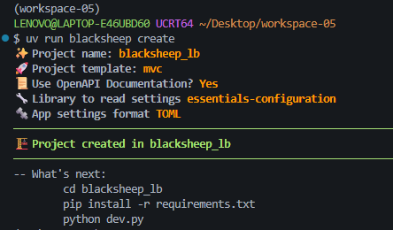

#### Pembahasan

---

**_Install paket yang diperlukan_**

Masuk terlebih dahulu ke folder direktori blacksheep_lb dengan perintah:

```bash
cd blacksheep_lb
```

Kemudian menginstall paket yang diperlukan dengan perintah:

```bash
uv pip install -r requirements.txt
```

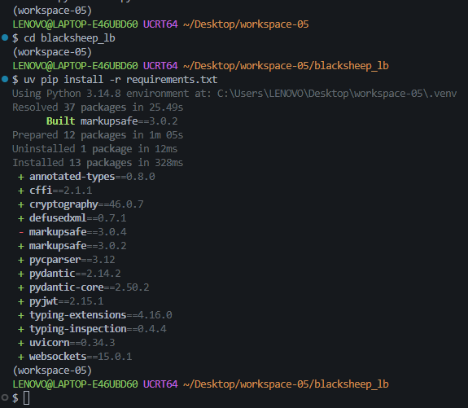

#### Pembahasan

---

Memastikan bahwa aplikasi tersebut bisa berjalan dengan baik:

```bash
python dev.py
```

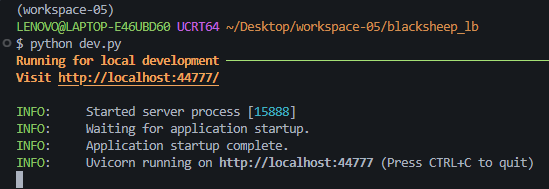

#### Pembahasan

---

kemudian akses ke http://localhost:44777/ menggunakan browser

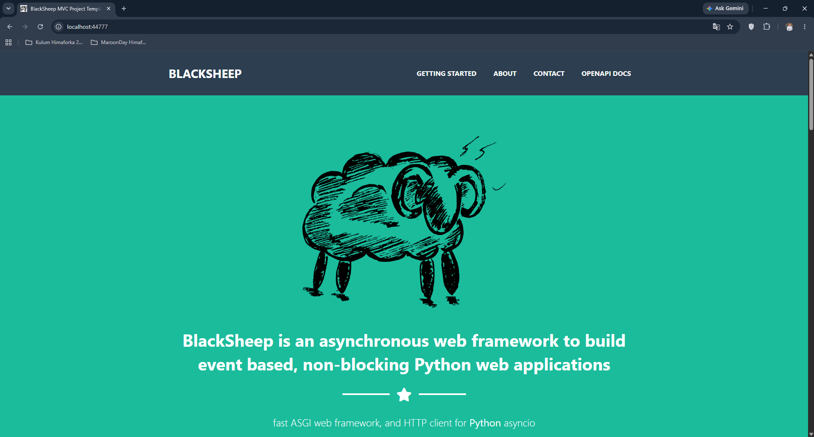

#### Pembahasan

---

Lalu pada shell tempat mengaktifkan server, muncul:

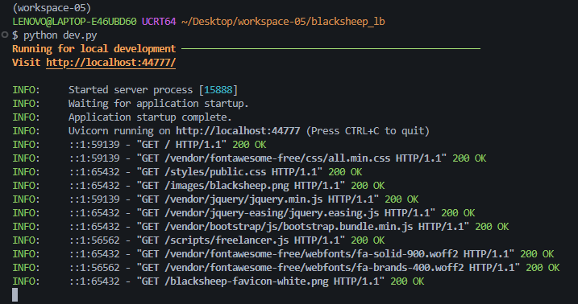

#### Pembahasan

---

Pada titik ini, sudah berhasil membuat aplikasi menggunakan Blacksheep. Perhatikan, dalam direktori blacksheep_lb sudah ada Dockerfile yang bisa digunakan:

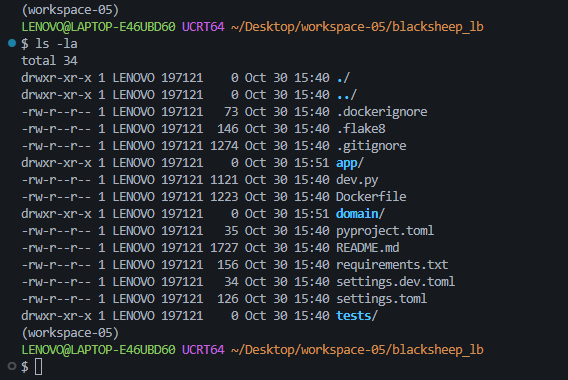

#### Pembahasan

---

#### 4.1.3 Siapkan Dockerfile dan docker-compose.yml

Struktur yang dihasilkan harus terdiri dari:

```
workspace-05/
├── blacksheep_lb/
│   ├── app/
│   ├── dev.py
│   ├── Dockerfile
│   ├── domain/
│   ├── pyproject.toml
│   ├── README.md
│   ├── requirements.txt
│   ├── settings.dev.toml
│   ├── settings.toml
│   └── tests/
├── docker-compose.yml
├── env.sh
└── nginx/
    ├── Dockerfile
    └── nginx.conf
```

_File blacksheep_lb/Dockerfile_

```
# Build the Server
FROM python:3.14.4-slim AS server_builder
WORKDIR /home
RUN apt-get update && apt-get install -y --no-install-recommends \
    build-essential \
    ca-certificates \
    && rm -rf /var/lib/apt/lists/*

COPY . /home
RUN python -m venv venv && \
    . venv/bin/activate && \
    pip install --upgrade pip && \
    pip install -r requirements.txt

EXPOSE 80

FROM python:3.14.4-slim
WORKDIR /home
COPY --from=server_builder /home /home

ENV APP_ENV=prod BG_COLOR="#1abc9c" APP_ROUTE_PREFIX=""
CMD ["sh", "-c", ". venv/bin/activate && uvicorn \"app.main:app\" --host 0.0.0.0 --port 80 --log-level info"]
```

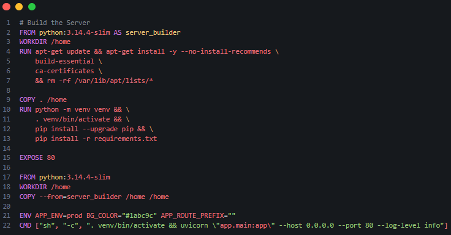

#### Pembahasan

---

Kemudian membuat direktori baru bernama _nginx_ pada workspace-05 dengan perintah:

```bash
mkdir nginx
```

Lalu masuk ke folder tersebut dengan perintah:

```bash
cd nginx
```

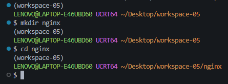

#### Pembahasan

---

Selanjutnya membuat file Dockerfile dan nginx.conf pada direktori nginx

**_Dockerfile_**

Gunakan perintah:

```bash
touch Dockerfile
```

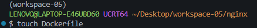

#### Pembahasan

---

Kemudian **_Dockerfile_** di isi dengan kode:

```
FROM nginx

# Override the default nginx configuration file
RUN rm /etc/nginx/conf.d/default.conf
COPY nginx.conf /etc/nginx/nginx.conf
```

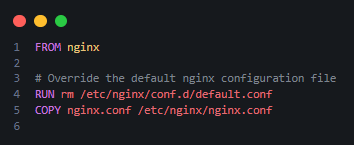

#### Pembahasan

---

**_nginx.conf_**

Gunakan perintah:

```bash
touch nginx.conf
```

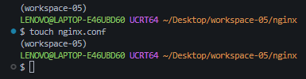

#### Pembahasan

---

Kemudian **_nginx.conf_** di isi dengan kode:

```
events {
    worker_connections 4096;
}

http {
    # Definisi grup, lihat di docker-compose.yml
    upstream backend {
        server bs_app:80;
        }
        server {
            listen 80;
            location / {
                # sesuaikan dengan nama upstream di atas
                proxy_pass http://backend;
                }
            }
}
```

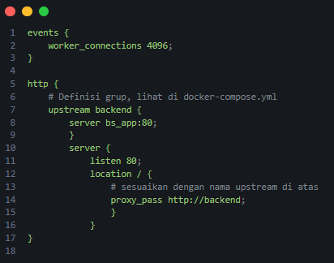

#### Pembahasan

---

**_docker-compose.yml_**

Selanjutnya membuat file bernama **_docker-compose.yml_** pada workspace-05 dengan perintah:

```bash
touch docker-compose.yml
```

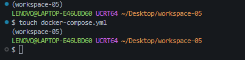

#### Pembahasan

---

Kemudian **_docker-compose.yml_** di isi dengan kode:

```
services:
  # aplikasi yang akan di-scale
  # ada pada direktori blacksheep_lb
  bs_app:
    build: ./blacksheep_lb
  # aktifkan nginx dengan menggunakan nginx/Dockerfile
  # lihat pada build
  nginx:
    container_name: nginx
    build: ./nginx
    ports:
      - "80:80"
    depends_on:
      - bs_app
```

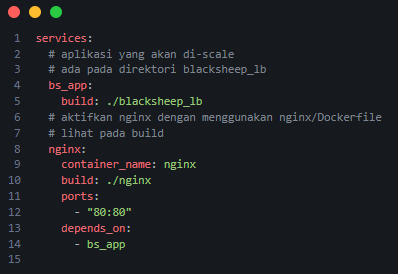

#### Pembahasan

**_env.sh_**

Selanjutnya membuat file bernama **_env.sh_** pada workspace-05 dengan perintah:

```bash
touch env.sh
```

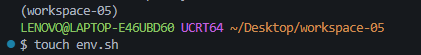

#### Pembahasan

---

Kemudian **_env.sh_** di isi dengan kode:

```
alias dcu="docker-compose up --build -d --scale bs_app=2"
alias dcd="docker compose down"
alias dps="docker ps --format '{{.Image}} {{.Names}}'"
alias dcln="docker logs nginx"
```

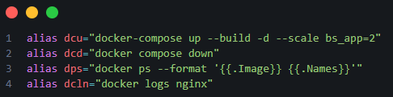

#### Pembahasan

---

Sebelum menjalankan Docker, Muat Alias terlebih dahulu dengan perintah:

```bash
source env.sh
```

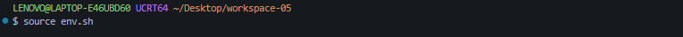

#### Pembahasan

---

#### 4.1.4 Jalankan Docker Compose

**_Jalankan Docker Compose_**

Gunakan perintah:

```bash
dcu
```

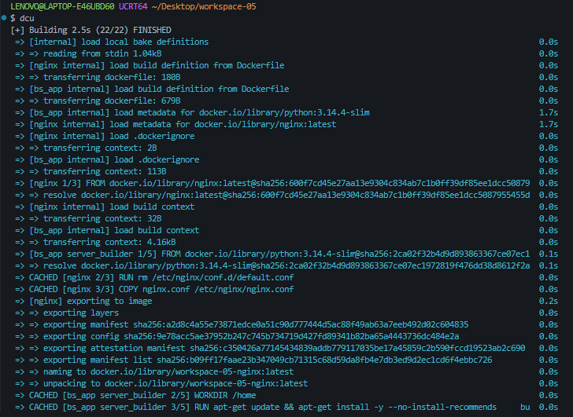
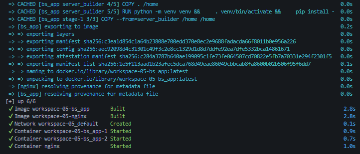

#### Pembahasan

---

Untuk memeriksa, bisa melihat pada browser

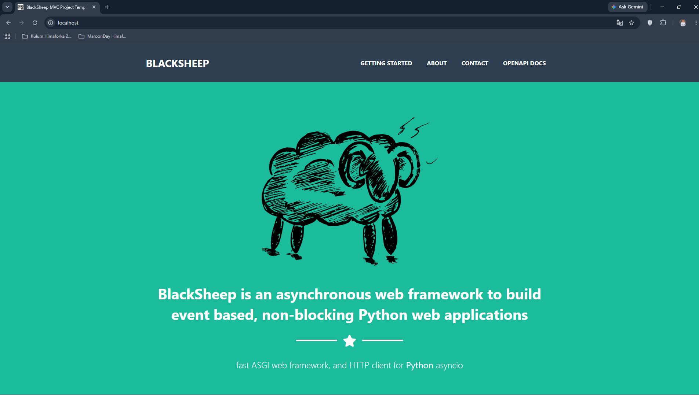

#### Pembahasan

---

**_Cek status Container_**

Gunakan perintah

```bash
dps
```

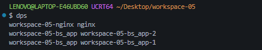

#### Pembahasan

---

**_Periksa Log Distribusi Request_**

Gunakan perintah

```bash
docker logs workspace-05-bs_app-2
```

dan

```bash
docker logs workspace-05-bs_app-1
```

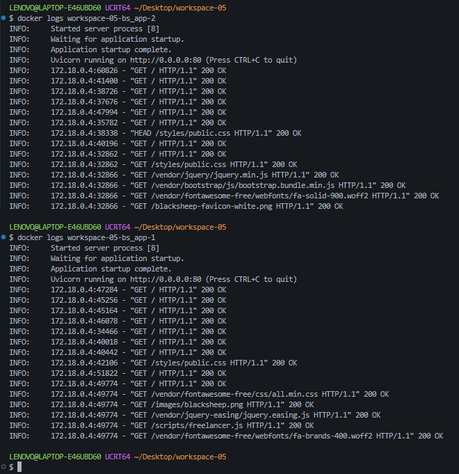

#### Pembahasan

---

**_Mematikan Semua Container_**

Jika sudah selesai, matikan semua container dengan perintah:

```bash
dcd
```

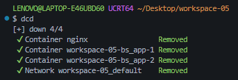

#### Pembahasan

---

## 📝 Kesimpulan

---

## 🗒️ Referensi
