# Praktikum Minggu 05 - Fault Tolerance

**Mata Kuliah:** Praktikum Sistem Terdistribusi dan Terdesentralisasi

**Topik:** Fault Tolerance

---

## 🎯 Tujuan Praktikum

1. Memahami fault tolerance, yaitu kemampuan sistem tetap melayani permintaan ketika sebagian komponennya gagal.
2. Menjalankan aplikasi BlackSheep dalam beberapa instance sekaligus menggunakan Docker Compose.
3. Mengatur nginx sebagai penyalur request ke instance aplikasi.
4. Membuktikan pembagian request melalui log setiap container.
5. Mengenali kegagalan koneksi dan menanganinya dengan heartbeat, retry, serta circuit breaker.

---

## 📚 Dasar Teori

<p align="justify">Sistem terdistribusi terdiri dari banyak komponen, dan setiap komponen bisa berhenti bekerja kapan saja. Proses bisa mati, jaringan bisa putus, atau host kehabisan sumber daya. Fault tolerance adalah kemampuan sistem untuk tetap melayani permintaan ketika hal itu terjadi. Salah satu caranya adalah menjalankan beberapa salinan layanan yang sama, sehingga tidak ada satu titik yang membuat seluruh layanan berhenti. Selama satu salinan masih hidup, pengguna seharusnya tidak merasakan gangguan.</p>

<p align="justify">Kalau ada beberapa salinan aplikasi, perlu ada pihak yang menentukan salinan mana yang menerima request. nginx bisa dipakai sebagai reverse proxy. Klien menghubungi satu alamat, lalu nginx meneruskan request ke salah satu server di grup upstream. Cara paling sederhana adalah round-robin, yaitu pembagian bergiliran sesuai urutan server. Docker Compose menyediakan opsi scale untuk membuat beberapa replika, dan nama service seperti <code>bs_app</code> dipakai sebagai alamat yang di-resolve ke semua replika. Dengan begitu, konfigurasi nginx tidak perlu menulis alamat IP satu per satu.</p>

<p align="justify">Load balancer hanya membagi trafik. Status tiap komponen tetap perlu dipantau. Protokol heartbeat menganggap komponen sehat jika masih mengirim sinyal dalam selang waktu tertentu. Kalau sinyal tidak datang sampai batas waktu, komponen dianggap gagal. Pemeriksaan paling sederhana adalah membuka koneksi TCP ke host dan port tujuan. Kalau koneksi diterima, port dianggap terbuka; kalau ditolak, layanan dianggap mati. Cara ini cepat dan murah, tetapi hanya menguji keterjangkauan port, bukan apakah aplikasi benar-benar bisa memproses permintaan. Batas waktu juga perlu dipilih dengan hati-hati: terlalu pendek membuat node sehat dianggap mati, terlalu panjang membuat deteksi terlambat.</p>

<p align="justify">Sebagian kegagalan koneksi hanya berlangsung sebentar, misalnya saat server restart atau jaringan sedang padat. Retry mengulang permintaan yang gagal supaya gangguan singkat tidak langsung terlihat sebagai error. Pengulangan tanpa jeda bisa memperburuk keadaan karena server yang sedang pulih langsung dibanjiri permintaan. Exponential backoff menambah jeda di setiap percobaan berikutnya, dan jumlah percobaan dibatasi agar proses tidak menggantung. Tidak semua kegagalan perlu diulang. Error koneksi biasanya sementara, sedangkan respons 4xx atau 5xx sering menandakan masalah yang tidak berubah walaupun dicoba lagi.</p>

<p align="justify">Retry berguna selama kegagalan berlangsung singkat. Kalau layanan benar-benar mati, mengulang permintaan hanya membuang waktu dan menahan sumber daya. Circuit breaker menyimpan riwayat kegagalan dan memutus alur setelah ambang tertentu. Pada kondisi closed, permintaan diizinkan dan kegagalan dihitung. Setelah ambang tercapai, kondisi berubah menjadi open dan permintaan berikutnya langsung ditolak tanpa menghubungi layanan. Setelah waktu tunggu habis, kondisi menjadi half-open untuk menguji apakah layanan sudah pulih. Kalau uji berhasil, kondisi kembali ke closed; kalau gagal, kembali ke open. Pada praktikum ini ambangnya empat kegagalan dengan waktu tunggu 20 detik, dan keempat mekanisme dipakai bersama untuk melihat jenis kegagalan yang ditangani masing-masing.</p>

---

# ⏩ PEMBAHASAN PRAKTIKUM

### 4.1 Load Balancing Aplikasi

#### 4.1.1 Persiapan

#### Install Docker

Langkah pertama yaitu menginstall Docker Dekstop terlebih dahulu, karena pada praktikum sebelumnya sudah menginstall docker, maka cukup cek versi saja:

<p align="center">
  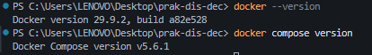
</p>
<p align="center"><em>Gambar 5.1 Pengecekan versi Docker dan Docker Compose</em></p>

#### Pembahasan

<p align="justify">Docker diperiksa lebih dulu karena seluruh praktikum berjalan di dalam container. Di mesin Windows ini Docker Desktop memakai versi 29.9.2 dan Docker Compose v5.6.1. Setelah keduanya tersedia, aplikasi dan nginx bisa dijalankan tanpa memasang Python atau nginx langsung di sistem.</p>

---

#### Buat Folder Kerja

<p align="center">
  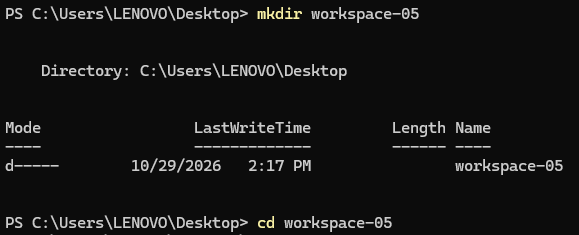
</p>
<p align="center"><em>Gambar 5.2 Pembuatan folder kerja workspace-05</em></p>

#### Pembahasan

<p align="justify">Folder ini menjadi tempat semua berkas modul, mulai dari proyek BlackSheep sampai konfigurasi nginx. Nama folder juga dipakai Docker Compose sebagai nama project, sehingga container yang muncul berawalan <code>workspace-05</code>.</p>

---

#### Cek List Versi Python yang tersedia

<p align="center">
  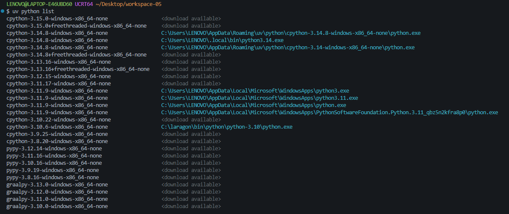
</p>
<p align="center"><em>Gambar 5.3 Daftar versi Python yang tersedia</em></p>

#### Pembahasan

<p align="justify">Perintah ini menampilkan versi Python yang sudah terpasang dan yang masih bisa diunduh. Dari daftar itu dipilih interpreter yang sudah ada di mesin supaya pembuatan environment tidak bergantung pada unduhan baru.</p>

---

#### Menyematkan Versi Python

<p align="center">
  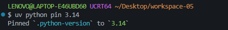
</p>
<p align="center"><em>Gambar 5.4 Penyematan versi Python pada proyek</em></p>

#### Pembahasan

<p align="justify">Pilihan interpreter disimpan ke berkas <code>.python-version</code>. Berkat berkas itu, perintah <code>uv</code> berikutnya selalu memakai versi Python yang sama walaupun dijalankan dari shell lain.</p>

---

#### Menampilkan daftar seluruh berkas dan folder secara rinci, termasuk yang tersembunyi

<p align="center">
  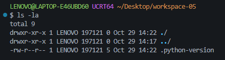
</p>
<p align="center"><em>Gambar 5.5 Daftar berkas pada folder kerja</em></p>

#### Pembahasan

<p align="justify">Perintah <code>ls -la</code> menampilkan semua isi folder, termasuk berkas tersembunyi. Berkas <code>.python-version</code> sudah terlihat, jadi proses pin berhasil dan folder siap dipakai.</p>

---

#### Membuat lingkungan virtual Python (virtual environment) baru.

<p align="center">
  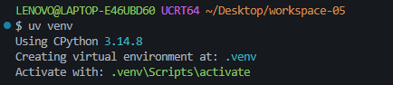
</p>
<p align="center"><em>Gambar 5.6 Pembuatan virtual environment</em></p>

#### Pembahasan

<p align="justify">Virtual environment dibuat agar paket BlackSheep tidak bercampur dengan paket Python lain di sistem. Setiap modul praktikum bisa membutuhkan versi paket yang berbeda, jadi pemisahan ini penting.</p>

---

#### Mengaktifkan lingkungan virtual (virtual environment) Python di sistem operasi Windows

Untuk mengaktifkan virtual environment Python di windows dapat menggunakan perintah:

```bash
source .venv/Scripts/activate
```

<p align="center">
  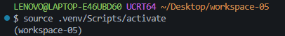
</p>
<p align="center"><em>Gambar 5.7 Aktivasi virtual environment</em></p>

#### Pembahasan

<p align="justify">Di Windows, environment diaktifkan lewat <code>.venv/Scripts/activate</code> dan prompt berubah menjadi <code>(workspace-05)</code>. Tanda itu memastikan <code>python</code> dan <code>pip</code> yang dipanggil berasal dari environment proyek.</p>

---

#### Install blacksheep dan blacksheep-cli

Untuk membuat aplikasi web menggunakan Blacksheep, install blacksheep dan blacksheep-cli terlebih dahulu:

**_Install Blacksheep_**

Untuk menginstall Blacksheep dapat menggunakan perintah:

```bash
uv pip install blacksheep
```

<p align="center">
  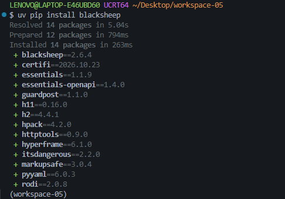
</p>
<p align="center"><em>Gambar 5.8 Instalasi paket BlackSheep</em></p>

#### Pembahasan

<p align="justify">Paket <code>blacksheep</code> adalah framework web yang nanti dijalankan di dalam container. Instalasinya ikut memasang 14 paket pendukung seperti <code>essentials</code>, <code>rodi</code>, <code>h11</code>, dan <code>httptools</code> yang dibutuhkan aplikasi ASGI.</p>

---

**_Install Blacksheep CLI_**

Untuk menginstall Blacksheep CLI dapat menggunakan perintah:

```bash
uv pip install blacksheep-cli
```

<p align="center">
  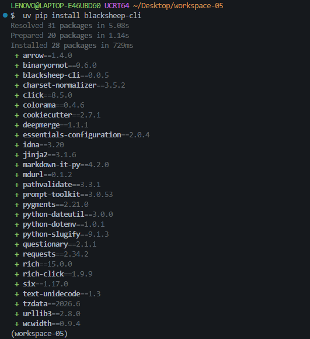
</p>
<p align="center"><em>Gambar 5.9 Instalasi BlackSheep CLI</em></p>

#### Pembahasan

<p align="justify"><code>blacksheep-cli</code> dipasang terpisah karena isinya generator proyek, bukan bagian dari aplikasi yang berjalan. CLI ini yang menyediakan perintah <code>blacksheep create</code> beserta template aplikasi MVC.</p>

---

#### 4.1.2 Pembuatan Aplikasi Web

Setelah itu, buat aplikasi menggunakan cli dengan perintah:

```bash
blacksheep create
```

<p align="center">
  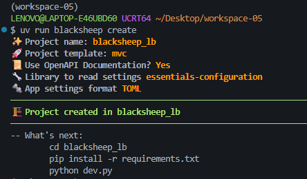
</p>
<p align="center"><em>Gambar 5.10 Pembuatan proyek blacksheep_lb</em></p>

#### Pembahasan

<p align="justify">Proyek dibuat dengan <code>uv run blacksheep create</code>. Template yang dipilih adalah MVC, dokumentasi OpenAPI diaktifkan, konfigurasi dibaca dengan <code>essentials-configuration</code>, dan formatnya TOML. Hasilnya folder <code>blacksheep_lb</code> berisi aplikasi contoh yang siap dijalankan, termasuk Dockerfile.</p>

---

**_Install paket yang diperlukan_**

Masuk terlebih dahulu ke folder direktori blacksheep_lb dengan perintah:

```bash
cd blacksheep_lb
```

Kemudian menginstall paket yang diperlukan dengan perintah:

```bash
uv pip install -r requirements.txt
```

<p align="center">
  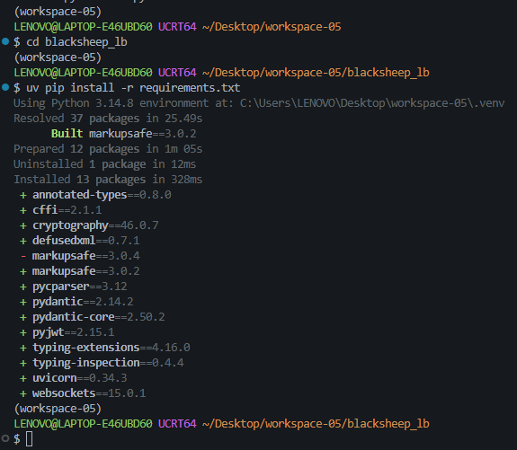
</p>
<p align="center"><em>Gambar 5.11 Instalasi paket dari requirements.txt</em></p>

#### Pembahasan

<p align="justify">Setelah masuk ke folder proyek, seluruh dependensi di <code>requirements.txt</code> dipasang. Beberapa paket seperti <code>cryptography</code>, <code>pydantic</code>, dan <code>uvicorn</code> ikut terpasang, dan <code>MarkupSafe</code> disesuaikan ke versi 3.0.2 sesuai isi berkas requirements.</p>

---

Memastikan bahwa aplikasi tersebut bisa berjalan dengan baik:

```bash
python dev.py
```

<p align="center">
  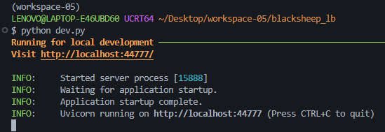
</p>
<p align="center"><em>Gambar 5.12 Menjalankan aplikasi pada mode pengembangan</em></p>

#### Pembahasan

<p align="justify"><code>python dev.py</code> menjalankan Uvicorn di port 44777 dengan mode pengembangan. Di mode ini aplikasi membaca <code>settings.dev.toml</code> dan menampilkan detail error. Mode produksi di dalam container nanti memakai port 80.</p>

---

kemudian akses ke http://localhost:44777/ menggunakan browser

<p align="center">
  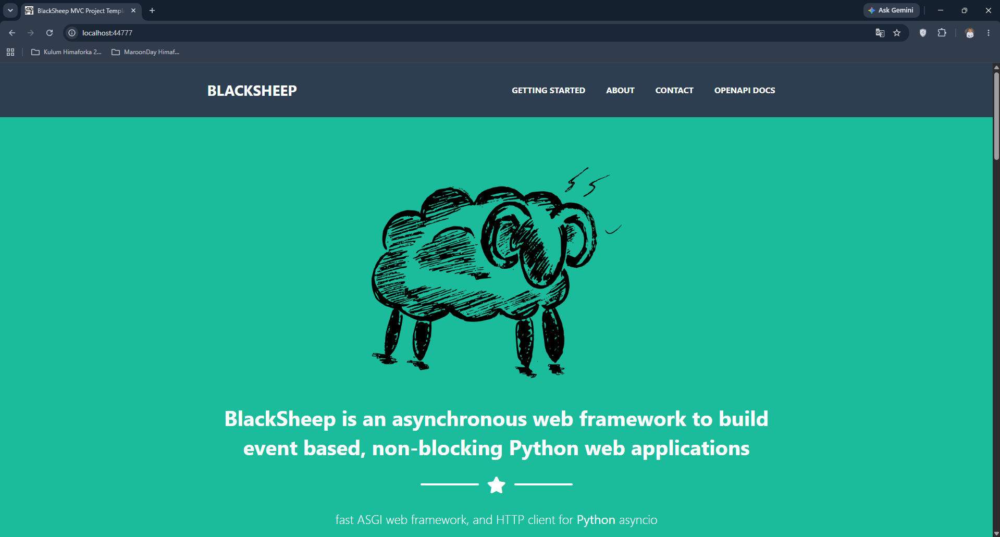
</p>
<p align="center"><em>Gambar 5.13 Tampilan aplikasi di browser</em></p>

#### Pembahasan

<p align="justify">Halaman yang muncul adalah tampilan bawaan BlackSheep dengan latar hijau tosca dan ilustrasi domba. Kalau halaman ini tampil, routing, template Jinja, dan penyajian file statis sudah bekerja.</p>

---

Lalu pada shell tempat mengaktifkan server, muncul:

<p align="center">
  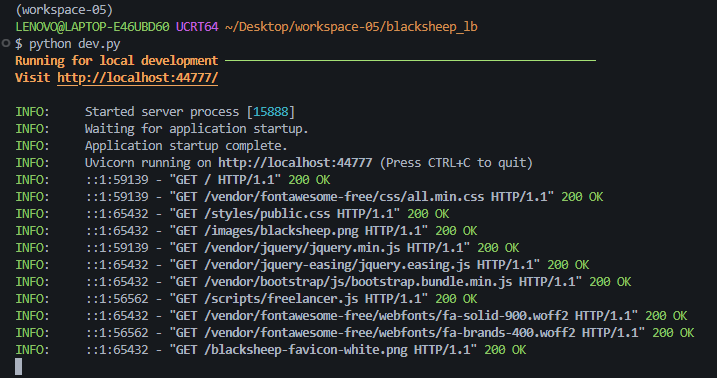
</p>
<p align="center"><em>Gambar 5.14 Log permintaan setelah halaman dibuka</em></p>

#### Pembahasan

<p align="justify">Log server mencatat <code>GET /</code> beserta permintaan file statis seperti <code>public.css</code>, <code>bootstrap.bundle.min.js</code>, dan <code>blacksheep.png</code>. Satu kali membuka halaman ternyata menghasilkan banyak request. Pola inilah yang nanti ikut terbagi ketika ada dua replika.</p>

---

Pada titik ini, sudah berhasil membuat aplikasi menggunakan Blacksheep. Perhatikan, dalam direktori blacksheep_lb sudah ada Dockerfile yang bisa digunakan:

<p align="center">
  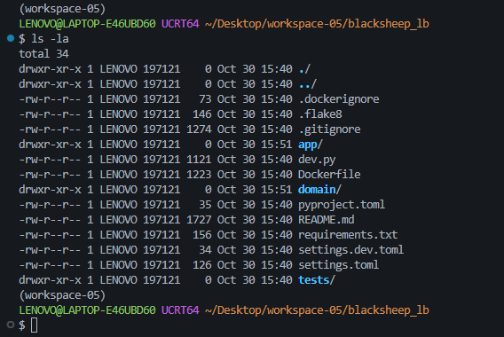
</p>
<p align="center"><em>Gambar 5.15 Struktur direktori proyek blacksheep_lb</em></p>

#### Pembahasan

<p align="justify"><code>ls -la</code> memperlihatkan struktur proyek: folder <code>app</code> untuk kode, <code>domain</code> untuk model, <code>tests</code>, serta berkas konfigurasi dan Dockerfile. Dockerfile sudah disediakan generator, jadi proyek bisa langsung dibangun menjadi image.</p>

---

#### 4.1.3 Siapkan Dockerfile dan docker-compose.yml

Struktur yang dihasilkan harus terdiri dari:

```
workspace-05/
├── blacksheep_lb/
│   ├── app/
│   ├── dev.py
│   ├── Dockerfile
│   ├── domain/
│   ├── pyproject.toml
│   ├── README.md
│   ├── requirements.txt
│   ├── settings.dev.toml
│   ├── settings.toml
│   └── tests/
├── docker-compose.yml
├── env.sh
└── nginx/
    ├── Dockerfile
    └── nginx.conf
```

_File blacksheep_lb/Dockerfile_

```
# Build the Server
FROM python:3.14.4-slim AS server_builder
WORKDIR /home
RUN apt-get update && apt-get install -y --no-install-recommends \
    build-essential \
    ca-certificates \
    && rm -rf /var/lib/apt/lists/*

COPY . /home
RUN python -m venv venv && \
    . venv/bin/activate && \
    pip install --upgrade pip && \
    pip install -r requirements.txt

EXPOSE 80

FROM python:3.14.4-slim
WORKDIR /home
COPY --from=server_builder /home /home

ENV APP_ENV=prod BG_COLOR="#1abc9c" APP_ROUTE_PREFIX=""
CMD ["sh", "-c", ". venv/bin/activate && uvicorn \"app.main:app\" --host 0.0.0.0 --port 80 --log-level info"]
```

<p align="center">
  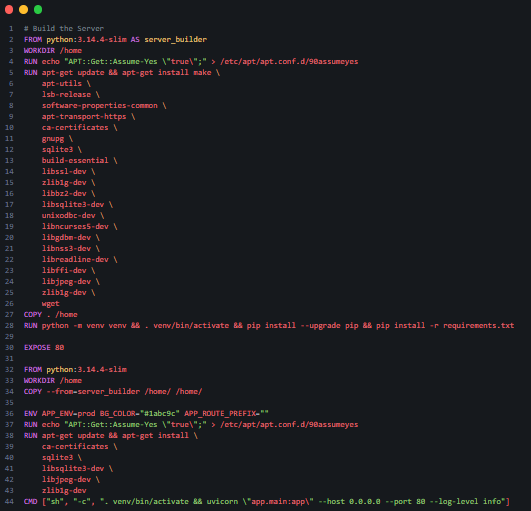
</p>
<p align="center"><em>Gambar 5.16 Isi Dockerfile aplikasi</em></p>

#### Pembahasan

<p align="justify">Dockerfile memakai dua tahap. Tahap pertama menyiapkan Python 3.14, venv, dan dependensi, lalu tahap kedua menyalin hasilnya ke image yang lebih ramping. Baris <code>EXPOSE 80</code> dan perintah Uvicorn dengan <code>--port 80</code> menjelaskan kenapa alamat aplikasi berubah dari 44777 menjadi port 80 saat berjalan di container.</p>

---

Kemudian membuat direktori baru bernama _nginx_ pada workspace-05 dengan perintah:

```bash
mkdir nginx
```

Lalu masuk ke folder tersebut dengan perintah:

```bash
cd nginx
```

<p align="center">
  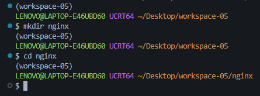
</p>
<p align="center"><em>Gambar 5.17 Pembuatan folder nginx</em></p>

#### Pembahasan

<p align="justify">Folder <code>nginx</code> dipisahkan dari folder aplikasi karena konfigurasi load balancer punya siklus sendiri. Dengan pemisahan ini, nginx bisa diubah tanpa membangun ulang image BlackSheep.</p>

---

Selanjutnya membuat file Dockerfile dan nginx.conf pada direktori nginx

**_Dockerfile_**

Gunakan perintah:

```bash
touch Dockerfile
```

<p align="center">
  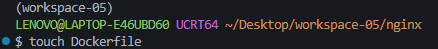
</p>
<p align="center"><em>Gambar 5.18 Pembuatan berkas Dockerfile nginx</em></p>

#### Pembahasan

<p align="justify">Berkas <code>Dockerfile</code> dibuat di dalam folder <code>nginx</code> sebagai resep pembangunan image proxy. Isinya nanti hanya menyesuaikan konfigurasi, karena image nginx resmi sudah menyediakan server.</p>

---

Kemudian **_Dockerfile_** di isi dengan kode:

```
FROM nginx

# Override the default nginx configuration file
RUN rm /etc/nginx/conf.d/default.conf
COPY nginx.conf /etc/nginx/nginx.conf
```

<p align="center">
  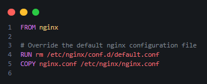
</p>
<p align="center"><em>Gambar 5.19 Isi Dockerfile nginx</em></p>

#### Pembahasan

<p align="justify">Isinya memakai image <code>nginx</code>, menghapus <code>conf.d/default.conf</code>, lalu menyalin <code>nginx.conf</code> ke <code>/etc/nginx/nginx.conf</code>. Konfigurasi bawaan perlu dihapus karena juga memakai port 80 dan bisa bentrok dengan server block buatan sendiri.</p>

---

**_nginx.conf_**

Gunakan perintah:

```bash
touch nginx.conf
```

<p align="center">
  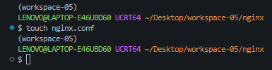
</p>
<p align="center"><em>Gambar 5.20 Pembuatan berkas nginx.conf</em></p>

#### Pembahasan

<p align="justify"><code>nginx.conf</code> disiapkan sebagai tempat aturan pembagian beban. Nama berkas ini harus sama dengan yang disebut di Dockerfile karena proses salin mengandalkan nama tersebut.</p>

---

Kemudian **_nginx.conf_** di isi dengan kode:

```
events {
    worker_connections 4096;
}

http {
    # Definisi grup, lihat di docker-compose.yml
    upstream backend {
        server bs_app:80;
        }
        server {
            listen 80;
            location / {
                # sesuaikan dengan nama upstream di atas
                proxy_pass http://backend;
                }
            }
}
```

<p align="center">
  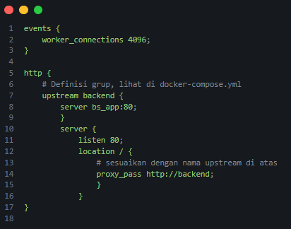
</p>
<p align="center"><em>Gambar 5.21 Konfigurasi load balancer pada nginx.conf</em></p>

#### Pembahasan

<p align="justify">Blok <code>upstream backend</code> mendaftarkan <code>bs_app:80</code> sebagai tujuan, memakai nama service dari Compose. <code>proxy_pass http://backend</code> meneruskan setiap request pada <code>location /</code> ke grup itu. Karena tidak ada metode khusus, nginx memakai round-robin.</p>

---

**_docker-compose.yml_**

Selanjutnya membuat file bernama **_docker-compose.yml_** pada workspace-05 dengan perintah:

```bash
touch docker-compose.yml
```

<p align="center">
  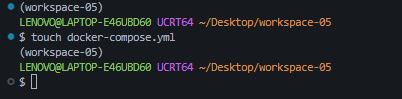
</p>
<p align="center"><em>Gambar 5.22 Pembuatan berkas docker-compose.yml</em></p>

#### Pembahasan

<p align="justify"><code>docker-compose.yml</code> diletakkan di root <code>workspace-05</code> supaya path build ke <code>blacksheep_lb</code> dan <code>nginx</code> tetap sederhana.</p>

---

Kemudian **_docker-compose.yml_** di isi dengan kode:

```
services:
  # aplikasi yang akan di-scale
  # ada pada direktori blacksheep_lb
  bs_app:
    build: ./blacksheep_lb
  # aktifkan nginx dengan menggunakan nginx/Dockerfile
  # lihat pada build
  nginx:
    container_name: nginx
    build: ./nginx
    ports:
      - "80:80"
    depends_on:
      - bs_app
```

<p align="center">
  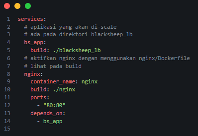
</p>
<p align="center"><em>Gambar 5.23 Isi docker-compose.yml</em></p>

#### Pembahasan

<p align="justify">Service <code>bs_app</code> dibangun dari folder aplikasi dan tidak memetakan port ke host. Service <code>nginx</code> memetakan port 80 dan menunggu <code>bs_app</code> siap. Karena hanya nginx yang terbuka ke luar, semua akses pasti melewati load balancer.</p>

---

**_env.sh_**

Selanjutnya membuat file bernama **_env.sh_** pada workspace-05 dengan perintah:

```bash
touch env.sh
```

<p align="center">
  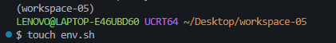
</p>
<p align="center"><em>Gambar 5.24 Pembuatan berkas env.sh</em></p>

#### Pembahasan

<p align="justify"><code>env.sh</code> dibuat untuk menyimpan alias perintah yang sering dipakai. Berkas ini hanya alat bantu pengetikan dan tidak mengubah cara kerja container.</p>

---

Kemudian **_env.sh_** di isi dengan kode:

```
alias dcu="docker-compose up --build -d --scale bs_app=2"
alias dcd="docker compose down"
alias dps="docker ps --format '{{.Image}} {{.Names}}'"
alias dcln="docker logs nginx"
```

<p align="center">
  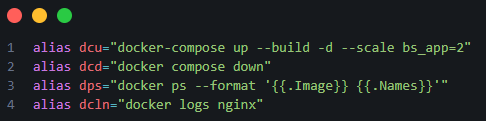
</p>
<p align="center"><em>Gambar 5.25 Alias perintah Docker pada env.sh</em></p>

#### Pembahasan

<p align="justify"><code>dcu</code> menjalankan Compose, membangun image, dan langsung membuat dua instance <code>bs_app</code>. <code>dcd</code> mematikan semuanya, <code>dps</code> menampilkan container yang aktif, dan <code>dcln</code> membuka log nginx. Dengan alias ini, perintah scale yang panjang tidak perlu ditulis berulang.</p>

---

Sebelum menjalankan Docker, Muat Alias terlebih dahulu dengan perintah:

```bash
source env.sh
```

<p align="center">
  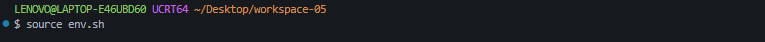
</p>
<p align="center"><em>Gambar 5.26 Memuat alias dari env.sh</em></p>

#### Pembahasan

<p align="justify"><code>source env.sh</code> memuat alias ke shell yang sedang terbuka. Alias hanya berlaku di sesi itu, jadi terminal baru perlu memuat berkasnya lagi.</p>

---

#### 4.1.4 Jalankan Docker Compose

**_Jalankan Docker Compose_**

Gunakan perintah:

```bash
dcu
```

<p align="center">
  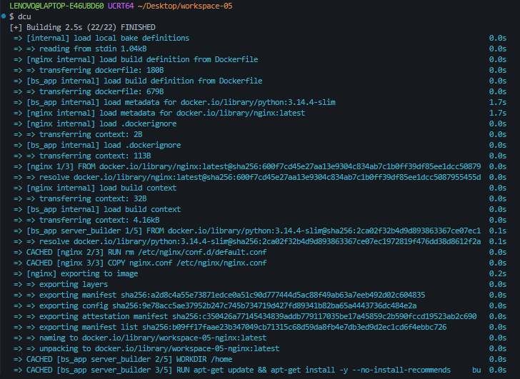
</p>
<p align="center"><em>Gambar 5.27 Proses build image melalui alias dcu</em></p>
<p align="center">
  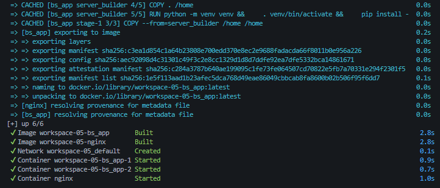
</p>
<p align="center"><em>Gambar 5.28 Container aplikasi dan nginx berhasil dijalankan</em></p>

#### Pembahasan

<p align="justify">Build berjalan untuk dua image, lalu empat container aktif: <code>workspace-05-bs_app-1</code>, <code>workspace-05-bs_app-2</code>, dan <code>workspace-05-nginx</code>, ditambah network <code>workspace-05_default</code>. Awalan <code>workspace-05</code> berasal dari nama direktori, bukan dari nama service.</p>

---

Untuk memeriksa, bisa melihat pada browser

<p align="center">
  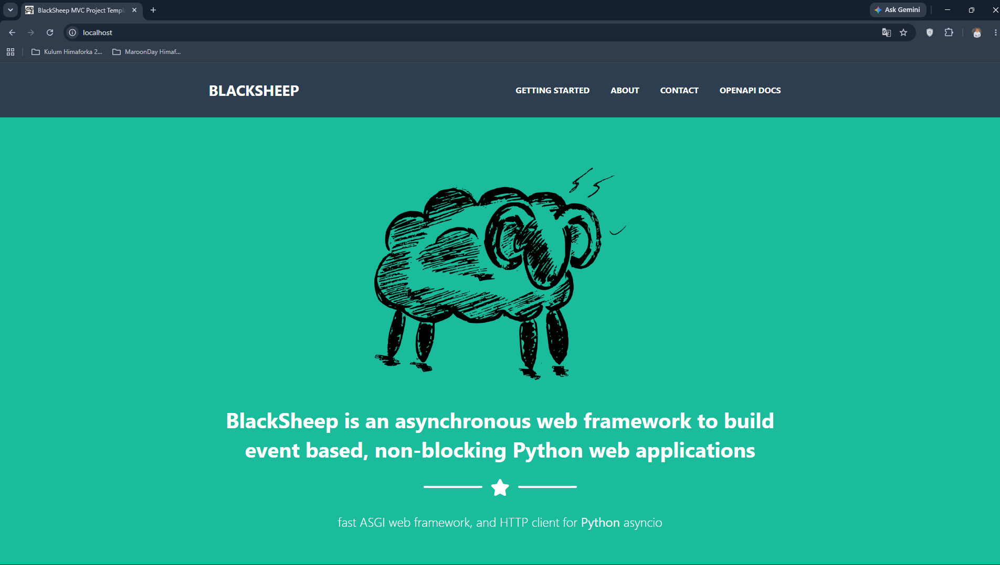
</p>
<p align="center"><em>Gambar 5.29 Aplikasi diakses melalui nginx pada port 80</em></p>

#### Pembahasan

<p align="justify">Aplikasi dibuka lewat <code>http://localhost</code> tanpa nomor port, yang berarti request masuk ke nginx di port 80. Halaman yang tampil sama seperti saat mode pengembangan, meskipun permintaannya diteruskan ke salah satu container <code>bs_app</code>.</p>

---

**_Cek status Container_**

Gunakan perintah:

```bash
dps
```

<p align="center">
  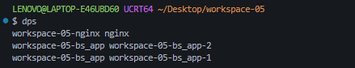
</p>
<p align="center"><em>Gambar 5.30 Status container yang sedang berjalan</em></p>

#### Pembahasan

<p align="justify"><code>dps</code> menampilkan tiga container: satu nginx dan dua replika <code>bs_app</code>. Jumlah replika itu membuktikan opsi <code>--scale bs_app=2</code> dijalankan, sehingga nginx punya dua tujuan yang bisa dipilih.</p>

---

**_Periksa Log Distribusi Request_**

Gunakan perintah:

```bash
docker logs workspace-05-bs_app-2
```

dan

```bash
docker logs workspace-05-bs_app-1
```

<p align="center">
  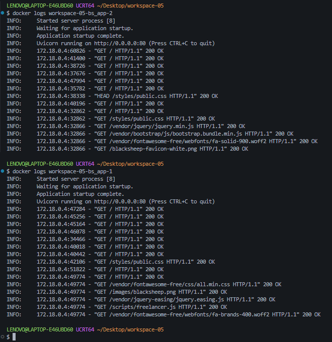
</p>
<p align="center"><em>Gambar 5.31 Distribusi request pada log kedua replika</em></p>

#### Pembahasan

<p align="justify">Log <code>bs_app-2</code> dan <code>bs_app-1</code> sama-sama berisi <code>GET /</code> dan permintaan file statis. Karena satu halaman memicu banyak request, pembagiannya terlihat jelas: sebagian request dilayani replika 1 dan sebagian lagi replika 2. File statis cenderung mengikuti replika yang mengirim HTML, sedangkan request halaman berikutnya bisa berpindah.</p>

---

**_Mematikan Semua Container_**

Jika sudah selesai, matikan semua container dengan perintah:

```bash
dcd
```

<p align="center">
  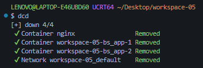
</p>
<p align="center"><em>Gambar 5.32 Mematikan seluruh container</em></p>

#### Pembahasan

<p align="justify"><code>dcd</code> menghentikan dan menghapus container beserta network yang dibuat Compose. Image hasil build tetap tersimpan, jadi menjalankan <code>dcu</code> lagi akan lebih cepat karena lapisan yang tidak berubah diambil dari cache.</p>

---

### 4.2 Failure Detection

**_Heartbeat_**

Buat file **_check-server.py_** dengan isi kode:

```
# taken from:
# https://stackoverflow.com/questions/20867184/how-to-check-whether-my-server-is-up-and-running-using-python

import sys
import socket

def servertest(argv):
    host = argv[1]
    port = int(argv[2])

    args = socket.getaddrinfo(host, port, socket.AF_INET, socket.SOCK_STREAM)
    for family, socktype, proto, canonname, sockaddr in args:
        s = socket.socket(family, socktype, proto)
        try:
            s.connect(sockaddr)
        except socket.error:
            return False
        else:
            s.close()
            return True


if __name__ == "__main__":
    if servertest(sys.argv):
        print("Server up")
    else:
        print("Server down")
```

<p align="center">
  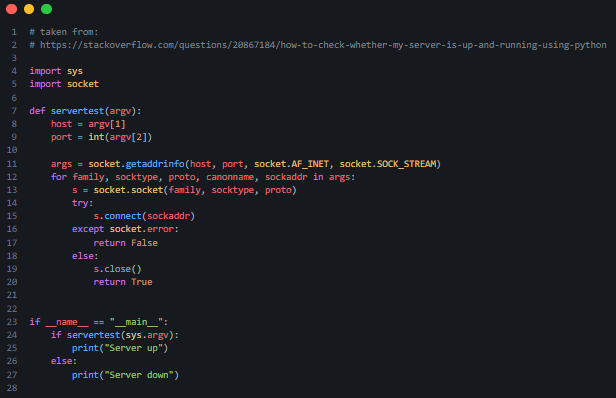
</p>
<p align="center"><em>Gambar 5.33 Isi berkas check-server.py</em></p>

#### Pembahasan

<p align="justify">Script ini membuka koneksi TCP ke host dan port yang diberikan lewat argumen. Kalau <code>connect()</code> berhasil, script mencetak <code>Server up</code>; kalau gagal, hasilnya <code>Server down</code>. Untuk heartbeat, pemeriksaan ini sudah memadai karena hanya perlu tahu apakah ada proses yang menerima koneksi di port tersebut.</p>

---

Menguji Heartbeat dapat menggunakan perintah:

Untuk blacksheep pada **_port 44777_** gunakan perintah:

```bash
python check-server.py localhost 44777
```

dan

Untuk blacksheep pada **_port localhost_** gunakan perintah:

```bash
python check-server.py localhost 80
```

#### Pembahasan

<p align="justify">Pengujian dilakukan di dua port: 44777 untuk server pengembangan dan 80 untuk stack Compose. Keduanya memakai script yang sama, hanya alamat targetnya yang berbeda.</p>

---

Kemudian menguji ketika aplikasi blacksheep di port 44777 atau di localhost tidak aktif hasilnya seperti berikut:

<p align="center">
  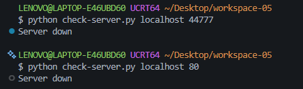
</p>
<p align="center"><em>Gambar 5.34 Hasil heartbeat saat server tidak aktif</em></p>

Selanjutnya menguji aplikasi blacksheep di port 44777 atau di localhost yang aktif hasilnya seperti berikut:

<p align="center">
  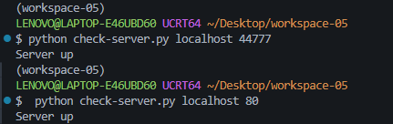
</p>
<p align="center"><em>Gambar 5.35 Hasil heartbeat saat server aktif</em></p>

#### Pembahasan

<p align="justify">Saat aplikasi mati, kedua pemeriksaan menghasilkan <code>Server down</code>. <code>socket.error</code> ditangkap, jadi tidak ada pesan panjang yang mengganggu. Setelah server pengembangan dan stack Compose dijalankan, keduanya berubah menjadi <code>Server up</code>. Perbedaan itu berasal dari ada tidaknya proses yang mendengarkan port, jadi heartbeat bisa dipakai sebagai penentu status tanpa perlu membaca isi respons HTTP.</p>

---

**_failure-detection_**

Library tenacity (https://github.com/jd/tenacity) bisa digunakan untuk mengelola proses yang memerlukan keterkaitan dengan komponen di luar aplikasi. Hal ini diperlukan. karena selalu ada kemungkinan kegagalan untuk koneksi dengan komponen di luar aplikasi.

_Install Package tenacity dan request_

<p align="center">
  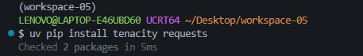
</p>
<p align="center"><em>Gambar 5.36 Instalasi paket tenacity dan requests</em></p>

#### Pembahasan

<p align="justify"><code>tenacity</code> dan <code>requests</code> dipasang untuk bagian failure detection. <code>requests</code> dipakai mengirim GET, sedangkan <code>tenacity</code> menyediakan dekorator retry. Output <code>Checked 2 packages</code> menunjukkan kedua paket sudah ada di environment, jadi tidak ada unduhan baru.</p>

---

Kemudian buat file bernama **_check-retry.py_** dengan isi kode:

```
from tenacity import retry, stop_after_attempt, wait_exponential, retry_if_exception_type
import requests

@retry(
    stop=stop_after_attempt(5),  # Stop after 5 attempts
    wait=wait_exponential(multiplier=1, min=4, max=10), # Exponential backoff with min 4s, max 10s
    retry=retry_if_exception_type(requests.exceptions.ConnectionError) # Retry only on connection errors
)

def make_http_request(url):
    print(f"Attempting to access {url}...")
    response = requests.get(url)
    response.raise_for_status()  # Raise an exception for bad status codes (4xx or 5xx)
    print(f"Successfully accessed {url}")
    return response.text

try:
    content = make_http_request("http://localhost:44777")
    # Process the content
except Exception as e:
    print(f"Failed to access URL after multiple retries: {e}")
```

<p align="center">
  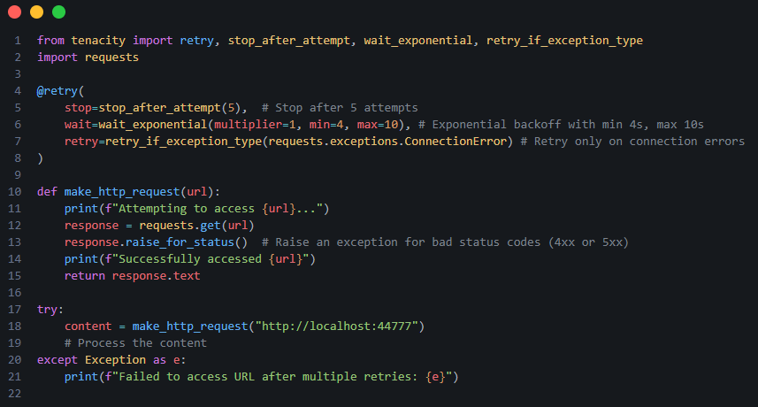
</p>
<p align="center"><em>Gambar 5.37 Isi berkas check-retry.py</em></p>

#### Pembahaasan

<p align="justify">Dekorator retry mengatur tiga hal yaitu berhenti setelah lima percobaan, memberi jeda eksponensial antara 4 dan 10 detik, dan hanya mengulang saat muncul <code>ConnectionError</code>. <code>raise_for_status()</code> dibiarkan agar respons 4xx atau 5xx tidak diulang, karena kesalahan seperti itu biasanya tidak berubah hanya dengan mencoba lagi.</p>

---

Lalu membuat file bernama **_check-circuit-breaker.py_** dengan isi:

```
import pybreaker
import requests

breaker = pybreaker.CircuitBreaker(fail_max=4, reset_timeout=20)

@breaker
def make_http_request(url):
    print(f"Attempting to access {url}...")
    response = requests.get(url)
    response.raise_for_status()  # Raise an exception for bad status codes (4xx or 5xx)
    print(f"Successfully accessed {url}")
    return response.text

try:
    content = make_http_request("http://localhost:44777")
    # Process the content
except Exception as e:
    print(e)
```

<p align="center">
  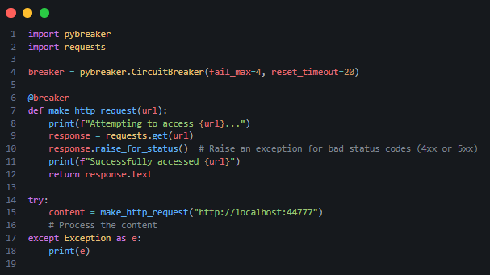
</p>
<p align="center"><em>Gambar 5.38 Isi berkas check-circuit-breaker.py</em></p>

#### Pembahasan

<p align="justify"><code>CircuitBreaker(fail_max=4, reset_timeout=20)</code> membuka rangkaian setelah empat kegagalan dan mencoba menutupnya lagi setelah 20 detik. Fungsi <code>make_http_request</code> dibungkus <code>@breaker</code>, sehingga setiap panggilan melewati pemeriksaan status sebelum request dikirim. Script ini membutuhkan <code>pybreaker</code>, dan paket tersebut sudah tersedia di environment praktikum.</p>

---

Kemudian lakukan pengujian menggunakan perintah:

```bash
python check-retry.py
```

dan

```bash
python check-circuit-breaker.py
```

#### Pembahasan

<p align="justify">Kedua script dijalankan pada kondisi yang sama, pertama saat server belum aktif lalu diulang setelah server hidup. Perbandingan ini perlu karena output error baru bisa ditafsirkan setelah diketahui apakah target sebenarnya bisa diakses.</p>

---

Menguji ketika aplikasi blacksheep di port 44777 atau di localhost tidak aktif hasilnya seperti berikut:

<p align="center">
  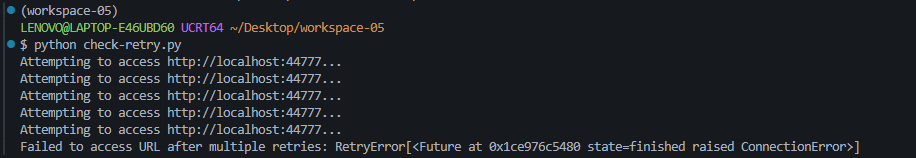
</p>
<p align="center"><em>Gambar 5.39 Keluaran check-retry.py saat server tidak aktif</em></p>

<p align="center">
  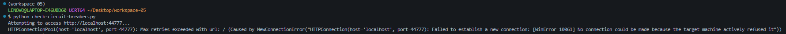
</p>
<p align="center"><em>Gambar 5.40 Keluaran check-circuit-breaker.py saat server tidak aktif</em></p>

#### Pembahasan

<p align="justify"><code>check-retry.py</code> mencetak <code>Attempting to access ...</code> lima kali sebelum menyerah dengan <code>RetryError</code> yang membungkus <code>ConnectionError</code>. Jeda antarpercobaan terasa membesar dan totalnya sekitar setengah menit. <code>check-circuit-breaker.py</code> hanya mencetak satu percobaan lalu gagal dengan pesan <code>Max retries exceeded</code> dari <code>requests</code>. Script itu memanggil fungsi satu kali, jadi rangkaian baru mencatat satu kegagalan dan belum mencapai ambang empat untuk berubah ke kondisi open.</p>

---

menguji ketika aplikasi blacksheep di port 44777 atau di localhost aktif hasilnya seperti berikut:

<p align="center">
  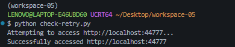
</p>
<p align="center"><em>Gambar 5.41 Keluaran check-retry.py saat server aktif</em></p>

<p align="center">
  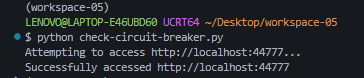
</p>
<p align="center"><em>Gambar 5.42 Keluaran check-circuit-breaker.py saat server aktif</em></p>

#### Pembahasan

<p align="justify">Setelah server aktif, kedua script berhasil pada percobaan pertama dan mencetak <code>Successfully accessed http://localhost:44777</code>. Tidak ada jeda tambahan karena retry hanya bekerja saat terjadi exception, dan circuit breaker tetap tertutup karena panggilan berhasil.</p>

---

## 📝 Kesimpulan

<p align="justify">Load balancing di praktikum ini dilakukan dengan menaruh nginx di depan dua replika aplikasi. Pengguna hanya menghubungi satu alamat di port 80, sementara nginx membagi request secara round-robin ke <code>bs_app-1</code> dan <code>bs_app-2</code>. Log kedua replika menjadi bukti paling jelas bahwa pembagian itu benar-benar terjadi, termasuk untuk permintaan file statis yang menyertai satu kali membuka halaman.</p>

<p align="justify">Failure detection bekerja di lapisan yang berbeda. <code>check-server.py</code> hanya bisa mengatakan port terbuka atau tertutup, jadi hasilnya lebih tepat dibaca sebagai indikator awal. Retry menangani gangguan koneksi singkat dengan jeda yang makin panjang, sedangkan circuit breaker berhenti menghubungi layanan setelah ambang kegagalan tercapai. Perbedaannya terlihat saat server mati: retry mencoba lima kali, sedangkan circuit breaker hanya sekali karena pemanggilan di script tidak diulang.</p>

<p align="justify">Konfigurasi yang dipakai masih sederhana. nginx belum memeriksa kesehatan tiap instance, dan script circuit breaker hanya memanggil satu kali sehingga perpindahan kondisi open dan half-open belum terlihat. Untuk penggunaan nyata, health check pada upstream dan pemanggilan berulang perlu ditambahkan.</p>

---

## 🗒️ Referensi

1. Bambang Purnomosidi D. P. (2026). _Modul 5: Fault Tolerance_. Praktikum Sistem Terdistribusi dan Terdesentralisasi, Prodi Informatika, Universitas Teknologi Digital Indonesia.
2. Neoteroi. _BlackSheep documentation_. https://www.neoteroi.dev/blacksheep/
3. nginx. _Module ngx_http_upstream_module_. https://nginx.org/en/docs/http/ngx_http_upstream_module.html
4. nginx. _HTTP load balancing_. https://docs.nginx.com/nginx/admin-guide/load-balancer/http-load-balancer/
5. Docker. _Compose file reference_. https://docs.docker.com/compose/compose-file/
6. Docker. _docker compose up_. https://docs.docker.com/reference/cli/docker/compose/up/
7. jd. _tenacity_. https://github.com/jd/tenacity
8. Daniel F. Martins. _pybreaker_. https://github.com/danielfm/pybreaker
9. Stack Overflow. _How to check whether my server is up and running using python_. https://stackoverflow.com/questions/20867184/
10. Microsoft. _Circuit Breaker pattern_. https://learn.microsoft.com/en-us/azure/architecture/patterns/circuit-breaker
11. Astral. _uv documentation_. https://docs.astral.sh/uv/
