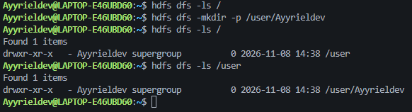

# Praktikum Minggu 06 - Distributed File System - HDFS

<p align="justify"><strong>Mata Kuliah:</strong> Praktikum Sistem Terdistribusi dan Terdesentralisasi</p>

<p align="justify"><strong>Topik:</strong> Distributed File System - HDFS</p>

---

## 🎯 Tujuan Praktikum

- Memahami konsep dasar _distributed file system_ dan alasan HDFS digunakan untuk menyimpan data berukuran besar.
- Menyiapkan lingkungan praktikum yang terdiri dari JDK, Apache Hadoop 3.5.0, pdsh, dan SSH pada satu node.
- Melakukan konfigurasi Hadoop melalui `core-site.xml`, `hdfs-site.xml`, `mapred-site.xml`, dan `yarn-site.xml`.
- Memformat NameNode serta menjalankan, memantau, dan menghentikan daemon HDFS.
- Mengoperasikan HDFS melalui shell (`hdfs dfs`) dan Web UI, mulai dari membuat direktori hingga mengunggah dan memverifikasi file.
- Menganalisis keterkaitan antara konfigurasi yang dipakai dengan peran NameNode, DataNode, dan replikasi blok dalam proses penyimpanan file.

---

## 📚 Dasar Teori

<p align="justify">Sistem file terdistribusi (<em>distributed file system</em>) adalah sistem file yang menyimpan datanya di beberapa mesin, tetapi tetap diakses seolah-olah merupakan satu sistem file biasa. Ide utamanya sederhana: ketika data sudah terlalu besar atau terlalu penting untuk ditaruh di satu disk, data tersebut dipecah dan disebar ke beberapa node. Dengan cara ini kapasitas penyimpanan bisa bertambah tanpa mengganti satu komputer mahal, dan kegagalan pada satu mesin tidak otomatis membuat seluruh data hilang. HDFS (<em>Hadoop Distributed File System</em>) adalah salah satu implementasi konsep ini yang paling banyak dipakai di ekosistem <em>big data</em>.</p>

<p align="justify">HDFS mengadopsi arsitektur <em>master–worker</em> yang terinspirasi dari Google File System. Pihak <em>master</em> adalah <strong>NameNode</strong>, yang tidak menyimpan isi file, melainkan menyimpan metadata: struktur direktori, nama file, izin akses, serta peta blok ke DataNode. Pihak <em>worker</em> adalah <strong>DataNode</strong>, yang menyimpan blok data secara fisik dan melaporkan kondisinya ke NameNode. Ada juga <strong>Secondary NameNode</strong>, yang tugasnya membuat <em>checkpoint</em> metadata secara berkala, bukan menjadi cadangan NameNode secara langsung.</p>

<p align="justify">Saat sebuah file diunggah, HDFS memecahnya menjadi blok-blok dengan ukuran default 128 MB. Setiap blok disimpan di DataNode dan direplikasi, dengan nilai default tiga salinan pada klaster normal. Replikasi inilah yang membuat HDFS tahan terhadap kegagalan: jika satu DataNode mati, salinan di node lain masih bisa dipakai. NameNode memantau DataNode lewat <em>heartbeat</em> dan <em>block report</em>; kalau ada blok yang jumlah salinannya kurang, HDFS akan berusaha membuat salinan baru selama masih ada node yang tersedia. Pada praktikum ini, karena hanya ada satu node, replikasi dikurangi menjadi satu.</p>

<p align="justify">HDFS dirancang untuk pola akses <em>write once, read many</em>: file ditulis sekali, lalu dibaca berkali-kali. Model ini cocok untuk pemrosesan batch seperti MapReduce, tetapi kurang cocok untuk aplikasi yang membutuhkan perubahan kecil secara terus-menerus atau akses dengan latensi sangat rendah. HDFS juga kurang efisien untuk banyak file kecil, karena metadata setiap file tetap harus disimpan di NameNode. Karena itu, HDFS lebih sering dipakai untuk dataset besar yang dibaca secara berurutan.</p>

<p align="justify">Untuk berinteraksi dengan HDFS, tersedia <em>FileSystem Shell</em> (<code>hdfs dfs</code>) yang menyediakan perintah mirip perintah Unix seperti <code>ls</code>, <code>mkdir</code>, <code>put</code>, <code>get</code>, dan <code>rm</code>. Selain itu, NameNode menyediakan Web UI pada port 9870 untuk melihat kondisi klaster, daftar DataNode, serta isi direktori. Pada praktikum ini Hadoop dijalankan dalam mode <em>pseudo-distributed</em>: semua daemon berada di satu komputer, tetapi tetap berkomunikasi melalui jaringan lokal seolah-olah merupakan klaster kecil. Konfigurasi YARN juga disiapkan agar MapReduce dapat berjalan di atas pengelola sumber daya tersebut, meskipun fokus utama modul ini adalah HDFS.</p>

---

## ⏩ PEMBAHASAN PRAKTIKUM

### 1. Persyaratan Software

<p align="justify">Gunakan JDK Versi 17 atau 21. Jika akan mengkompilasi Apache Hadoop, gunakan versi 17. JDK versi 17 digunakan untuk server sedangkan untuk client bisa menggunakan JDK 17 atau 21.</p>

#### Pembahasan

<p align="justify">Hadoop berjalan di atas Java, sehingga seluruh daemon-nya membutuhkan JDK yang benar-benar tersedia, bukan hanya Java Runtime. Saya memakai JDK 17 karena versi itu yang dipakai untuk membangun dan menjalankan Hadoop 3.5.0, sedangkan untuk sisi client masih terbuka pada JDK 17 atau 21. Sebelum melanjutkan, versi Java saya cek dengan <code>java -version</code> agar tidak terjebak pada masalah klasik seperti <code>JAVA_HOME</code> tidak ditemukan atau versi kelas yang tidak cocok saat daemon dijalankan.</p>

---

### 2. Unduh Apache Hadoop

<p align="justify">Ambil distribusi Apache Hadoop di https://hadoop.apache.org/releases.html, dan pasang distribusi <strong>binary</strong>, bukan <strong>binary-aarch64</strong>.</p>

<p align="center">
  
  <br>
  <em>Gambar 1. Halaman unduhan Apache Hadoop 3.5.0</em>
</p>

#### Pembahasan

<p align="justify">Saya memilih distribusi <em>binary</em> biasa, bukan <em>binary-aarch64</em>, karena laptop yang dipakai menggunakan prosesor x86_64. Kalau yang diunduh adalah versi arsitektur lain, binernya bisa ada tetapi tidak akan bisa dijalankan. Mengambil installer dari halaman resmi Apache juga penting supaya versinya jelas dan checksum-nya bisa diverifikasi, sehingga tidak ada keraguan apakah file yang dipakai benar-benar Hadoop 3.5.0.</p>

---

### 3. Instalasi Apache Hadoop

<p align="justify">Praktikum ini memakai dua instalasi Hadoop yang terpisah. Instalasi pertama berada di MSYS2 UCRT64 pada Windows dan dipakai untuk mengenal perintah dasar Hadoop pada Gambar 2–6. Instalasi kedua berada di Ubuntu WSL dan dipakai untuk konfigurasi serta menjalankan HDFS. Keduanya memiliki direktori instalasi sendiri di <code>~/software/storage/hadoop</code>, sehingga perubahan konfigurasi pada satu instalasi tidak otomatis berlaku pada instalasi lainnya.</p>

<p align="justify">Buat folder atau direktori terlebih dahulu dengan nama misal <strong>software</strong>, dengan perintah:</p>

```bash
mkdir -p software/storage
cd software/storage
```

#### Pembahasan

<p align="justify">Saya sengaja menaruh Hadoop di direktori khusus <code>software/storage</code> agar semua file pendukungnya terkumpul di satu tempat dan tidak bercampur dengan file sistem. Perintah <code>mkdir -p</code> membuat folder induk sekaligus, dan opsi <code>-p</code> membuat perintah ini tidak error kalau foldernya ternyata sudah ada. Dengan begitu, lokasi <code>$HADOOP_HOME</code> nanti menjadi konsisten dan mudah diingat.</p>

---

<p align="justify">Kemudian ekstrak berkas Hadoop yang sudah diunduh dengan perintah:</p>

```bash
tar -xvf ~/Downloads/hadoop-3.5.0.tar.gz
```

<p align="justify">Catatan: sesuaikan <code>~/Downloads</code> dengan tempat berkas Hadoop disimpan.</p>

#### Pembahasan

<p align="justify">Perintah <code>tar -xvf</code> dipakai untuk membuka arsip <code>.tar.gz</code>: <code>-x</code> berarti mengekstrak, <code>-v</code> menampilkan file yang sedang diproses, dan <code>-f</code> menunjuk nama arsip yang dibaca. Lokasi <code>~/Downloads</code> hanya contoh, jadi harus disesuaikan dengan tempat file Hadoop benar-benar disimpan. Setelah proses selesai, akan muncul direktori <code>hadoop-3.5.0</code> yang berisi seluruh komponen Hadoop.</p>

---

<p align="justify">Lalu membuat <strong>Symlink</strong> dan <strong>Verifikasi</strong> dengan perintah</p>

```bash
ln -s hadoop-3.5.0 hadoop
ls -l
```

<p align="center">
  
  <br>
  <em>Gambar 2. Symlink direktori hadoop mengarah ke hadoop-3.5.0</em>
</p>

#### Pembahasan

<p align="justify">Symlink <code>hadoop</code> dibuat agar semua konfigurasi dan variabel lingkungan cukup menunjuk ke satu nama pendek, yaitu <code>hadoop</code>, tanpa harus menyebut <code>hadoop-3.5.0</code> di mana-mana. Kalau nanti ada versi baru, cukup ubah target symlink-nya dan seluruh konfigurasi lama tetap berlaku. Perintah <code>ls -l</code> memastikan link tersebut benar-benar menunjuk ke folder <code>hadoop-3.5.0</code>, bukan ke folder lain atau ke file yang salah.</p>

---

<p align="justify">Kemudian periksa isi file <code>hadoop.sh</code> dengan perintah:</p>

```bash
cat ~/env/bash/storage/hadoop.sh
```

<p align="center">
  
  <br>
  <em>Gambar 3. Isi file hadoop.sh</em>
</p>

#### Pembahasan

<p align="justify">Isi file <code>hadoop.sh</code> ternyata hanya menambahkan dua direktori ke <code>PATH</code>, yaitu <code>bin</code> dan <code>sbin</code> milik Hadoop. Folder <code>bin</code> berisi perintah client seperti <code>hadoop</code> dan <code>hdfs</code>, sedangkan <code>sbin</code> berisi script untuk menjalankan atau menghentikan daemon seperti <code>start-dfs.sh</code> dan <code>stop-dfs.sh</code>. Jadi, file ini adalah penghubung antara lokasi instalasi Hadoop dan shell yang kita pakai.</p>

---

<p align="justify">Periksa versi Hadoop dengan menggunakan perintah</p>

```bash
hadoop version
```

<p align="center">
  
  <br>
  <em>Gambar 4. Versi Apache Hadoop yang terpasang</em>
</p>

#### Pembahasan

<p align="justify">Perintah <code>hadoop version</code> menjadi uji cepat apakah binary Hadoop bisa dieksekusi dan apakah ia berhasil menemukan Java yang sesuai. Output yang muncul menunjukkan versi 3.5.0 beserta informasi build dan lokasi jar yang dipakai. Kalau perintah ini gagal, biasanya sumber masalahnya ada pada <code>PATH</code> atau <code>JAVA_HOME</code>, bukan pada instalasi Hadoop itu sendiri.</p>

---

<p align="justify">Setiap akan menggunakan Apache Hadoop di suatu shell/terminal source file tersebut (cukup sekali saja):</p>

```bash
source ~/env/bash/storage/hadoop.sh
```

<p align="center">
  
  <br>
  <em>Gambar 5. Memuat variabel lingkungan Hadoop</em>
</p>

#### Pembahasan

<p align="justify"><code>source</code> menjalankan isi file di dalam shell yang sedang aktif, sehingga perubahan <code>PATH</code> langsung terasa di terminal itu. Ini berbeda dengan mengeksekusi file sebagai program biasa, yang perubahannya hanya berlaku di proses anak dan hilang setelah selesai. Karena itu, setiap membuka terminal baru, file yang sama perlu di-<em>source</em> lagi sebelum perintah Hadoop dipakai.</p>

---

<p align="justify">Selanjutnya, untuk memeriksa apakah Hadoop telah terpasang dengan baik, jalankan perintah</p>

```bash
hadoop
```

<p align="center">
  
  <br>
  <em>Gambar 6. Daftar subcommand Hadoop</em>
</p>

#### Pembahasan

<p align="justify">Menjalankan <code>hadoop</code> tanpa argumen adalah cara paling sederhana untuk memastikan CLI benar-benar siap dipakai. Kalau instalasi berhasil, Hadoop akan menampilkan daftar subcommand seperti <code>fs</code>, <code>jar</code>, <code>version</code>, dan lain-lain, bukan pesan <code>command not found</code>. Dari sini saya tahu bahwa masalah PATH sudah beres dan saya bisa lanjut ke tahap konfigurasi.</p>

---

### 4. Konfigurasi PDSH dan SSH Tanpa Password

<p align="justify">Praktikum ini dijalankan pada lingkungan Windows dengan MSYS2 UCRT64 untuk eksplorasi awal dan Ubuntu WSL untuk menjalankan Hadoop. Paket <code>pdsh</code> dipasang terlebih dahulu; pada WSL digunakan <code>apt</code>, sedangkan pada MSYS2 digunakan <code>pacman</code>:</p>

```bash
sudo apt install pdsh        # Ubuntu WSL
pacman -S pdsh               # MSYS2 UCRT64
```

<p align="justify">Setelah paket tersedia, protokol yang dipakai pdsh dapat diperiksa dengan perintah:</p>

```bash
echo $PDSH_RCMD_TYPE
```

<p align="center">
  
  <br>
  <em>Gambar 7. Pemeriksaan PDSH_RCMD_TYPE</em>
</p>

#### Pembahasan

<p align="justify">pdsh perlu tahu protokol apa yang dipakai untuk menjalankan perintah di node lain, dan secara default ia bisa memakai <code>rsh</code> yang tidak selalu tersedia di sistem modern. Karena itu saya mengecek <code>PDSH_RCMD_TYPE</code>; hasil <code>ssh</code> berarti pdsh sudah diarahkan ke SSH. Kalau nilainya kosong atau bukan <code>ssh</code>, variabel itu perlu di-<em>export</em> ulang agar Hadoop bisa memakai pdsh tanpa error.</p>

---

<p align="justify">Kemudian, atur variabel lingkungan dengan perintah:</p>

```bash
export PDSH_RCMD_TYPE=ssh
```

<p align="justify">Agar nilai tersebut tidak hilang setiap kali terminal baru dibuka, baris yang sama ditambahkan ke file lingkungan Hadoop:</p>

```bash
echo 'export PDSH_RCMD_TYPE=ssh' >> ~/env/bash/storage/hadoop.sh
```

<p align="justify">Supaya SSH ke localhost tidak meminta login, buat kunci SSH lalu daftarkan public key-nya:</p>

```bash
ssh-keygen -t rsa -P '' -f ~/.ssh/id_rsa
cat ~/.ssh/id_rsa.pub >> ~/.ssh/authorized_keys
chmod 0600 ~/.ssh/authorized_keys
```

<p align="center">
  
  <br>
  <em>Gambar 8. Konfigurasi SSH tanpa password ke localhost</em>
</p>

#### Pembahasan

<p align="justify"><code>start-dfs.sh</code> menjalankan daemon melalui SSH ke <code>localhost</code>, sehingga tanpa kunci SSH prosesnya bisa berhenti menunggu password atau gagal di tengah jalan. <code>ssh-keygen</code> membuat pasangan kunci tanpa passphrase, lalu public key-nya ditempel ke <code>authorized_keys</code> supaya login ke localhost tidak lagi meminta password. <code>chmod 0600</code> pada file tersebut penting karena SSH menolak file kunci yang izinnya terlalu terbuka.</p>

---

### 5. Konfigurasi Apache Hadoop

<p align="justify">Konfigurasi pada bagian ini ditampilkan sebagai contoh konfigurasi instalasi MSYS2. Pada instalasi Ubuntu WSL yang dipakai menjalankan HDFS, konfigurasi yang benar-benar digunakan lebih ringkas: <code>fs.defaultFS</code> dan <code>dfs.replication = 1</code>, ditambah lokasi penyimpanan NameNode dan DataNode. File <code>mapred-site.xml</code> dan <code>yarn-site.xml</code> pada WSL masih menggunakan konfigurasi bawaan karena fokus praktikum ini adalah HDFS, bukan menjalankan pekerjaan MapReduce.</p>

<p align="justify">Tambahkan konfigurasi pada file <code>$HADOOP_HOME/etc/hadoop/hdfs-site.xml</code> dengan kode:</p>

```
<configuration>
  <property>
    <name>dfs.replication</name>
    <value>1</value>
  </property>
</configuration>
```

<p align="justify">Sehingga menjadi:</p>

```
<?xml version="1.0" encoding="UTF-8"?>
<?xml-stylesheet type="text/xsl" href="configuration.xsl"?>
<!--
  Licensed under the Apache License, Version 2.0 (the "License");
  you may not use this file except in compliance with the License.
  You may obtain a copy of the License at

    http://www.apache.org/licenses/LICENSE-2.0

  Unless required by applicable law or agreed to in writing, software
  distributed under the License is distributed on an "AS IS" BASIS,
  WITHOUT WARRANTIES OR CONDITIONS OF ANY KIND, either express or implied.
  See the License for the specific language governing permissions and
  limitations under the License. See accompanying LICENSE file.
-->

<!-- Put site-specific property overrides in this file. -->

<configuration>
  <property>
    <name>dfs.replication</name>
    <value>1</value>
  </property>
</configuration>
```

#### Pembahasan

<p align="justify">Nilai <code>dfs.replication</code> saya set menjadi <code>1</code> karena klaster ini hanya memiliki satu DataNode. Kalau dibiarkan pada nilai default tiga, HDFS akan menganggap setiap blok kekurangan salinan dan terus memunculkan peringatan <em>under-replicated</em>. Untuk kebutuhan belajar, satu replika sudah cukup untuk menunjukkan cara kerja penyimpanan blok.</p>

---

<p align="justify">Tambahkan konfigurasi pada file <code>$HADOOP_HOME/etc/hadoop/core-site.xml</code> dengan kode:</p>

```
<configuration>
  <property>
      <name>fs.defaultFS</name>
      <value>hdfs://localhost:9000</value>
  </property>
  <property>
      <name>hadoop.proxyuser.Ayyrieldev.groups</name>
      <value>*</value>
  </property>
  <property>
      <name>hadoop.proxyuser.Ayyrieldev.hosts</name>
      <value>*</value>
  </property>
</configuration>
```

<p align="justify">Sehingga menjadi:</p>

```
<?xml version="1.0" encoding="UTF-8"?>
<?xml-stylesheet type="text/xsl" href="configuration.xsl"?>
<!--
  Licensed under the Apache License, Version 2.0 (the "License");
  you may not use this file except in compliance with the License.
  You may obtain a copy of the License at

    http://www.apache.org/licenses/LICENSE-2.0

  Unless required by applicable law or agreed to in writing, software
  distributed under the License is distributed on an "AS IS" BASIS,
  WITHOUT WARRANTIES OR CONDITIONS OF ANY KIND, either express or implied.
  See the License for the specific language governing permissions and
  limitations under the License. See accompanying LICENSE file.
-->

<!-- Put site-specific property overrides in this file. -->

<configuration>
  <property>
      <name>fs.defaultFS</name>
      <value>hdfs://localhost:9000</value>
  </property>
  <property>
      <name>hadoop.proxyuser.Ayyrieldev.groups</name>
      <value>*</value>
  </property>
  <property>
      <name>hadoop.proxyuser.Ayyrieldev.hosts</name>
      <value>*</value>
  </property>
</configuration>
```

#### Pembahasan

<p align="justify"><code>fs.defaultFS</code> menentukan alamat sistem file default yang dipakai Hadoop, yaitu <code>hdfs://localhost:9000</code>. Dengan pengaturan ini, perintah <code>hdfs dfs</code> otomatis mengarah ke HDFS tanpa perlu menyebut alamat secara manual. Properti <code>proxyuser</code> ditambahkan agar akses melalui Web UI dan proses HTTP bisa berjalan atas nama user yang sedang dipakai, sehingga tidak muncul error izin saat menelusuri direktori.</p>

---

<p align="justify">Tambahkan konfigurasi pada file <code>$HADOOP_HOME/etc/hadoop/mapred-site.xml</code> dengan kode:</p>

```
<configuration>
  <property>
    <name>mapreduce.framework.name</name>
    <value>yarn</value>
  </property>
  <property>
    <name>mapreduce.application.classpath</name>
    <value>$HADOOP_CLASSPATH:$HADOOP_HOME/share/hadoop/mapreduce/*:$HADOOP_MAPRED_HOME/share/hadoop/mapreduce/lib/*</value>
  </property>
</configuration>
```

<p align="justify">Sehingga menjadi:</p>

```
<?xml version="1.0"?>
<?xml-stylesheet type="text/xsl" href="configuration.xsl"?>
<!--
  Licensed under the Apache License, Version 2.0 (the "License");
  you may not use this file except in compliance with the License.
  You may obtain a copy of the License at

    http://www.apache.org/licenses/LICENSE-2.0

  Unless required by applicable law or agreed to in writing, software
  distributed under the License is distributed on an "AS IS" BASIS,
  WITHOUT WARRANTIES OR CONDITIONS OF ANY KIND, either express or implied.
  See the License for the specific language governing permissions and
  limitations under the License. See accompanying LICENSE file.
-->

<!-- Put site-specific property overrides in this file. -->

<configuration>
  <property>
    <name>mapreduce.framework.name</name>
    <value>yarn</value>
  </property>
  <property>
    <name>mapreduce.application.classpath</name>
    <value>$HADOOP_CLASSPATH:$HADOOP_HOME/share/hadoop/mapreduce/*:$HADOOP_MAPRED_HOME/share/hadoop/mapreduce/lib/*</value>
  </property>
</configuration>
```

#### Pembahasan

<p align="justify">Di <code>mapred-site.xml</code>, <code>mapreduce.framework.name</code> diarahkan ke <code>yarn</code>, artinya pekerjaan MapReduce tidak dijalankan secara lokal di mesin yang sama, tetapi diserahkan kepada YARN sebagai pengelola sumber daya. Properti <code>mapreduce.application.classpath</code> memastikan container yang dibuat YARN tetap bisa menemukan pustaka MapReduce yang dibutuhkan. Penulisan <code>$HADOOP_MAPRED_HOME</code> harus tepat, karena satu karakter garis miring yang salah saja bisa membuat classpath tidak terbaca.</p>

---

<p align="justify">Tambahkan konfigurasi pada file <code>$HADOOP_HOME/etc/hadoop/yarn-site.xml</code> dengan kode:</p>

```
<configuration>

<!-- Site specific YARN configuration properties -->

  <property>
    <name>yarn.nodemanager.aux-services</name>
    <value>mapreduce_shuffle</value>
  </property>
  <property>
    <name>yarn.nodemanager.env-whitelist</name>
    <value>JAVA_HOME,HADOOP_COMMON_HOME,HADOOP_HDFS_HOME,HADOOP_CONF_DIR,CLASSPATH_PREPEND_DISTCACHE,HADOOP_YARN_HOME,HADOOP_HOME,PATH,LANG,TZ,HADOOP_MAPRED_HOME</value>
  </property>
  <property>
    <name>yarn.nodemanager.resource.memory-mb</name>
    <value>4096</value>
  </property>
  <property>
    <name>yarn.scheduler.minimum-allocation-mb</name>
    <value>2048</value>
  </property>
  <property>
    <name>yarn.nodemanager.vmem-pmem-ratio</name>
    <value>2.1</value>
  </property>
</configuration>
```

<p align="justify">Sehingga menjadi:</p>

```
<?xml version="1.0"?>
<!--
  Licensed under the Apache License, Version 2.0 (the "License");
  you may not use this file except in compliance with the License.
  You may obtain a copy of the License at

    http://www.apache.org/licenses/LICENSE-2.0

  Unless required by applicable law or agreed to in writing, software
  distributed under the License is distributed on an "AS IS" BASIS,
  WITHOUT WARRANTIES OR CONDITIONS OF ANY KIND, either express or implied.
  See the License for the specific language governing permissions and
  limitations under the License. See accompanying LICENSE file.
-->
<configuration>

<!-- Site specific YARN configuration properties -->

  <property>
    <name>yarn.nodemanager.aux-services</name>
    <value>mapreduce_shuffle</value>
  </property>
  <property>
    <name>yarn.nodemanager.env-whitelist</name>
    <value>JAVA_HOME,HADOOP_COMMON_HOME,HADOOP_HDFS_HOME,HADOOP_CONF_DIR,CLASSPATH_PREPEND_DISTCACHE,HADOOP_YARN_HOME,HADOOP_HOME,PATH,LANG,TZ,HADOOP_MAPRED_HOME</value>
  </property>
  <property>
    <name>yarn.nodemanager.resource.memory-mb</name>
    <value>4096</value>
  </property>
  <property>
    <name>yarn.scheduler.minimum-allocation-mb</name>
    <value>2048</value>
  </property>
  <property>
    <name>yarn.nodemanager.vmem-pmem-ratio</name>
    <value>2.1</value>
  </property>
</configuration>
```

#### Pembahasan

<p align="justify">Konfigurasi YARN di sini terutama menyiapkan <code>mapreduce_shuffle</code> sebagai layanan tambahan NodeManager, karena proses <em>shuffle</em> adalah bagian yang menghubungkan output Map dengan input Reduce. Nilai memori 4096 MB dan alokasi minimum 2048 MB saya sesuaikan dengan kapasitas laptop agar NodeManager punya ruang untuk menjalankan container tanpa menghabiskan RAM. Properti <code>env-whitelist</code> memastikan variabel penting seperti <code>JAVA_HOME</code> dan <code>HADOOP_HOME</code> tetap diteruskan ke proses container.</p>

---

### 6. Atur konfigurasi JAVA_HOME

<p align="justify">Edit file <code>$HADOOP_HOME/etc/hadoop/hadoop-env.sh</code> dan isi <code>JAVA_HOME</code> sesuai lokasi JDK pada lingkungan yang digunakan. Gambar 9 menunjukkan konfigurasi pada instalasi MSYS2:</p>

```bash
export JAVA_HOME="/c/Program Files/Java/jdk-17.0.21.0.3"
```

<p align="justify">HDFS pada praktikum ini dijalankan melalui instalasi Ubuntu WSL. Pada WSL, path Windows di atas tidak digunakan. Lokasi JDK WSL yang dipakai adalah:</p>

```bash
export JAVA_HOME=/usr/lib/jvm/java-17-openjdk-amd64
```

<p align="justify">Path tersebut juga dapat diisi secara otomatis dengan:</p>

```bash
export JAVA_HOME=$(dirname $(dirname $(readlink -f $(which java))))
```

<p align="center">
  
  <br>
  <em>Gambar 9. Konfigurasi JAVA_HOME pada hadoop-env.sh</em>
</p>

#### Pembahasan

<p align="justify">Script Hadoop membutuhkan <code>JAVA_HOME</code> untuk mengetahui lokasi Java. Nilai pada Gambar 9 hanya berlaku untuk instalasi MSYS2, yang menulis path Windows dalam format <code>/c/...</code>. Karena HDFS dijalankan dari Ubuntu WSL, instalasi tersebut memakai path JDK Linux <code>/usr/lib/jvm/java-17-openjdk-amd64</code>, atau nilai yang dideteksi otomatis dengan <code>readlink</code>. Kedua instalasi memiliki <code>hadoop-env.sh</code> masing-masing, sehingga pengaturan pada MSYS2 tidak otomatis berlaku di WSL. Kalau path tidak menunjuk ke folder JDK yang benar, daemon biasanya berhenti dengan pesan bahwa <code>JAVA_HOME</code> tidak di-set atau Java tidak ditemukan.</p>

---

### 7. Format NameNode

<p align="justify">Proses ini dilakukan sekali saja. Jika dilakukan lagi, akan menghapus berbagai file yang telah diproses di HDFS.</p>

<p align="justify">Untuk menjalankan pemformatan NameNode dapat menggunakan perintah:</p>

```bash
hdfs namenode -format
```

```bash
Ayyrieldev@LAPTOP-E46UBD60:~/software/storage/hadoop/etc/hadoop$ java -version
openjdk version "17.0.20.1" 2026-08-18
OpenJDK Runtime Environment (build 17.0.20.1+1-1-26.04-Ubuntu)
OpenJDK 64-Bit Server VM (build 17.0.20.1+1-1-26.04-Ubuntu, mixed mode, sharing)
Ayyrieldev@LAPTOP-E46UBD60:~/software/storage/hadoop/etc/hadoop$ hdfs namenode -format
WARNING: /home/Ayyrieldev/software/storage/hadoop/logs does not exist. Creating.
2026-11-08 11:25:57,036 INFO namenode.NameNode: STARTUP_MSG:
/************************************************************
STARTUP_MSG: Starting NameNode
STARTUP_MSG:   host = LAPTOP-E46UBD60/127.0.1.1
STARTUP_MSG:   args = [-format]
STARTUP_MSG:   version = 3.5.0
STARTUP_MSG:   classpath = /home/Ayyrieldev/software/storage/hadoop/etc/hadoop:/home/Ayyrieldev/software/storage/hadoop/share/hadoop/common/lib/hadoop-cos-3.5.0.jar:/home/Ayyrieldev/software/storage/hadoop/share/hadoop/common/lib/jackson-core-2.18.6.jar:/home/Ayyrieldev/software/storage/hadoop/share/hadoop/common/lib/commons-codec-1.15.jar:/home/Ayyrieldev/software/storage/hadoop/share/hadoop/common/lib/netty-resolver-4.1.130.Final.jar:/home/Ayyrieldev/software/storage/hadoop/share/hadoop/common/lib/jetty-io-9.4.58.v20250814.jar:/home/Ayyrieldev/software/storage/hadoop/share/hadoop/common/lib/jetty-util-ajax-9.4.58.v20250814.jar:/home/Ayyrieldev/software/storage/hadoop/share/hadoop/common/lib/jackson-annotations-2.18.6.jar:/home/Ayyrieldev/software/storage/hadoop/share/hadoop/common/lib/bcprov-jdk18on-1.82.jar:/home/Ayyrieldev/software/storage/hadoop/share/hadoop/common/lib/hadoop-huaweicloud-3.5.0.jar:/home/Ayyrieldev/software/storage/hadoop/share/hadoop/common/lib/jetty-webapp-9.4.58.v20250814.jar:/home/Ayyrieldev/software/storage/hadoop/share/hadoop/common/lib/commons-compress-1.26.1.jar:/home/Ayyrieldev/software/storage/hadoop/share/hadoop/common/lib/netty-transport-native-epoll-4.1.130.Final.jar:/home/Ayyrieldev/software/storage/hadoop/share/hadoop/common/lib/jersey-common-2.46.jar:/home/Ayyrieldev/software/storage/hadoop/share/hadoop/common/lib/analyticsaccelerator-s3-1.3.1.jar:/home/Ayyrieldev/software/storage/hadoop/share/hadoop/common/lib/hk2-locator-2.6.1.jar:/home/Ayyrieldev/software/storage/hadoop/share/hadoop/common/lib/dnsjava-3.6.1.jar:/home/Ayyrieldev/software/storage/hadoop/share/hadoop/common/lib/jetty-xml-9.4.58.v20250814.jar:/home/Ayyrieldev/software/storage/hadoop/share/hadoop/common/lib/jakarta.ws.rs-api-2.1.6.jar:/home/Ayyrieldev/software/storage/hadoop/share/hadoop/common/lib/nimbus-jose-jwt-10.4.jar:/home/Ayyrieldev/software/storage/hadoop/share/hadoop/common/lib/jersey-client-2.46.jar:/home/Ayyrieldev/software/storage/hadoop/share/hadoop/common/lib/istack-commons-runtime-3.0.12.jar:/home/Ayyrieldev/software/storage/hadoop/share/hadoop/common/lib/HdrHistogram-2.1.12.jar:/home/Ayyrieldev/software/storage/hadoop/share/hadoop/common/lib/hadoop-shaded-guava-1.5.0.jar:/home/Ayyrieldev/software/storage/hadoop/share/hadoop/common/lib/httpclient-4.5.13.jar:/home/Ayyrieldev/software/storage/hadoop/share/hadoop/common/lib/kerby-pkix-2.0.3.jar:/home/Ayyrieldev/software/storage/hadoop/share/hadoop/common/lib/javassist-3.30.2-GA.jar:/home/Ayyrieldev/software/storage/hadoop/share/hadoop/common/lib/hk2-utils-2.6.1.jar:/home/Ayyrieldev/software/storage/hadoop/share/hadoop/common/lib/commons-collections4-4.4.jar:/home/Ayyrieldev/software/storage/hadoop/share/hadoop/common/lib/hadoop-gcp-3.5.0.jar:/home/Ayyrieldev/software/storage/hadoop/share/hadoop/common/lib/jersey-container-servlet-core-2.46.jar:/home/Ayyrieldev/software/storage/hadoop/share/hadoop/common/lib/reload4j-1.2.22.jar:/home/Ayyrieldev/software/storage/hadoop/share/hadoop/common/lib/netty-codec-4.1.130.Final.jar:/home/Ayyrieldev/software/storage/hadoop/share/hadoop/common/lib/httpcore-4.4.13.jar:/home/Ayyrieldev/software/storage/hadoop/share/hadoop/common/lib/azure-storage-7.0.1.jar:/home/Ayyrieldev/software/storage/hadoop/share/hadoop/common/lib/jakarta.activation-api-1.2.1.jar:/home/Ayyrieldev/software/storage/hadoop/share/hadoop/common/lib/netty-buffer-4.1.130.Final.jar:/home/Ayyrieldev/software/storage/hadoop/share/hadoop/common/lib/netty-handler-4.1.130.Final.jar:/home/Ayyrieldev/software/storage/hadoop/share/hadoop/common/lib/snappy-java-1.1.10.4.jar:/home/Ayyrieldev/software/storage/hadoop/share/hadoop/common/lib/jersey-container-servlet-2.46.jar:/home/Ayyrieldev/software/storage/hadoop/share/hadoop/common/lib/listenablefuture-9999.0-empty-to-avoid-conflict-with-guava.jar:/home/Ayyrieldev/software/storage/hadoop/share/hadoop/common/lib/metrics-core-3.2.4.jar:/home/Ayyrieldev/software/storage/hadoop/share/hadoop/common/lib/jakarta.inject-2.6.1.jar:/home/Ayyrieldev/software/storage/hadoop/share/hadoop/common/lib/commons-lang3-3.18.0.jar:/home/Ayyrieldev/software/storage/hadoop/share/hadoop/common/lib/commons-configuration2-2.10.1.jar:/home/Ayyrieldev/software/storage/hadoop/share/hadoop/common/lib/jul-to-slf4j-1.7.36.jar:/home/Ayyrieldev/software/storage/hadoop/share/hadoop/common/lib/audience-annotations-0.12.0.jar:/home/Ayyrieldev/software/storage/hadoop/share/hadoop/common/lib/j2objc-annotations-3.0.0.jar:/home/Ayyrieldev/software/storage/hadoop/share/hadoop/common/lib/jakarta.servlet-api-4.0.4.jar:/home/Ayyrieldev/software/storage/hadoop/share/hadoop/common/lib/netty-common-4.1.130.Final.jar:/home/Ayyrieldev/software/storage/hadoop/share/hadoop/common/lib/commons-math3-3.6.1.jar:/home/Ayyrieldev/software/storage/hadoop/share/hadoop/common/lib/curator-client-5.2.0.jar:/home/Ayyrieldev/software/storage/hadoop/share/hadoop/common/lib/jersey-hk2-2.46.jar:/home/Ayyrieldev/software/storage/hadoop/share/hadoop/common/lib/netty-transport-4.1.130.Final.jar:/home/Ayyrieldev/software/storage/hadoop/share/hadoop/common/lib/avro-1.11.5.jar:/home/Ayyrieldev/software/storage/hadoop/share/hadoop/common/lib/slf4j-api-1.7.36.jar:/home/Ayyrieldev/software/storage/hadoop/share/hadoop/common/lib/gson-2.9.0.jar:/home/Ayyrieldev/software/storage/hadoop/share/hadoop/common/lib/curator-framework-5.2.0.jar:/home/Ayyrieldev/software/storage/hadoop/share/hadoop/common/lib/jetty-servlet-9.4.58.v20250814.jar:/home/Ayyrieldev/software/storage/hadoop/share/hadoop/common/lib/kerb-core-2.0.3.jar:/home/Ayyrieldev/software/storage/hadoop/share/hadoop/common/lib/guava-33.4.8-jre.jar:/home/Ayyrieldev/software/storage/hadoop/share/hadoop/common/lib/kerby-util-2.0.3.jar:/home/Ayyrieldev/software/storage/hadoop/share/hadoop/common/lib/jetty-server-9.4.58.v20250814.jar:/home/Ayyrieldev/software/storage/hadoop/share/hadoop/common/lib/jackson-databind-2.18.6.jar:/home/Ayyrieldev/software/storage/hadoop/share/hadoop/common/lib/kerby-asn1-2.0.3.jar:/home/Ayyrieldev/software/storage/hadoop/share/hadoop/common/lib/jetty-util-9.4.58.v20250814.jar:/home/Ayyrieldev/software/storage/hadoop/share/hadoop/common/lib/jspecify-1.0.0.jar:/home/Ayyrieldev/software/storage/hadoop/share/hadoop/common/lib/hadoop-aws-3.5.0.jar:/home/Ayyrieldev/software/storage/hadoop/share/hadoop/common/lib/netty-transport-native-unix-common-4.1.130.Final.jar:/home/Ayyrieldev/software/storage/hadoop/share/hadoop/common/lib/commons-cli-1.9.0.jar:/home/Ayyrieldev/software/storage/hadoop/share/hadoop/common/lib/failureaccess-1.0.3.jar:/home/Ayyrieldev/software/storage/hadoop/share/hadoop/common/lib/jersey-server-2.46.jar:/home/Ayyrieldev/software/storage/hadoop/share/hadoop/common/lib/commons-io-2.16.1.jar:/home/Ayyrieldev/software/storage/hadoop/share/hadoop/common/lib/hadoop-annotations-3.5.0.jar:/home/Ayyrieldev/software/storage/hadoop/share/hadoop/common/lib/javax.servlet-api-3.1.0.jar:/home/Ayyrieldev/software/storage/hadoop/share/hadoop/common/lib/stax2-api-4.2.1.jar:/home/Ayyrieldev/software/storage/hadoop/share/hadoop/common/lib/commons-text-1.14.0.jar:/home/Ayyrieldev/software/storage/hadoop/share/hadoop/common/lib/aopalliance-repackaged-2.6.1.jar:/home/Ayyrieldev/software/storage/hadoop/share/hadoop/common/lib/hadoop-tos-3.5.0.jar:/home/Ayyrieldev/software/storage/hadoop/share/hadoop/common/lib/commons-logging-1.3.0.jar:/home/Ayyrieldev/software/storage/hadoop/share/hadoop/common/lib/jaxb-runtime-2.3.9.jar:/home/Ayyrieldev/software/storage/hadoop/share/hadoop/common/lib/jakarta.servlet.jsp-api-2.3.6.jar:/home/Ayyrieldev/software/storage/hadoop/share/hadoop/common/lib/commons-net-3.9.0.jar:/home/Ayyrieldev/software/storage/hadoop/share/hadoop/common/lib/hadoop-azure-3.5.0.jar:/home/Ayyrieldev/software/storage/hadoop/share/hadoop/common/lib/txw2-2.3.9.jar:/home/Ayyrieldev/software/storage/hadoop/share/hadoop/common/lib/zookeeper-3.8.6.jar:/home/Ayyrieldev/software/storage/hadoop/share/hadoop/common/lib/hk2-api-2.6.1.jar:/home/Ayyrieldev/software/storage/hadoop/share/hadoop/common/lib/kerb-util-2.0.3.jar:/home/Ayyrieldev/software/storage/hadoop/share/hadoop/common/lib/azure-keyvault-core-1.0.0.jar:/home/Ayyrieldev/software/storage/hadoop/share/hadoop/common/lib/curator-recipes-5.2.0.jar:/home/Ayyrieldev/software/storage/hadoop/share/hadoop/common/lib/jetty-security-9.4.58.v20250814.jar:/home/Ayyrieldev/software/storage/hadoop/share/hadoop/common/lib/hadoop-azure-datalake-3.5.0.jar:/home/Ayyrieldev/software/storage/hadoop/share/hadoop/common/lib/osgi-resource-locator-1.0.3.jar:/home/Ayyrieldev/software/storage/hadoop/share/hadoop/common/lib/jsr305-3.0.2.jar:/home/Ayyrieldev/software/storage/hadoop/share/hadoop/common/lib/re2j-1.1.jar:/home/Ayyrieldev/software/storage/hadoop/share/hadoop/common/lib/commons-daemon-1.0.13.jar:/home/Ayyrieldev/software/storage/hadoop/share/hadoop/common/lib/zookeeper-jute-3.8.6.jar:/home/Ayyrieldev/software/storage/hadoop/share/hadoop/common/lib/slf4j-reload4j-1.7.36.jar:/home/Ayyrieldev/software/storage/hadoop/share/hadoop/common/lib/jetty-http-9.4.58.v20250814.jar:/home/Ayyrieldev/software/storage/hadoop/share/hadoop/common/lib/hadoop-shaded-protobuf_3_25-1.5.0.jar:/home/Ayyrieldev/software/storage/hadoop/share/hadoop/common/lib/jakarta.activation-1.2.2.jar:/home/Ayyrieldev/software/storage/hadoop/share/hadoop/common/lib/jakarta.xml.bind-api-2.3.3.jar:/home/Ayyrieldev/software/storage/hadoop/share/hadoop/common/lib/kerby-config-2.0.3.jar:/home/Ayyrieldev/software/storage/hadoop/share/hadoop/common/lib/woodstox-core-5.4.0.jar:/home/Ayyrieldev/software/storage/hadoop/share/hadoop/common/lib/jsch-0.1.55.jar:/home/Ayyrieldev/software/storage/hadoop/share/hadoop/common/lib/wildfly-openssl-2.2.5.Final.jar:/home/Ayyrieldev/software/storage/hadoop/share/hadoop/common/lib/kerb-crypto-2.0.3.jar:/home/Ayyrieldev/software/storage/hadoop/share/hadoop/common/lib/jakarta.validation-api-2.0.2.jar:/home/Ayyrieldev/software/storage/hadoop/share/hadoop/common/lib/jakarta.annotation-api-1.3.5.jar:/home/Ayyrieldev/software/storage/hadoop/share/hadoop/common/lib/hadoop-auth-3.5.0.jar:/home/Ayyrieldev/software/storage/hadoop/share/hadoop/common/lib/netty-transport-classes-epoll-4.1.130.Final.jar:/home/Ayyrieldev/software/storage/hadoop/share/hadoop/common/hadoop-registry-3.5.0.jar:/home/Ayyrieldev/software/storage/hadoop/share/hadoop/common/hadoop-nfs-3.5.0.jar:/home/Ayyrieldev/software/storage/hadoop/share/hadoop/common/hadoop-common-3.5.0-tests.jar:/home/Ayyrieldev/software/storage/hadoop/share/hadoop/common/hadoop-kms-3.5.0.jar:/home/Ayyrieldev/software/storage/hadoop/share/hadoop/common/hadoop-common-3.5.0.jar:/home/Ayyrieldev/software/storage/hadoop/share/hadoop/hdfs:/home/Ayyrieldev/software/storage/hadoop/share/hadoop/hdfs/lib/jackson-core-2.18.6.jar:/home/Ayyrieldev/software/storage/hadoop/share/hadoop/hdfs/lib/commons-codec-1.15.jar:/home/Ayyrieldev/software/storage/hadoop/share/hadoop/hdfs/lib/netty-resolver-4.1.130.Final.jar:/home/Ayyrieldev/software/storage/hadoop/share/hadoop/hdfs/lib/jetty-io-9.4.58.v20250814.jar:/home/Ayyrieldev/software/storage/hadoop/share/hadoop/hdfs/lib/jetty-util-ajax-9.4.58.v20250814.jar:/home/Ayyrieldev/software/storage/hadoop/share/hadoop/hdfs/lib/netty-codec-http-4.1.130.Final.jar:/home/Ayyrieldev/software/storage/hadoop/share/hadoop/hdfs/lib/jackson-annotations-2.18.6.jar:/home/Ayyrieldev/software/storage/hadoop/share/hadoop/hdfs/lib/netty-codec-stomp-4.1.130.Final.jar:/home/Ayyrieldev/software/storage/hadoop/share/hadoop/hdfs/lib/jetty-webapp-9.4.58.v20250814.jar:/home/Ayyrieldev/software/storage/hadoop/share/hadoop/hdfs/lib/netty-transport-rxtx-4.1.130.Final.jar:/home/Ayyrieldev/software/storage/hadoop/share/hadoop/hdfs/lib/netty-handler-proxy-4.1.130.Final.jar:/home/Ayyrieldev/software/storage/hadoop/share/hadoop/hdfs/lib/commons-compress-1.26.1.jar:/home/Ayyrieldev/software/storage/hadoop/share/hadoop/hdfs/lib/netty-transport-native-epoll-4.1.130.Final.jar:/home/Ayyrieldev/software/storage/hadoop/share/hadoop/hdfs/lib/netty-codec-http2-4.1.130.Final.jar:/home/Ayyrieldev/software/storage/hadoop/share/hadoop/hdfs/lib/jersey-common-2.46.jar:/home/Ayyrieldev/software/storage/hadoop/share/hadoop/hdfs/lib/netty-transport-classes-kqueue-4.1.130.Final.jar:/home/Ayyrieldev/software/storage/hadoop/share/hadoop/hdfs/lib/hk2-locator-2.6.1.jar:/home/Ayyrieldev/software/storage/hadoop/share/hadoop/hdfs/lib/dnsjava-3.6.1.jar:/home/Ayyrieldev/software/storage/hadoop/share/hadoop/hdfs/lib/jetty-xml-9.4.58.v20250814.jar:/home/Ayyrieldev/software/storage/hadoop/share/hadoop/hdfs/lib/jakarta.ws.rs-api-2.1.6.jar:/home/Ayyrieldev/software/storage/hadoop/share/hadoop/hdfs/lib/nimbus-jose-jwt-10.4.jar:/home/Ayyrieldev/software/storage/hadoop/share/hadoop/hdfs/lib/jersey-client-2.46.jar:/home/Ayyrieldev/software/storage/hadoop/share/hadoop/hdfs/lib/istack-commons-runtime-3.0.12.jar:/home/Ayyrieldev/software/storage/hadoop/share/hadoop/hdfs/lib/hadoop-shaded-guava-1.5.0.jar:/home/Ayyrieldev/software/storage/hadoop/share/hadoop/hdfs/lib/httpclient-4.5.13.jar:/home/Ayyrieldev/software/storage/hadoop/share/hadoop/hdfs/lib/kerby-pkix-2.0.3.jar:/home/Ayyrieldev/software/storage/hadoop/share/hadoop/hdfs/lib/netty-resolver-dns-native-macos-4.1.130.Final-osx-x86_64.jar:/home/Ayyrieldev/software/storage/hadoop/share/hadoop/hdfs/lib/javassist-3.30.2-GA.jar:/home/Ayyrieldev/software/storage/hadoop/share/hadoop/hdfs/lib/hk2-utils-2.6.1.jar:/home/Ayyrieldev/software/storage/hadoop/share/hadoop/hdfs/lib/commons-collections4-4.4.jar:/home/Ayyrieldev/software/storage/hadoop/share/hadoop/hdfs/lib/jersey-container-servlet-core-2.46.jar:/home/Ayyrieldev/software/storage/hadoop/share/hadoop/hdfs/lib/reload4j-1.2.22.jar:/home/Ayyrieldev/software/storage/hadoop/share/hadoop/hdfs/lib/netty-codec-4.1.130.Final.jar:/home/Ayyrieldev/software/storage/hadoop/share/hadoop/hdfs/lib/httpcore-4.4.13.jar:/home/Ayyrieldev/software/storage/hadoop/share/hadoop/hdfs/lib/jakarta.activation-api-1.2.1.jar:/home/Ayyrieldev/software/storage/hadoop/share/hadoop/hdfs/lib/netty-buffer-4.1.130.Final.jar:/home/Ayyrieldev/software/storage/hadoop/share/hadoop/hdfs/lib/netty-handler-4.1.130.Final.jar:/home/Ayyrieldev/software/storage/hadoop/share/hadoop/hdfs/lib/snappy-java-1.1.10.4.jar:/home/Ayyrieldev/software/storage/hadoop/share/hadoop/hdfs/lib/jersey-container-servlet-2.46.jar:/home/Ayyrieldev/software/storage/hadoop/share/hadoop/hdfs/lib/netty-codec-socks-4.1.130.Final.jar:/home/Ayyrieldev/software/storage/hadoop/share/hadoop/hdfs/lib/listenablefuture-9999.0-empty-to-avoid-conflict-with-guava.jar:/home/Ayyrieldev/software/storage/hadoop/share/hadoop/hdfs/lib/metrics-core-3.2.4.jar:/home/Ayyrieldev/software/storage/hadoop/share/hadoop/hdfs/lib/jakarta.inject-2.6.1.jar:/home/Ayyrieldev/software/storage/hadoop/share/hadoop/hdfs/lib/commons-lang3-3.18.0.jar:/home/Ayyrieldev/software/storage/hadoop/share/hadoop/hdfs/lib/commons-configuration2-2.10.1.jar:/home/Ayyrieldev/software/storage/hadoop/share/hadoop/hdfs/lib/audience-annotations-0.12.0.jar:/home/Ayyrieldev/software/storage/hadoop/share/hadoop/hdfs/lib/j2objc-annotations-3.0.0.jar:/home/Ayyrieldev/software/storage/hadoop/share/hadoop/hdfs/lib/HikariCP-4.0.3.jar:/home/Ayyrieldev/software/storage/hadoop/share/hadoop/hdfs/lib/jakarta.servlet-api-4.0.4.jar:/home/Ayyrieldev/software/storage/hadoop/share/hadoop/hdfs/lib/netty-common-4.1.130.Final.jar:/home/Ayyrieldev/software/storage/hadoop/share/hadoop/hdfs/lib/commons-math3-3.6.1.jar:/home/Ayyrieldev/software/storage/hadoop/share/hadoop/hdfs/lib/curator-client-5.2.0.jar:/home/Ayyrieldev/software/storage/hadoop/share/hadoop/hdfs/lib/netty-transport-native-epoll-4.1.130.Final-linux-aarch_64.jar:/home/Ayyrieldev/software/storage/hadoop/share/hadoop/hdfs/lib/jersey-hk2-2.46.jar:/home/Ayyrieldev/software/storage/hadoop/share/hadoop/hdfs/lib/netty-codec-mqtt-4.1.130.Final.jar:/home/Ayyrieldev/software/storage/hadoop/share/hadoop/hdfs/lib/netty-transport-4.1.130.Final.jar:/home/Ayyrieldev/software/storage/hadoop/share/hadoop/hdfs/lib/avro-1.11.5.jar:/home/Ayyrieldev/software/storage/hadoop/share/hadoop/hdfs/lib/gson-2.9.0.jar:/home/Ayyrieldev/software/storage/hadoop/share/hadoop/hdfs/lib/leveldbjni-all-1.8.jar:/home/Ayyrieldev/software/storage/hadoop/share/hadoop/hdfs/lib/curator-framework-5.2.0.jar:/home/Ayyrieldev/software/storage/hadoop/share/hadoop/hdfs/lib/jetty-servlet-9.4.58.v20250814.jar:/home/Ayyrieldev/software/storage/hadoop/share/hadoop/hdfs/lib/netty-transport-sctp-4.1.130.Final.jar:/home/Ayyrieldev/software/storage/hadoop/share/hadoop/hdfs/lib/kerb-core-2.0.3.jar:/home/Ayyrieldev/software/storage/hadoop/share/hadoop/hdfs/lib/guava-33.4.8-jre.jar:/home/Ayyrieldev/software/storage/hadoop/share/hadoop/hdfs/lib/kerby-util-2.0.3.jar:/home/Ayyrieldev/software/storage/hadoop/share/hadoop/hdfs/lib/json-simple-1.1.1.jar:/home/Ayyrieldev/software/storage/hadoop/share/hadoop/hdfs/lib/jetty-server-9.4.58.v20250814.jar:/home/Ayyrieldev/software/storage/hadoop/share/hadoop/hdfs/lib/jackson-databind-2.18.6.jar:/home/Ayyrieldev/software/storage/hadoop/share/hadoop/hdfs/lib/netty-transport-native-kqueue-4.1.130.Final-osx-x86_64.jar:/home/Ayyrieldev/software/storage/hadoop/share/hadoop/hdfs/lib/kerby-asn1-2.0.3.jar:/home/Ayyrieldev/software/storage/hadoop/share/hadoop/hdfs/lib/netty-codec-xml-4.1.130.Final.jar:/home/Ayyrieldev/software/storage/hadoop/share/hadoop/hdfs/lib/jetty-util-9.4.58.v20250814.jar:/home/Ayyrieldev/software/storage/hadoop/share/hadoop/hdfs/lib/jspecify-1.0.0.jar:/home/Ayyrieldev/software/storage/hadoop/share/hadoop/hdfs/lib/netty-transport-native-unix-common-4.1.130.Final.jar:/home/Ayyrieldev/software/storage/hadoop/share/hadoop/hdfs/lib/commons-cli-1.9.0.jar:/home/Ayyrieldev/software/storage/hadoop/share/hadoop/hdfs/lib/failureaccess-1.0.3.jar:/home/Ayyrieldev/software/storage/hadoop/share/hadoop/hdfs/lib/jersey-server-2.46.jar:/home/Ayyrieldev/software/storage/hadoop/share/hadoop/hdfs/lib/commons-io-2.16.1.jar:/home/Ayyrieldev/software/storage/hadoop/share/hadoop/hdfs/lib/hadoop-annotations-3.5.0.jar:/home/Ayyrieldev/software/storage/hadoop/share/hadoop/hdfs/lib/javax.servlet-api-3.1.0.jar:/home/Ayyrieldev/software/storage/hadoop/share/hadoop/hdfs/lib/netty-codec-memcache-4.1.130.Final.jar:/home/Ayyrieldev/software/storage/hadoop/share/hadoop/hdfs/lib/netty-handler-ssl-ocsp-4.1.130.Final.jar:/home/Ayyrieldev/software/storage/hadoop/share/hadoop/hdfs/lib/stax2-api-4.2.1.jar:/home/Ayyrieldev/software/storage/hadoop/share/hadoop/hdfs/lib/netty-codec-smtp-4.1.130.Final.jar:/home/Ayyrieldev/software/storage/hadoop/share/hadoop/hdfs/lib/netty-transport-native-epoll-4.1.130.Final-linux-riscv64.jar:/home/Ayyrieldev/software/storage/hadoop/share/hadoop/hdfs/lib/commons-text-1.14.0.jar:/home/Ayyrieldev/software/storage/hadoop/share/hadoop/hdfs/lib/aopalliance-repackaged-2.6.1.jar:/home/Ayyrieldev/software/storage/hadoop/share/hadoop/hdfs/lib/netty-resolver-dns-4.1.130.Final.jar:/home/Ayyrieldev/software/storage/hadoop/share/hadoop/hdfs/lib/netty-all-4.1.130.Final.jar:/home/Ayyrieldev/software/storage/hadoop/share/hadoop/hdfs/lib/netty-transport-udt-4.1.130.Final.jar:/home/Ayyrieldev/software/storage/hadoop/share/hadoop/hdfs/lib/netty-transport-native-epoll-4.1.130.Final-linux-x86_64.jar:/home/Ayyrieldev/software/storage/hadoop/share/hadoop/hdfs/lib/commons-logging-1.3.0.jar:/home/Ayyrieldev/software/storage/hadoop/share/hadoop/hdfs/lib/jaxb-runtime-2.3.9.jar:/home/Ayyrieldev/software/storage/hadoop/share/hadoop/hdfs/lib/jakarta.servlet.jsp-api-2.3.6.jar:/home/Ayyrieldev/software/storage/hadoop/share/hadoop/hdfs/lib/commons-net-3.9.0.jar:/home/Ayyrieldev/software/storage/hadoop/share/hadoop/hdfs/lib/txw2-2.3.9.jar:/home/Ayyrieldev/software/storage/hadoop/share/hadoop/hdfs/lib/netty-resolver-dns-native-macos-4.1.130.Final-osx-aarch_64.jar:/home/Ayyrieldev/software/storage/hadoop/share/hadoop/hdfs/lib/zookeeper-3.8.6.jar:/home/Ayyrieldev/software/storage/hadoop/share/hadoop/hdfs/lib/hk2-api-2.6.1.jar:/home/Ayyrieldev/software/storage/hadoop/share/hadoop/hdfs/lib/kerb-util-2.0.3.jar:/home/Ayyrieldev/software/storage/hadoop/share/hadoop/hdfs/lib/curator-recipes-5.2.0.jar:/home/Ayyrieldev/software/storage/hadoop/share/hadoop/hdfs/lib/jetty-security-9.4.58.v20250814.jar:/home/Ayyrieldev/software/storage/hadoop/share/hadoop/hdfs/lib/netty-codec-redis-4.1.130.Final.jar:/home/Ayyrieldev/software/storage/hadoop/share/hadoop/hdfs/lib/osgi-resource-locator-1.0.3.jar:/home/Ayyrieldev/software/storage/hadoop/share/hadoop/hdfs/lib/netty-codec-haproxy-4.1.130.Final.jar:/home/Ayyrieldev/software/storage/hadoop/share/hadoop/hdfs/lib/jsr305-3.0.2.jar:/home/Ayyrieldev/software/storage/hadoop/share/hadoop/hdfs/lib/re2j-1.1.jar:/home/Ayyrieldev/software/storage/hadoop/share/hadoop/hdfs/lib/commons-daemon-1.0.13.jar:/home/Ayyrieldev/software/storage/hadoop/share/hadoop/hdfs/lib/zookeeper-jute-3.8.6.jar:/home/Ayyrieldev/software/storage/hadoop/share/hadoop/hdfs/lib/jetty-http-9.4.58.v20250814.jar:/home/Ayyrieldev/software/storage/hadoop/share/hadoop/hdfs/lib/hadoop-shaded-protobuf_3_25-1.5.0.jar:/home/Ayyrieldev/software/storage/hadoop/share/hadoop/hdfs/lib/jakarta.activation-1.2.2.jar:/home/Ayyrieldev/software/storage/hadoop/share/hadoop/hdfs/lib/netty-transport-native-kqueue-4.1.130.Final-osx-aarch_64.jar:/home/Ayyrieldev/software/storage/hadoop/share/hadoop/hdfs/lib/jakarta.xml.bind-api-2.3.3.jar:/home/Ayyrieldev/software/storage/hadoop/share/hadoop/hdfs/lib/kerby-config-2.0.3.jar:/home/Ayyrieldev/software/storage/hadoop/share/hadoop/hdfs/lib/netty-codec-dns-4.1.130.Final.jar:/home/Ayyrieldev/software/storage/hadoop/share/hadoop/hdfs/lib/woodstox-core-5.4.0.jar:/home/Ayyrieldev/software/storage/hadoop/share/hadoop/hdfs/lib/jsch-0.1.55.jar:/home/Ayyrieldev/software/storage/hadoop/share/hadoop/hdfs/lib/kerb-crypto-2.0.3.jar:/home/Ayyrieldev/software/storage/hadoop/share/hadoop/hdfs/lib/jakarta.validation-api-2.0.2.jar:/home/Ayyrieldev/software/storage/hadoop/share/hadoop/hdfs/lib/jettison-1.5.4.jar:/home/Ayyrieldev/software/storage/hadoop/share/hadoop/hdfs/lib/jakarta.annotation-api-1.3.5.jar:/home/Ayyrieldev/software/storage/hadoop/share/hadoop/hdfs/lib/hadoop-auth-3.5.0.jar:/home/Ayyrieldev/software/storage/hadoop/share/hadoop/hdfs/lib/netty-resolver-dns-classes-macos-4.1.130.Final.jar:/home/Ayyrieldev/software/storage/hadoop/share/hadoop/hdfs/lib/netty-transport-classes-epoll-4.1.130.Final.jar:/home/Ayyrieldev/software/storage/hadoop/share/hadoop/hdfs/hadoop-hdfs-3.5.0-tests.jar:/home/Ayyrieldev/software/storage/hadoop/share/hadoop/hdfs/hadoop-hdfs-rbf-3.5.0.jar:/home/Ayyrieldev/software/storage/hadoop/share/hadoop/hdfs/hadoop-hdfs-httpfs-3.5.0.jar:/home/Ayyrieldev/software/storage/hadoop/share/hadoop/hdfs/hadoop-hdfs-native-client-3.5.0-tests.jar:/home/Ayyrieldev/software/storage/hadoop/share/hadoop/hdfs/hadoop-hdfs-native-client-3.5.0.jar:/home/Ayyrieldev/software/storage/hadoop/share/hadoop/hdfs/hadoop-hdfs-client-3.5.0.jar:/home/Ayyrieldev/software/storage/hadoop/share/hadoop/hdfs/hadoop-hdfs-rbf-3.5.0-tests.jar:/home/Ayyrieldev/software/storage/hadoop/share/hadoop/hdfs/hadoop-hdfs-nfs-3.5.0.jar:/home/Ayyrieldev/software/storage/hadoop/share/hadoop/hdfs/hadoop-hdfs-3.5.0.jar:/home/Ayyrieldev/software/storage/hadoop/share/hadoop/hdfs/hadoop-hdfs-client-3.5.0-tests.jar:/home/Ayyrieldev/software/storage/hadoop/share/hadoop/mapreduce/lib/javax.inject-1.jar:/home/Ayyrieldev/software/storage/hadoop/share/hadoop/mapreduce/hadoop-mapreduce-client-jobclient-3.5.0.jar:/home/Ayyrieldev/software/storage/hadoop/share/hadoop/mapreduce/hadoop-mapreduce-client-hs-3.5.0.jar:/home/Ayyrieldev/software/storage/hadoop/share/hadoop/mapreduce/hadoop-mapreduce-client-app-3.5.0.jar:/home/Ayyrieldev/software/storage/hadoop/share/hadoop/mapreduce/hadoop-mapreduce-client-hs-plugins-3.5.0.jar:/home/Ayyrieldev/software/storage/hadoop/share/hadoop/mapreduce/hadoop-mapreduce-client-uploader-3.5.0.jar:/home/Ayyrieldev/software/storage/hadoop/share/hadoop/mapreduce/hadoop-mapreduce-client-nativetask-3.5.0.jar:/home/Ayyrieldev/software/storage/hadoop/share/hadoop/mapreduce/hadoop-mapreduce-client-common-3.5.0.jar:/home/Ayyrieldev/software/storage/hadoop/share/hadoop/mapreduce/hadoop-mapreduce-client-core-3.5.0.jar:/home/Ayyrieldev/software/storage/hadoop/share/hadoop/mapreduce/hadoop-mapreduce-client-shuffle-3.5.0.jar:/home/Ayyrieldev/software/storage/hadoop/share/hadoop/mapreduce/hadoop-mapreduce-client-jobclient-3.5.0-tests.jar:/home/Ayyrieldev/software/storage/hadoop/share/hadoop/mapreduce/hadoop-mapreduce-examples-3.5.0.jar:/home/Ayyrieldev/software/storage/hadoop/share/hadoop/yarn:/home/Ayyrieldev/software/storage/hadoop/share/hadoop/yarn/lib/cache-api-1.1.1.jar:/home/Ayyrieldev/software/storage/hadoop/share/hadoop/yarn/lib/asm-commons-9.7.1.jar:/home/Ayyrieldev/software/storage/hadoop/share/hadoop/yarn/lib/websocket-servlet-9.4.58.v20250814.jar:/home/Ayyrieldev/software/storage/hadoop/share/hadoop/yarn/lib/fst-2.50.jar:/home/Ayyrieldev/software/storage/hadoop/share/hadoop/yarn/lib/javax.websocket-api-1.0.jar:/home/Ayyrieldev/software/storage/hadoop/share/hadoop/yarn/lib/mssql-jdbc-6.2.1.jre7.jar:/home/Ayyrieldev/software/storage/hadoop/share/hadoop/yarn/lib/javax-websocket-client-impl-9.4.58.v20250814.jar:/home/Ayyrieldev/software/storage/hadoop/share/hadoop/yarn/lib/jetty-jndi-9.4.58.v20250814.jar:/home/Ayyrieldev/software/storage/hadoop/share/hadoop/yarn/lib/jackson-jaxrs-json-provider-2.18.6.jar:/home/Ayyrieldev/software/storage/hadoop/share/hadoop/yarn/lib/websocket-common-9.4.58.v20250814.jar:/home/Ayyrieldev/software/storage/hadoop/share/hadoop/yarn/lib/failsafe-2.4.4.jar:/home/Ayyrieldev/software/storage/hadoop/share/hadoop/yarn/lib/commons-csv-1.9.0.jar:/home/Ayyrieldev/software/storage/hadoop/share/hadoop/yarn/lib/caffeine-2.9.3.jar:/home/Ayyrieldev/software/storage/hadoop/share/hadoop/yarn/lib/swagger-annotations-1.5.4.jar:/home/Ayyrieldev/software/storage/hadoop/share/hadoop/yarn/lib/javax.json-1.1.4.jar:/home/Ayyrieldev/software/storage/hadoop/share/hadoop/yarn/lib/jline-3.9.0.jar:/home/Ayyrieldev/software/storage/hadoop/share/hadoop/yarn/lib/aopalliance-1.0.jar:/home/Ayyrieldev/software/storage/hadoop/share/hadoop/yarn/lib/jetty-client-9.4.58.v20250814.jar:/home/Ayyrieldev/software/storage/hadoop/share/hadoop/yarn/lib/jsonschema2pojo-core-1.0.2.jar:/home/Ayyrieldev/software/storage/hadoop/share/hadoop/yarn/lib/jetty-annotations-9.4.58.v20250814.jar:/home/Ayyrieldev/software/storage/hadoop/share/hadoop/yarn/lib/javax.annotation-api-1.3.2.jar:/home/Ayyrieldev/software/storage/hadoop/share/hadoop/yarn/lib/org.eclipse.persistence.asm-9.6.0.jar:/home/Ayyrieldev/software/storage/hadoop/share/hadoop/yarn/lib/jakarta.json-api-1.1.6.jar:/home/Ayyrieldev/software/storage/hadoop/share/hadoop/yarn/lib/jackson-module-jaxb-annotations-2.18.6.jar:/home/Ayyrieldev/software/storage/hadoop/share/hadoop/yarn/lib/javax.websocket-client-api-1.0.jar:/home/Ayyrieldev/software/storage/hadoop/share/hadoop/yarn/lib/jersey-media-jaxb-2.46.jar:/home/Ayyrieldev/software/storage/hadoop/share/hadoop/yarn/lib/org.eclipse.persistence.core-2.7.14.jar:/home/Ayyrieldev/software/storage/hadoop/share/hadoop/yarn/lib/guice-servlet-5.1.0.jar:/home/Ayyrieldev/software/storage/hadoop/share/hadoop/yarn/lib/jetty-plus-9.4.58.v20250814.jar:/home/Ayyrieldev/software/storage/hadoop/share/hadoop/yarn/lib/asm-tree-9.7.1.jar:/home/Ayyrieldev/software/storage/hadoop/share/hadoop/yarn/lib/jcodings-1.0.13.jar:/home/Ayyrieldev/software/storage/hadoop/share/hadoop/yarn/lib/snakeyaml-2.0.jar:/home/Ayyrieldev/software/storage/hadoop/share/hadoop/yarn/lib/guice-5.1.0.jar:/home/Ayyrieldev/software/storage/hadoop/share/hadoop/yarn/lib/codemodel-2.6.jar:/home/Ayyrieldev/software/storage/hadoop/share/hadoop/yarn/lib/commons-lang-2.6.jar:/home/Ayyrieldev/software/storage/hadoop/share/hadoop/yarn/lib/bcpkix-jdk18on-1.82.jar:/home/Ayyrieldev/software/storage/hadoop/share/hadoop/yarn/lib/objenesis-2.6.jar:/home/Ayyrieldev/software/storage/hadoop/share/hadoop/yarn/lib/websocket-server-9.4.58.v20250814.jar:/home/Ayyrieldev/software/storage/hadoop/share/hadoop/yarn/lib/websocket-client-9.4.58.v20250814.jar:/home/Ayyrieldev/software/storage/hadoop/share/hadoop/yarn/lib/jackson-jaxrs-base-2.18.6.jar:/home/Ayyrieldev/software/storage/hadoop/share/hadoop/yarn/lib/ehcache-3.8.2.jar:/home/Ayyrieldev/software/storage/hadoop/share/hadoop/yarn/lib/javax-websocket-server-impl-9.4.58.v20250814.jar:/home/Ayyrieldev/software/storage/hadoop/share/hadoop/yarn/lib/websocket-api-9.4.58.v20250814.jar:/home/Ayyrieldev/software/storage/hadoop/share/hadoop/yarn/lib/bcutil-jdk18on-1.82.jar:/home/Ayyrieldev/software/storage/hadoop/share/hadoop/yarn/lib/org.eclipse.persistence.moxy-2.7.14.jar:/home/Ayyrieldev/software/storage/hadoop/share/hadoop/yarn/lib/jersey-media-json-jettison-2.46.jar:/home/Ayyrieldev/software/storage/hadoop/share/hadoop/yarn/lib/jna-5.2.0.jar:/home/Ayyrieldev/software/storage/hadoop/share/hadoop/yarn/hadoop-yarn-services-core-3.5.0.jar:/home/Ayyrieldev/software/storage/hadoop/share/hadoop/yarn/hadoop-yarn-client-3.5.0.jar:/home/Ayyrieldev/software/storage/hadoop/share/hadoop/yarn/hadoop-yarn-applications-mawo-core-3.5.0.jar:/home/Ayyrieldev/software/storage/hadoop/share/hadoop/yarn/hadoop-yarn-server-web-proxy-3.5.0.jar:/home/Ayyrieldev/software/storage/hadoop/share/hadoop/yarn/hadoop-yarn-api-3.5.0.jar:/home/Ayyrieldev/software/storage/hadoop/share/hadoop/yarn/hadoop-yarn-applications-distributedshell-3.5.0.jar:/home/Ayyrieldev/software/storage/hadoop/share/hadoop/yarn/hadoop-yarn-server-nodemanager-3.5.0.jar:/home/Ayyrieldev/software/storage/hadoop/share/hadoop/yarn/hadoop-yarn-server-timeline-pluginstorage-3.5.0.jar:/home/Ayyrieldev/software/storage/hadoop/share/hadoop/yarn/hadoop-yarn-server-resourcemanager-3.5.0.jar:/home/Ayyrieldev/software/storage/hadoop/share/hadoop/yarn/hadoop-yarn-server-common-3.5.0.jar:/home/Ayyrieldev/software/storage/hadoop/share/hadoop/yarn/hadoop-yarn-server-applicationhistoryservice-3.5.0.jar:/home/Ayyrieldev/software/storage/hadoop/share/hadoop/yarn/hadoop-yarn-server-tests-3.5.0.jar:/home/Ayyrieldev/software/storage/hadoop/share/hadoop/yarn/hadoop-yarn-server-router-3.5.0.jar:/home/Ayyrieldev/software/storage/hadoop/share/hadoop/yarn/hadoop-yarn-registry-3.5.0.jar:/home/Ayyrieldev/software/storage/hadoop/share/hadoop/yarn/hadoop-yarn-common-3.5.0.jar:/home/Ayyrieldev/software/storage/hadoop/share/hadoop/yarn/hadoop-yarn-server-globalpolicygenerator-3.5.0.jar:/home/Ayyrieldev/software/storage/hadoop/share/hadoop/yarn/hadoop-yarn-applications-unmanaged-am-launcher-3.5.0.jar:/home/Ayyrieldev/software/storage/hadoop/share/hadoop/yarn/hadoop-yarn-services-api-3.5.0.jar:/home/Ayyrieldev/software/storage/hadoop/share/hadoop/yarn/hadoop-yarn-server-sharedcachemanager-3.5.0.jar
STARTUP_MSG:   build = https://github.com/apache/hadoop.git -r dbcc7cd797100e6b32cd84f85b53a5193a5f9af0; compiled by 'cnauroth' on 2026-03-24T16:56Z
STARTUP_MSG:   java = 17.0.20.1
************************************************************/
2026-11-08 11:25:57,066 INFO namenode.NameNode: registered UNIX signal handlers for [TERM, HUP, INT]
2026-11-08 11:25:57,148 INFO namenode.NameNode: createNameNode [-format]
2026-11-08 11:25:57,612 INFO namenode.NameNode: Formatting using clusterid: CID-d51c5dd6-0a88-43af-a4ec-8118814cb5a0
2026-11-08 11:25:57,643 INFO namenode.FSEditLog: Edit logging is async:true
2026-11-08 11:25:57,672 INFO namenode.FSNamesystem: KeyProvider: null
2026-11-08 11:25:57,693 INFO namenode.FSNamesystem: FSNLock is fair: true.
2026-11-08 11:25:57,693 INFO namenode.FSNamesystem: Detailed lock hold time metrics of FSNLock is disabled.
2026-11-08 11:25:57,715 INFO namenode.FSNamesystem: fsOwner                = Ayyrieldev (auth:SIMPLE)
2026-11-08 11:25:57,715 INFO namenode.FSNamesystem: supergroup             = supergroup
2026-11-08 11:25:57,716 INFO namenode.FSNamesystem: isPermissionEnabled    = true
2026-11-08 11:25:57,716 INFO namenode.FSNamesystem: isStoragePolicyEnabled = true
2026-11-08 11:25:57,716 INFO namenode.FSNamesystem: HA Enabled: false
2026-11-08 11:25:57,749 INFO common.Util: dfs.datanode.fileio.profiling.sampling.percentage set to 0. Disabling file IO profiling
2026-11-08 11:25:57,907 INFO blockmanagement.DatanodeManager: Slow peers collection thread shutdown
2026-11-08 11:25:57,917 INFO blockmanagement.DatanodeManager: dfs.block.invalidate.limit : configured=1000, counted=60, effected=1000
2026-11-08 11:25:57,917 INFO blockmanagement.DatanodeManager: dfs.namenode.datanode.registration.ip-hostname-check=true
2026-11-08 11:25:57,922 INFO blockmanagement.BlockManager: dfs.namenode.startup.delay.block.deletion.sec is set to 000:00:00:00.000
2026-11-08 11:25:57,922 INFO blockmanagement.BlockManager: The block deletion will start around 2026 Nov 08 11:25:57
2026-11-08 11:25:57,924 INFO util.GSet: Computing capacity for map BlocksMap
2026-11-08 11:25:57,924 INFO util.GSet: VM type       = 64-bit
2026-11-08 11:25:57,931 INFO util.GSet: 2.0% max memory 1.9 GB = 39.0 MB
2026-11-08 11:25:57,933 INFO util.GSet: capacity      = 2^22 = 4194304 entries
2026-11-08 11:25:57,955 INFO blockmanagement.BlockManager: Storage policy satisfier is disabled
2026-11-08 11:25:57,955 INFO blockmanagement.BlockManager: dfs.block.access.token.enable = false
2026-11-08 11:25:57,962 INFO blockmanagement.BlockManagerSafeMode: Using 1000 as SafeModeMonitor Interval
2026-11-08 11:25:57,962 INFO blockmanagement.BlockManagerSafeMode: dfs.namenode.safemode.threshold-pct = 0.999
2026-11-08 11:25:57,962 INFO blockmanagement.BlockManagerSafeMode: dfs.namenode.safemode.min.datanodes = 0
2026-11-08 11:25:57,963 INFO blockmanagement.BlockManagerSafeMode: dfs.namenode.safemode.extension = 30000
2026-11-08 11:25:57,963 INFO blockmanagement.BlockManager: defaultReplication         = 3
2026-11-08 11:25:57,963 INFO blockmanagement.BlockManager: maxReplication             = 512
2026-11-08 11:25:57,963 INFO blockmanagement.BlockManager: minReplication             = 1
2026-11-08 11:25:57,963 INFO blockmanagement.BlockManager: maxReplicationStreams      = 2
2026-11-08 11:25:57,964 INFO blockmanagement.BlockManager: redundancyRecheckInterval  = 3000ms
2026-11-08 11:25:57,964 INFO blockmanagement.BlockManager: encryptDataTransfer        = false
2026-11-08 11:25:57,964 INFO blockmanagement.BlockManager: maxNumBlocksToLog          = 1000
2026-11-08 11:25:58,013 INFO namenode.FSDirectory: GLOBAL serial map: bits=29 maxEntries=536870911
2026-11-08 11:25:58,013 INFO namenode.FSDirectory: USER serial map: bits=24 maxEntries=16777215
2026-11-08 11:25:58,013 INFO namenode.FSDirectory: GROUP serial map: bits=24 maxEntries=16777215
2026-11-08 11:25:58,013 INFO namenode.FSDirectory: XATTR serial map: bits=24 maxEntries=16777215
2026-11-08 11:25:58,022 INFO util.GSet: Computing capacity for map INodeMap
2026-11-08 11:25:58,022 INFO util.GSet: VM type       = 64-bit
2026-11-08 11:25:58,023 INFO util.GSet: 1.0% max memory 1.9 GB = 19.5 MB
2026-11-08 11:25:58,023 INFO util.GSet: capacity      = 2^21 = 2097152 entries
2026-11-08 11:25:58,032 INFO namenode.FSDirectory: ACLs enabled? true
2026-11-08 11:25:58,032 INFO namenode.FSDirectory: POSIX ACL inheritance enabled? true
2026-11-08 11:25:58,032 INFO namenode.FSDirectory: XAttrs enabled? true
2026-11-08 11:25:58,033 INFO namenode.NameNode: Caching file names occurring more than 10 times
2026-11-08 11:25:58,041 INFO snapshot.SnapshotManager: Loaded config captureOpenFiles: false, skipCaptureAccessTimeOnlyChange: false, snapshotDiffAllowSnapRootDescendant: true, maxSnapshotFSLimit: 65536, maxSnapshotLimit: 65536
2026-11-08 11:25:58,042 INFO snapshot.SnapshotManager: dfs.namenode.snapshot.deletion.ordered = false
2026-11-08 11:25:58,046 INFO snapshot.SnapshotManager: SkipList is disabled
2026-11-08 11:25:58,050 INFO util.GSet: Computing capacity for map cachedBlocks
2026-11-08 11:25:58,050 INFO util.GSet: VM type       = 64-bit
2026-11-08 11:25:58,051 INFO util.GSet: 0.25% max memory 1.9 GB = 4.9 MB
2026-11-08 11:25:58,051 INFO util.GSet: capacity      = 2^19 = 524288 entries
2026-11-08 11:25:58,067 INFO metrics.TopMetrics: NNTop conf: dfs.namenode.top.window.num.buckets = 10
2026-11-08 11:25:58,067 INFO metrics.TopMetrics: NNTop conf: dfs.namenode.top.num.users = 10
2026-11-08 11:25:58,067 INFO metrics.TopMetrics: NNTop conf: dfs.namenode.top.windows.minutes = 1,5,25
2026-11-08 11:25:58,070 INFO namenode.FSNamesystem: Retry cache on namenode is enabled
2026-11-08 11:25:58,072 INFO namenode.FSNamesystem: Retry cache will use 0.03 of total heap and retry cache entry expiry time is 600000 millis
2026-11-08 11:25:58,074 INFO util.GSet: Computing capacity for map NameNodeRetryCache
2026-11-08 11:25:58,074 INFO util.GSet: VM type       = 64-bit
2026-11-08 11:25:58,075 INFO util.GSet: 0.029999999329447746% max memory 1.9 GB = 598.4 KB
2026-11-08 11:25:58,075 INFO util.GSet: capacity      = 2^16 = 65536 entries
2026-11-08 11:25:58,095 INFO namenode.FSImage: Allocated new BlockPoolId: BP-1067443854-127.0.1.1-1794111958087
2026-11-08 11:25:58,111 INFO common.Storage: Storage directory /tmp/hadoop-Ayyrieldev/dfs/name has been successfully formatted.
2026-11-08 11:25:58,138 INFO namenode.FSImageFormatProtobuf: Saving image file /tmp/hadoop-Ayyrieldev/dfs/name/current/fsimage.ckpt_0000000000000000000 using no compression
2026-11-08 11:25:58,254 INFO namenode.FSImageFormatProtobuf: Image file /tmp/hadoop-Ayyrieldev/dfs/name/current/fsimage.ckpt_0000000000000000000 of size 405 bytes saved in 0 seconds .
2026-11-08 11:25:58,256 INFO common.Storage: setMostRecentCheckpointInfo txid is 0, time is 1794111958256
2026-11-08 11:25:58,266 INFO namenode.NNStorageRetentionManager: Going to retain 1 images with txid >= 0
2026-11-08 11:25:58,272 INFO blockmanagement.DatanodeManager: Slow peers collection thread shutdown
2026-11-08 11:25:58,292 INFO namenode.FSNamesystem: Stopping services started for active state
2026-11-08 11:25:58,292 INFO namenode.FSNamesystem: Stopping services started for standby state
2026-11-08 11:25:58,295 INFO namenode.FSImage: FSImageSaver clean checkpoint: txid=0 when meet shutdown.
2026-11-08 11:25:58,296 INFO namenode.NameNode: SHUTDOWN_MSG:
/************************************************************
SHUTDOWN_MSG: Shutting down NameNode at LAPTOP-E46UBD60/127.0.1.1
************************************************************/
```

#### Pembahasan

<p align="justify">Format NameNode adalah langkah yang membuat struktur metadata HDFS pertama kali, yaitu <code>fsimage</code> dan edit log di direktori penyimpanan NameNode. Pada output terlihat <code>Formatting using clusterid</code> dan <code>Storage directory ... has been successfully formatted</code>, yang menandakan proses berhasil dan HDFS siap menerima blok data. Perintah ini hanya boleh dijalankan sekali; kalau diulang, metadata lama akan dihapus dan seluruh file yang pernah disimpan di HDFS ikut hilang.</p>

<p align="justify">Perlu dicatat bahwa log di atas masih menampilkan sebagian nilai bawaan, yaitu <code>defaultReplication = 3</code> dan direktori penyimpanan <code>/tmp/hadoop-Ayyrieldev/dfs/name</code>. Hal ini menunjukkan bahwa saat perintah dijalankan, <code>hdfs-site.xml</code> dan <code>core-site.xml</code> belum sepenuhnya diterapkan. Nilai replikasi yang benar-benar dipakai pada akhir praktikum terlihat dari keluaran <code>hdfs dfs -ls</code> pada Gambar 17, yang menampilkan replikasi 1 sesuai konfigurasi.</p>

<p align="justify">Karena direktori penyimpanan masih berada di <code>/tmp</code>, data HDFS berpotensi hilang ketika WSL dimulai ulang atau <code>/tmp</code> dibersihkan. Untuk pemakaian yang lebih permanen, sebaiknya <code>dfs.namenode.name.dir</code> dan <code>dfs.datanode.data.dir</code> pada <code>hdfs-site.xml</code> diarahkan ke direktori tetap, misalnya <code>~/software/storage/data/dfs/name</code> dan <code>~/software/storage/data/dfs/data</code>, lalu NameNode diformat ulang.</p>

---

### 8. Jalankan daemon untuk HDFS

<p align="justify">Untuk menjalankan daemon untuk HDFS dapat menggunakan perintah:</p>

```bash
start-dfs.sh
```

<p align="center">
  
  <br>
  <em>Gambar 10. Menjalankan daemon HDFS</em>
</p>

#### Pembahasan

<p align="justify"><code>start-dfs.sh</code> membaca konfigurasi lalu menjalankan NameNode, DataNode, dan Secondary NameNode di node yang terdaftar. Output <code>Starting namenodes on [localhost]</code> serta <code>Starting datanodes</code> menunjukkan ketiga komponen berhasil dijalankan, dan setelah beberapa saat HDFS keluar dari mode <em>safemode</em> sehingga siap dipakai. Kalau salah satu daemon gagal, biasanya penyebabnya adalah SSH lokal, <code>JAVA_HOME</code>, atau konfigurasi XML yang tidak valid.</p>

---

<p align="justify">Pemantauan dapat dilakukan melalui Web UI pada <code>http://localhost:9870/dfshealth.html#tab-overview</code></p>

<p align="center">
  
  <br>
  <em>Gambar 11. Halaman pemantauan HDFS</em>
</p>

#### Pembahasan

<p align="justify">Web UI di <code>http://localhost:9870/dfshealth.html#tab-overview</code> adalah cara memantau HDFS tanpa harus mengetik perintah di terminal. Halaman <em>Overview</em> menampilkan kapasitas terpakai, jumlah DataNode yang aktif, serta status <em>safemode</em>, sehingga kita bisa memastikan klaster benar-benar hidup. Dari sini juga terlihat bahwa NameNode dan DataNode sudah saling terhubung, bukan hanya proses yang berjalan tetapi tidak saling mengenali.</p>

---

### 9. Selesai

<p align="center">
  
  <br>
  <em>Gambar 12. Pembuatan direktori user di HDFS</em>
</p>

#### Pembahasan

<p align="justify">Pada tahap ini HDFS sudah bisa dipakai, dan saya mengujinya dengan <code>hdfs dfs -ls /</code> serta <code>hdfs dfs -mkdir -p /user/Ayyrieldev</code>. Perintah pertama menunjukkan bahwa root HDFS masih kosong, sedangkan perintah kedua membuat direktori user yang nantinya menjadi tempat dataset. Adanya direktori <code>/user/Ayyrieldev</code> dengan owner yang sesuai menandakan operasi tulis ke HDFS sudah berjalan normal.</p>

---

<p align="justify">Untuk menghentikan HDFS gunakan perintah:</p>

```bash
stop-dfs.sh
```

<p align="center">
  
  <br>
  <em>Gambar 13. Menghentikan daemon HDFS</em>
</p>

#### Pembahasan

<p align="justify"><code>stop-dfs.sh</code> menghentikan NameNode, DataNode, dan Secondary NameNode secara berurutan agar tidak ada proses yang tertinggal. Menghentikan HDFS tidak menghapus data, karena blok dan metadata tetap tersimpan di direktori penyimpanan masing-masing daemon. Saat HDFS dijalankan lagi, data yang sudah ada akan dibaca kembali tanpa perlu memformat NameNode. Syaratnya, direktori penyimpanan tersebut tidak berada di <code>/tmp</code> yang bisa dibersihkan saat WSL dimulai ulang (lihat §7).</p>

---

## 📜 PEMBAHASAN TUGAS

### 1. Buat direktori di HDFS

<p align="justify">Untuk membuat direktori, gunakan perintah</p>

```bash
hdfs dfs -mkdir -p /user/Ayyrieldev/datasets
```

<p align="center">
  
  <br>
  <em>Gambar 14. Membuat direktori datasets</em>
</p>

#### Pembahasan

<p align="justify">Perintah <code>hdfs dfs -mkdir -p /user/Ayyrieldev/datasets</code> membuat direktori beserta folder induknya sekaligus, sehingga <code>/user/Ayyrieldev</code> tidak perlu dibuat satu per satu. Opsi <code>-p</code> juga membuat perintah ini aman dijalankan ulang karena tidak akan error kalau direktorinya sudah ada. Penamaan <code>/user/nama-user</code> sengaja dipilih agar mengikuti kebiasaan HDFS, di mana setiap user punya ruang kerja sendiri.</p>

---

### 2. Cari 3 file .csv di Internet dan kemudian copykan 3 file tersebut ke direktori yang baru saja dibuat pada tugas 1.

<p align="justify">Unduh 3 file CSV menggunakan perintah:</p>

```bash
curl -o iris.csv https://raw.githubusercontent.com/mwaskom/seaborn-data/master/iris.csv
curl -o titanic.csv https://raw.githubusercontent.com/datasciencedojo/datasets/master/titanic.csv
curl -o housing.csv https://raw.githubusercontent.com/selva86/datasets/master/BostonHousing.csv
```

<p align="center">
  
  <br>
  <em>Gambar 15. Mengunduh tiga file CSV</em>
</p>

#### Pembahasan

<p align="justify">Saya memakai <code>curl</code> untuk mengunduh tiga dataset publik langsung dari GitHub, yaitu <code>iris.csv</code>, <code>titanic.csv</code>, dan <code>housing.csv</code>. Opsi <code>-o</code> menentukan nama file hasil unduhan agar lebih rapi dan mudah diingat dibandingkan nama bawaan dari server. Ketiga file ini dipilih karena ukurannya cukup kecil untuk praktikum, tetapi kolom dan jumlah barisnya berbeda sehingga bisa dipakai untuk latihan pengolahan data berikutnya.</p>

---

<p align="justify">Kemudian menyalin 3 file CSV ke HDFS dengan perintah:</p>

```bash
hdfs dfs -put iris.csv titanic.csv housing.csv /user/Ayyrieldev/datasets/
```

<p align="center">
  
  <br>
  <em>Gambar 16. Menyalin file CSV ke HDFS</em>
</p>

#### Pembahasan

<p align="justify">Perintah <code>hdfs dfs -put</code> mengunggah file dari sistem file lokal ke HDFS, lalu HDFS memecahnya menjadi blok-blok dan menyimpannya di DataNode sesuai konfigurasi replikasi. Ketiga file dimasukkan dalam satu perintah karena semuanya ditujukan ke direktori yang sama, dan tanda <code>/</code> di akhir path memastikan hasilnya menjadi file di dalam direktori, bukan direktori baru. Kalau proses berhasil, tidak ada output yang ditampilkan, sehingga pengecekan perlu dilakukan lewat perintah berikutnya.</p>

---

<p align="justify">Lalu memverifikasi isi folder HDFS dengan perintah:</p>

```bash
hdfs dfs -ls /user/Ayyrieldev/datasets
```

<p align="center">
  
  <br>
  <em>Gambar 17. Verifikasi file CSV di HDFS</em>
</p>

#### Pembahasan

<p align="justify"><code>hdfs dfs -ls /user/Ayyrieldev/datasets</code> menampilkan daftar file beserta ukuran, owner, grup, dan waktu modifikasinya. Dari output terlihat <code>iris.csv</code>, <code>titanic.csv</code>, dan <code>housing.csv</code> sudah berada di HDFS dengan ukuran yang wajar dan replikasi <code>1</code>, sesuai konfigurasi pada <code>hdfs-site.xml</code>. Ini membuktikan bahwa file benar-benar tersimpan di HDFS, bukan hanya ada di folder lokal.</p>

---

<p align="justify">Lalu periksa hasilnya melalui Web UI <code>http://localhost:9870</code>, kemudian klik menu <strong>Utilities</strong>, lalu pilih <strong>Browse the file system</strong>.</p>

<p align="center">
  
  <br>
  <em>Gambar 18. Menu Browse the file system</em>
</p>

#### Pembahasan

<p align="justify">Web UI menyediakan jalur alternatif untuk memeriksa isi HDFS melalui menu <strong>Utilities → Browse the file system</strong>. Halaman <em>Browse Directory</em> menampilkan struktur direktori dan file dengan informasi yang kurang lebih sama seperti <code>hdfs dfs -ls</code>. Cara ini berguna ketika ingin memastikan hasilnya secara visual tanpa berpindah ke terminal.</p>

---

<p align="justify">Pada kolom isian lokasi direktori (Path), ketik:</p>

```
/user/Ayyrieldev/datasets
```

<p align="justify">dan klik Go</p>

<p align="center">
  
  <br>
  <em>Gambar 19. Isi direktori datasets melalui Web UI</em>
</p>

#### Pembahasan

<p align="justify">Setelah path <code>/user/Ayyrieldev/datasets</code> dimasukkan dan tombol <strong>Go</strong> diklik, browser menampilkan tiga file CSV yang sebelumnya diunggah. Adanya ketiga file tersebut di Web UI menegaskan bahwa NameNode sudah mengenali direktori dan blok data yang tersimpan di DataNode. Dengan begitu, rangkaian tugas mulai dari pembuatan direktori sampai verifikasi data sudah selesai.</p>

---

## 📝 Kesimpulan

<p align="justify">Praktikum ini menunjukkan bahwa HDFS dapat dijalankan pada satu komputer dalam mode <em>pseudo-distributed</em>, asalkan JDK, Hadoop, pdsh, dan SSH disiapkan dengan benar. Keberhasilan instalasi tidak hanya ditentukan oleh file Hadoop yang berhasil diekstrak, tetapi juga oleh detail kecil seperti <code>JAVA_HOME</code>, hak akses <code>authorized_keys</code>, dan nilai <code>fs.defaultFS</code>, yang kalau salah akan membuat daemon gagal berjalan. Konfigurasi <code>dfs.replication = 1</code> juga memperlihatkan bahwa HDFS cukup fleksibel untuk disesuaikan dengan jumlah node yang tersedia.</p>

<p align="justify">Dari sisi penggunaan, HDFS bekerja seperti sistem file biasa: direktori dibuat dengan <code>mkdir</code>, file diunggah dengan <code>put</code>, dan isinya diperiksa dengan <code>ls</code> atau Web UI. Di balik kemudahan itu, NameNode menyimpan metadata dan DataNode menyimpan blok data, sehingga file yang terlihat sebagai satu kesatuan sebenarnya tersebar dan direplikasi. Pemahaman ini menjadi dasar penting sebelum masuk ke pemrosesan data terdistribusi seperti MapReduce pada praktikum berikutnya.</p>

---

## 🗒️ Referensi

1. Apache Software Foundation. _Apache Hadoop 3.5.0 Documentation_. https://hadoop.apache.org/docs/current/
2. Apache Software Foundation. _HDFS Architecture Guide_. https://hadoop.apache.org/docs/current/hadoop-project-dist/hadoop-hdfs/HdfsDesign.html
3. Apache Software Foundation. _FileSystem Shell_. https://hadoop.apache.org/docs/current/hadoop-project-dist/hadoop-common/FileSystemShell.html
4. Apache Software Foundation. _Hadoop: Setting up a Single Node Cluster_. https://hadoop.apache.org/docs/stable/hadoop-project-dist/hadoop-common/SingleCluster.html
5. Apache Software Foundation. _Apache Hadoop Releases_. https://hadoop.apache.org/releases.html
6. chaos. _pdsh – Parallel Distributed Shell_. https://github.com/chaos/pdsh
7. Oracle. _Java SE 17 Documentation_. https://docs.oracle.com/en/java/javase/17/
8. Program Studi Informatika, Universitas Teknologi Digital Indonesia. _Modul 6: Distributed File System – HDFS_. Yogyakarta: UTDI.
