# Praktikum Minggu 06 - Distributed File System - HDFS

**Mata Kuliah:** Praktikum Sistem Terdistribusi dan Terdesentralisasi

**Topik:** Distributed File System - HDFS

---

## 🎯 Tujuan Praktikum

---

## 📚 Dasar Teori

---

# ⏩ PEMBAHASAN PRAKTIKUM

### 1. Persyaratan Software

Gunakan JDK Versi 17 atau 21. Jika akan mengkompilasi Apache Hadoop, gunakan versi 17. JDK versi 17 digunakan untuk server sedangkan untuk client bisa menggunakan JDK 17 atau 21.

#### Pembahasan

---

### 2. Unduh Apache Hadoop

Ambil distribusi Apache Hadoop di https://hadoop.apache.org/releases.html, dan install yang **_binary_** bukan yang binary-aarch64.

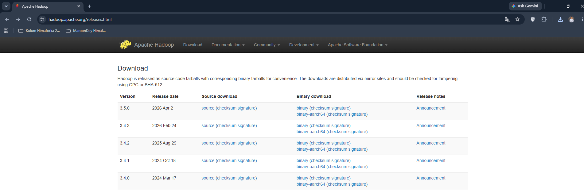

#### Pembahasan

---

### 3. Instalasi Apache Hadoop

Buat folder atau direktori terlebih dahulu dengan nama misal **_software_**, dengan perintah:

```bash
mkdir -p software/storage
cd software/storage
```

#### Pembahasan

---

Kemudian ekstrak berkas Hadoop yang sudah di unduh dengan perintah:

```bash
tar -xvf ~/Downloads/hadoop-3.5.0.tar.gz
```

catatan: untuk **_/Downloads_** sesuaikan dengan tempat berkas Hadoop disimpan.

#### Pembahasan

---

Lalu membuat **_Symlink_** dan **_Verikasi_** dengan perintah

```bash
ln -s hadoop-3.5.0-src hadoop
ls -l
```


#### Pembahasan

---

Kemudian cek isi file hadoop.sh dengan perintah:

```bash
cat ~/env/bash/storage/hadoop.sh
```

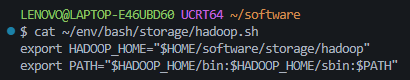

#### Pembahasan

---

Cek versi hadoop dengan menggunakan perintah

```bash
hadoop version
```

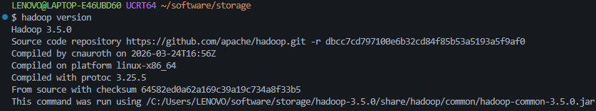

#### Pembahasan

---

Setiap akan menggunakan Apache Hadoop di suatu shell/terminal source file tersebut (cukup sekali saja):

```bash
source ~/env/bash/storage/hadoop.sh
```

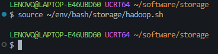

#### Pembahasan

---

Selanjutnya, untuk memeriksa apakah telah terinstall dengan baik, jalankan perintah

```bash
hadoop
```

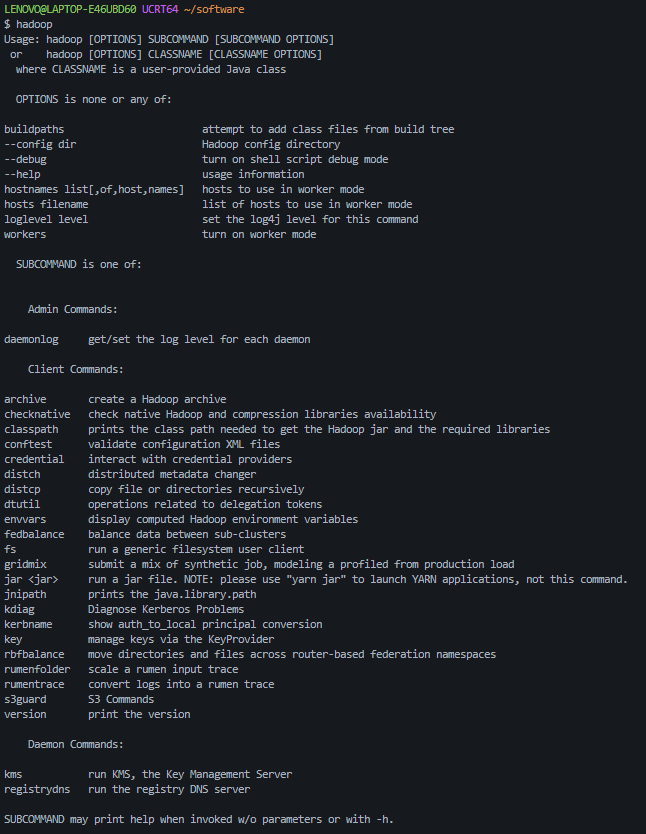

#### Pembahasan

---

### 4. Instalasi PDSH

Karena praktikum ini menggunakan operasi sistem windows, dapat mengecek dengan perintah:

```bash
echo $PDSH_RCMD_TYPE
```


#### Pembahasan

---

Kemudian, mengatur env variabel dengan perintah:

```bash
 export PDSH_RCMD_TYPE=ssh
```

Atur supaya ssh ke localhost tidak perlu login dengan perintah:

```bash
ssh-keygen -t rsa -P '' -f ~/.ssh/id_rsa
cat ~/.ssh/id_rsa.pub >> ~/.ssh/authorized_keys
chmod 0600 ~/.ssh/authorized_keys
```

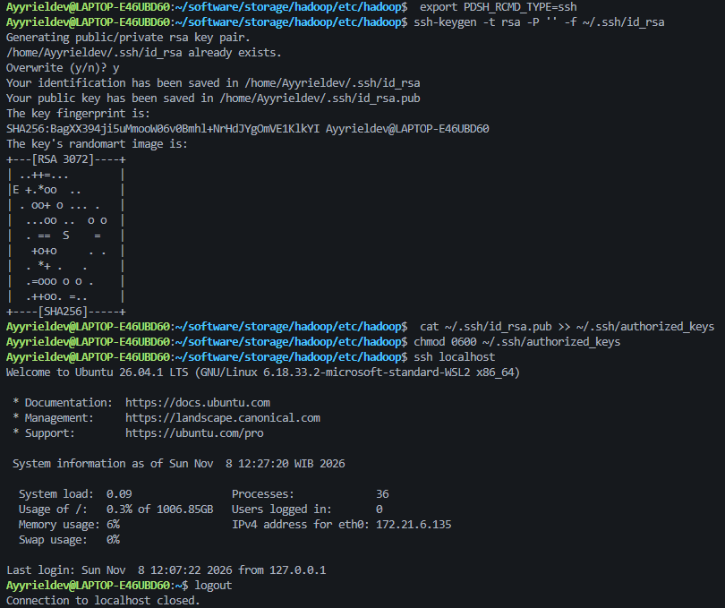

#### Pembahasan

---

### 5. Konfigurasi Apache Hadoop

Tambahkan config pada file $HADOOP_HOME/etc/hadoop/hdfs-site.xml dengan kode:

```
<configuration>
  <property>
    <name>dfs.replication</name>
    <value>1</value>
  </property>
</configuration>
```

Sehingga menjadi:

```
<?xml version="1.0" encoding="UTF-8"?>
<?xml-stylesheet type="text/xsl" href="configuration.xsl"?>
<!--
  Licensed under the Apache License, Version 2.0 (the "License");
  you may not use this file except in compliance with the License.
  You may obtain a copy of the License at

    http://www.apache.org/licenses/LICENSE-2.0

  Unless required by applicable law or agreed to in writing, software
  distributed under the License is distributed on an "AS IS" BASIS,
  WITHOUT WARRANTIES OR CONDITIONS OF ANY KIND, either express or implied.
  See the License for the specific language governing permissions and
  limitations under the License. See accompanying LICENSE file.
-->

<!-- Put site-specific property overrides in this file. -->

<configuration>
  <property>
    <name>dfs.replication</name>
    <value>1</value>
  </property>
</configuration>
```

#### Pembahasan

---

Tambahkan config pada file $HADOOP_HOME/etc/hadoop/core-site.xml dengan kode:

```
<configuration>
  <property>
      <name>fs.defaultFS</name>
      <value>hdfs://localhost:9000</value>
  </property>
  <property>
      <name>hadoop.proxyuser.yourusername.groups</name>
      <value>*</value>
  </property>
  <property>
      <name>hadoop.proxyuser.yourusername.hosts</name>
      <value>*</value>
  </property>
</configuration>
```

Sehingga menjadi:

```
<?xml version="1.0" encoding="UTF-8"?>
<?xml-stylesheet type="text/xsl" href="configuration.xsl"?>
<!--
  Licensed under the Apache License, Version 2.0 (the "License");
  you may not use this file except in compliance with the License.
  You may obtain a copy of the License at

    http://www.apache.org/licenses/LICENSE-2.0

  Unless required by applicable law or agreed to in writing, software
  distributed under the License is distributed on an "AS IS" BASIS,
  WITHOUT WARRANTIES OR CONDITIONS OF ANY KIND, either express or implied.
  See the License for the specific language governing permissions and
  limitations under the License. See accompanying LICENSE file.
-->

<!-- Put site-specific property overrides in this file. -->

<configuration>
  <property>
      <name>fs.defaultFS</name>
      <value>hdfs://localhost:9000</value>
  </property>
  <property>
      <name>hadoop.proxyuser.yourusername.groups</name>
      <value>*</value>
  </property>
  <property>
      <name>hadoop.proxyuser.yourusername.hosts</name>
      <value>*</value>
  </property>
</configuration>
```

#### Pembahasan

---

Tambahkan Config pada file $HADOOP_HOME/etc/hadoop/mapred-site.xml dengan kode:

```
<configuration>
  <property>
    <name>mapreduce.framework.name</name>
    <value>yarn</value>
  </property>
  <property>
    <name>mapreduce.application.classpath</name>
    <value>$HADOOP_CLASSPATH:$HADOOP_HOME/share/hadoop/mapreduce/*:$HADOOP_MAPRED_/HOME/share/hadoop/mapreduce/lib/*</value>
  </property>
</configuration>
```

Sehingga menjadi:

```
<?xml version="1.0"?>
<?xml-stylesheet type="text/xsl" href="configuration.xsl"?>
<!--
  Licensed under the Apache License, Version 2.0 (the "License");
  you may not use this file except in compliance with the License.
  You may obtain a copy of the License at

    http://www.apache.org/licenses/LICENSE-2.0

  Unless required by applicable law or agreed to in writing, software
  distributed under the License is distributed on an "AS IS" BASIS,
  WITHOUT WARRANTIES OR CONDITIONS OF ANY KIND, either express or implied.
  See the License for the specific language governing permissions and
  limitations under the License. See accompanying LICENSE file.
-->

<!-- Put site-specific property overrides in this file. -->

<configuration>
  <property>
    <name>mapreduce.framework.name</name>
    <value>yarn</value>
  </property>
  <property>
    <name>mapreduce.application.classpath</name>
    <value>$HADOOP_CLASSPATH:$HADOOP_HOME/share/hadoop/mapreduce/*:$HADOOP_MAPRED_/HOME/share/hadoop/mapreduce/lib/*</value>
  </property>
</configuration>
```

#### Pembahasan

---

Tambahkan Config pada file $HADOOP_HOME/etc/hadoop/yarn-site.xml dengan kode:

```
<configuration>

<!-- Site specific YARN configuration properties -->

  <property>
    <name>yarn.nodemanager.aux-services</name>
    <value>mapreduce_shuffle</value>
  </property>
  <property>
    <name>yarn.nodemanager.env-whitelist</name>
    <value>JAVA_HOME,HADOOP_COMMON_HOME,HADOOP_HDFS_HOME,HADOOP_CONF_DIR,CLASSPATH_PREPEND_DISTCACHE,HADOOP_YARN_HOME,HADOOP_HOME,PATH,LANG,TZ,HADOOP_MAPRED_HOME</value>
  </property>
  <property>
    <name>yarn.nodemanager.resource.memory-mb</name>
    <value>4096</value>
  </property>
  <property>
    <name>yarn.scheduler.minimum-allocation-mb</name>
    <value>2048</value>
  </property>
  <property>
    <name>yarn.nodemanager.vmem-pmem-ratio</name>
    <value>2.1</value>
  </property>
</configuration>
```

Sehingga menjadi:

```
<?xml version="1.0"?>
<!--
  Licensed under the Apache License, Version 2.0 (the "License");
  you may not use this file except in compliance with the License.
  You may obtain a copy of the License at

    http://www.apache.org/licenses/LICENSE-2.0

  Unless required by applicable law or agreed to in writing, software
  distributed under the License is distributed on an "AS IS" BASIS,
  WITHOUT WARRANTIES OR CONDITIONS OF ANY KIND, either express or implied.
  See the License for the specific language governing permissions and
  limitations under the License. See accompanying LICENSE file.
-->
<configuration>

<!-- Site specific YARN configuration properties -->

  <property>
    <name>yarn.nodemanager.aux-services</name>
    <value>mapreduce_shuffle</value>
  </property>
  <property>
    <name>yarn.nodemanager.env-whitelist</name>
    <value>JAVA_HOME,HADOOP_COMMON_HOME,HADOOP_HDFS_HOME,HADOOP_CONF_DIR,CLASSPATH_PREPEND_DISTCACHE,HADOOP_YARN_HOME,HADOOP_HOME,PATH,LANG,TZ,HADOOP_MAPRED_HOME</value>
  </property>
  <property>
    <name>yarn.nodemanager.resource.memory-mb</name>
    <value>4096</value>
  </property>
  <property>
    <name>yarn.scheduler.minimum-allocation-mb</name>
    <value>2048</value>
  </property>
  <property>
    <name>yarn.nodemanager.vmem-pmem-ratio</name>
    <value>2.1</value>
  </property>
</configuration>
```

#### Pembahasan

---

### 6. Format NameNode

Proses ini dilakukan sekali saja. Jika dilakukan lagi, akan menghapus berbagai file yang telah diproses di HDFS.

Untuk menjalankan pemformatan NameNode dapat menggunakan perintah:

```bash
hdfs namenode -format
```

```bash
Ayyrieldev@LAPTOP-E46UBD60:~/software/storage/hadoop/etc/hadoop$ java -version
openjdk version "17.0.20.1" 2026-08-18
OpenJDK Runtime Environment (build 17.0.20.1+1-1-26.04-Ubuntu)
OpenJDK 64-Bit Server VM (build 17.0.20.1+1-1-26.04-Ubuntu, mixed mode, sharing)
Ayyrieldev@LAPTOP-E46UBD60:~/software/storage/hadoop/etc/hadoop$ hdfs namenode -format
WARNING: /home/Ayyrieldev/software/storage/hadoop/logs does not exist. Creating.
2026-11-08 11:25:57,036 INFO namenode.NameNode: STARTUP_MSG:
/************************************************************
STARTUP_MSG: Starting NameNode
STARTUP_MSG:   host = LAPTOP-E46UBD60/127.0.1.1
STARTUP_MSG:   args = [-format]
STARTUP_MSG:   version = 3.5.0
STARTUP_MSG:   classpath = /home/Ayyrieldev/software/storage/hadoop/etc/hadoop:/home/Ayyrieldev/software/storage/hadoop/share/hadoop/common/lib/hadoop-cos-3.5.0.jar:/home/Ayyrieldev/software/storage/hadoop/share/hadoop/common/lib/jackson-core-2.18.6.jar:/home/Ayyrieldev/software/storage/hadoop/share/hadoop/common/lib/commons-codec-1.15.jar:/home/Ayyrieldev/software/storage/hadoop/share/hadoop/common/lib/netty-resolver-4.1.130.Final.jar:/home/Ayyrieldev/software/storage/hadoop/share/hadoop/common/lib/jetty-io-9.4.58.v20250814.jar:/home/Ayyrieldev/software/storage/hadoop/share/hadoop/common/lib/jetty-util-ajax-9.4.58.v20250814.jar:/home/Ayyrieldev/software/storage/hadoop/share/hadoop/common/lib/jackson-annotations-2.18.6.jar:/home/Ayyrieldev/software/storage/hadoop/share/hadoop/common/lib/bcprov-jdk18on-1.82.jar:/home/Ayyrieldev/software/storage/hadoop/share/hadoop/common/lib/hadoop-huaweicloud-3.5.0.jar:/home/Ayyrieldev/software/storage/hadoop/share/hadoop/common/lib/jetty-webapp-9.4.58.v20250814.jar:/home/Ayyrieldev/software/storage/hadoop/share/hadoop/common/lib/commons-compress-1.26.1.jar:/home/Ayyrieldev/software/storage/hadoop/share/hadoop/common/lib/netty-transport-native-epoll-4.1.130.Final.jar:/home/Ayyrieldev/software/storage/hadoop/share/hadoop/common/lib/jersey-common-2.46.jar:/home/Ayyrieldev/software/storage/hadoop/share/hadoop/common/lib/analyticsaccelerator-s3-1.3.1.jar:/home/Ayyrieldev/software/storage/hadoop/share/hadoop/common/lib/hk2-locator-2.6.1.jar:/home/Ayyrieldev/software/storage/hadoop/share/hadoop/common/lib/dnsjava-3.6.1.jar:/home/Ayyrieldev/software/storage/hadoop/share/hadoop/common/lib/jetty-xml-9.4.58.v20250814.jar:/home/Ayyrieldev/software/storage/hadoop/share/hadoop/common/lib/jakarta.ws.rs-api-2.1.6.jar:/home/Ayyrieldev/software/storage/hadoop/share/hadoop/common/lib/nimbus-jose-jwt-10.4.jar:/home/Ayyrieldev/software/storage/hadoop/share/hadoop/common/lib/jersey-client-2.46.jar:/home/Ayyrieldev/software/storage/hadoop/share/hadoop/common/lib/istack-commons-runtime-3.0.12.jar:/home/Ayyrieldev/software/storage/hadoop/share/hadoop/common/lib/HdrHistogram-2.1.12.jar:/home/Ayyrieldev/software/storage/hadoop/share/hadoop/common/lib/hadoop-shaded-guava-1.5.0.jar:/home/Ayyrieldev/software/storage/hadoop/share/hadoop/common/lib/httpclient-4.5.13.jar:/home/Ayyrieldev/software/storage/hadoop/share/hadoop/common/lib/kerby-pkix-2.0.3.jar:/home/Ayyrieldev/software/storage/hadoop/share/hadoop/common/lib/javassist-3.30.2-GA.jar:/home/Ayyrieldev/software/storage/hadoop/share/hadoop/common/lib/hk2-utils-2.6.1.jar:/home/Ayyrieldev/software/storage/hadoop/share/hadoop/common/lib/commons-collections4-4.4.jar:/home/Ayyrieldev/software/storage/hadoop/share/hadoop/common/lib/hadoop-gcp-3.5.0.jar:/home/Ayyrieldev/software/storage/hadoop/share/hadoop/common/lib/jersey-container-servlet-core-2.46.jar:/home/Ayyrieldev/software/storage/hadoop/share/hadoop/common/lib/reload4j-1.2.22.jar:/home/Ayyrieldev/software/storage/hadoop/share/hadoop/common/lib/netty-codec-4.1.130.Final.jar:/home/Ayyrieldev/software/storage/hadoop/share/hadoop/common/lib/httpcore-4.4.13.jar:/home/Ayyrieldev/software/storage/hadoop/share/hadoop/common/lib/azure-storage-7.0.1.jar:/home/Ayyrieldev/software/storage/hadoop/share/hadoop/common/lib/jakarta.activation-api-1.2.1.jar:/home/Ayyrieldev/software/storage/hadoop/share/hadoop/common/lib/netty-buffer-4.1.130.Final.jar:/home/Ayyrieldev/software/storage/hadoop/share/hadoop/common/lib/netty-handler-4.1.130.Final.jar:/home/Ayyrieldev/software/storage/hadoop/share/hadoop/common/lib/snappy-java-1.1.10.4.jar:/home/Ayyrieldev/software/storage/hadoop/share/hadoop/common/lib/jersey-container-servlet-2.46.jar:/home/Ayyrieldev/software/storage/hadoop/share/hadoop/common/lib/listenablefuture-9999.0-empty-to-avoid-conflict-with-guava.jar:/home/Ayyrieldev/software/storage/hadoop/share/hadoop/common/lib/metrics-core-3.2.4.jar:/home/Ayyrieldev/software/storage/hadoop/share/hadoop/common/lib/jakarta.inject-2.6.1.jar:/home/Ayyrieldev/software/storage/hadoop/share/hadoop/common/lib/commons-lang3-3.18.0.jar:/home/Ayyrieldev/software/storage/hadoop/share/hadoop/common/lib/commons-configuration2-2.10.1.jar:/home/Ayyrieldev/software/storage/hadoop/share/hadoop/common/lib/jul-to-slf4j-1.7.36.jar:/home/Ayyrieldev/software/storage/hadoop/share/hadoop/common/lib/audience-annotations-0.12.0.jar:/home/Ayyrieldev/software/storage/hadoop/share/hadoop/common/lib/j2objc-annotations-3.0.0.jar:/home/Ayyrieldev/software/storage/hadoop/share/hadoop/common/lib/jakarta.servlet-api-4.0.4.jar:/home/Ayyrieldev/software/storage/hadoop/share/hadoop/common/lib/netty-common-4.1.130.Final.jar:/home/Ayyrieldev/software/storage/hadoop/share/hadoop/common/lib/commons-math3-3.6.1.jar:/home/Ayyrieldev/software/storage/hadoop/share/hadoop/common/lib/curator-client-5.2.0.jar:/home/Ayyrieldev/software/storage/hadoop/share/hadoop/common/lib/jersey-hk2-2.46.jar:/home/Ayyrieldev/software/storage/hadoop/share/hadoop/common/lib/netty-transport-4.1.130.Final.jar:/home/Ayyrieldev/software/storage/hadoop/share/hadoop/common/lib/avro-1.11.5.jar:/home/Ayyrieldev/software/storage/hadoop/share/hadoop/common/lib/slf4j-api-1.7.36.jar:/home/Ayyrieldev/software/storage/hadoop/share/hadoop/common/lib/gson-2.9.0.jar:/home/Ayyrieldev/software/storage/hadoop/share/hadoop/common/lib/curator-framework-5.2.0.jar:/home/Ayyrieldev/software/storage/hadoop/share/hadoop/common/lib/jetty-servlet-9.4.58.v20250814.jar:/home/Ayyrieldev/software/storage/hadoop/share/hadoop/common/lib/kerb-core-2.0.3.jar:/home/Ayyrieldev/software/storage/hadoop/share/hadoop/common/lib/guava-33.4.8-jre.jar:/home/Ayyrieldev/software/storage/hadoop/share/hadoop/common/lib/kerby-util-2.0.3.jar:/home/Ayyrieldev/software/storage/hadoop/share/hadoop/common/lib/jetty-server-9.4.58.v20250814.jar:/home/Ayyrieldev/software/storage/hadoop/share/hadoop/common/lib/jackson-databind-2.18.6.jar:/home/Ayyrieldev/software/storage/hadoop/share/hadoop/common/lib/kerby-asn1-2.0.3.jar:/home/Ayyrieldev/software/storage/hadoop/share/hadoop/common/lib/jetty-util-9.4.58.v20250814.jar:/home/Ayyrieldev/software/storage/hadoop/share/hadoop/common/lib/jspecify-1.0.0.jar:/home/Ayyrieldev/software/storage/hadoop/share/hadoop/common/lib/hadoop-aws-3.5.0.jar:/home/Ayyrieldev/software/storage/hadoop/share/hadoop/common/lib/netty-transport-native-unix-common-4.1.130.Final.jar:/home/Ayyrieldev/software/storage/hadoop/share/hadoop/common/lib/commons-cli-1.9.0.jar:/home/Ayyrieldev/software/storage/hadoop/share/hadoop/common/lib/failureaccess-1.0.3.jar:/home/Ayyrieldev/software/storage/hadoop/share/hadoop/common/lib/jersey-server-2.46.jar:/home/Ayyrieldev/software/storage/hadoop/share/hadoop/common/lib/commons-io-2.16.1.jar:/home/Ayyrieldev/software/storage/hadoop/share/hadoop/common/lib/hadoop-annotations-3.5.0.jar:/home/Ayyrieldev/software/storage/hadoop/share/hadoop/common/lib/javax.servlet-api-3.1.0.jar:/home/Ayyrieldev/software/storage/hadoop/share/hadoop/common/lib/stax2-api-4.2.1.jar:/home/Ayyrieldev/software/storage/hadoop/share/hadoop/common/lib/commons-text-1.14.0.jar:/home/Ayyrieldev/software/storage/hadoop/share/hadoop/common/lib/aopalliance-repackaged-2.6.1.jar:/home/Ayyrieldev/software/storage/hadoop/share/hadoop/common/lib/hadoop-tos-3.5.0.jar:/home/Ayyrieldev/software/storage/hadoop/share/hadoop/common/lib/commons-logging-1.3.0.jar:/home/Ayyrieldev/software/storage/hadoop/share/hadoop/common/lib/jaxb-runtime-2.3.9.jar:/home/Ayyrieldev/software/storage/hadoop/share/hadoop/common/lib/jakarta.servlet.jsp-api-2.3.6.jar:/home/Ayyrieldev/software/storage/hadoop/share/hadoop/common/lib/commons-net-3.9.0.jar:/home/Ayyrieldev/software/storage/hadoop/share/hadoop/common/lib/hadoop-azure-3.5.0.jar:/home/Ayyrieldev/software/storage/hadoop/share/hadoop/common/lib/txw2-2.3.9.jar:/home/Ayyrieldev/software/storage/hadoop/share/hadoop/common/lib/zookeeper-3.8.6.jar:/home/Ayyrieldev/software/storage/hadoop/share/hadoop/common/lib/hk2-api-2.6.1.jar:/home/Ayyrieldev/software/storage/hadoop/share/hadoop/common/lib/kerb-util-2.0.3.jar:/home/Ayyrieldev/software/storage/hadoop/share/hadoop/common/lib/azure-keyvault-core-1.0.0.jar:/home/Ayyrieldev/software/storage/hadoop/share/hadoop/common/lib/curator-recipes-5.2.0.jar:/home/Ayyrieldev/software/storage/hadoop/share/hadoop/common/lib/jetty-security-9.4.58.v20250814.jar:/home/Ayyrieldev/software/storage/hadoop/share/hadoop/common/lib/hadoop-azure-datalake-3.5.0.jar:/home/Ayyrieldev/software/storage/hadoop/share/hadoop/common/lib/osgi-resource-locator-1.0.3.jar:/home/Ayyrieldev/software/storage/hadoop/share/hadoop/common/lib/jsr305-3.0.2.jar:/home/Ayyrieldev/software/storage/hadoop/share/hadoop/common/lib/re2j-1.1.jar:/home/Ayyrieldev/software/storage/hadoop/share/hadoop/common/lib/commons-daemon-1.0.13.jar:/home/Ayyrieldev/software/storage/hadoop/share/hadoop/common/lib/zookeeper-jute-3.8.6.jar:/home/Ayyrieldev/software/storage/hadoop/share/hadoop/common/lib/slf4j-reload4j-1.7.36.jar:/home/Ayyrieldev/software/storage/hadoop/share/hadoop/common/lib/jetty-http-9.4.58.v20250814.jar:/home/Ayyrieldev/software/storage/hadoop/share/hadoop/common/lib/hadoop-shaded-protobuf_3_25-1.5.0.jar:/home/Ayyrieldev/software/storage/hadoop/share/hadoop/common/lib/jakarta.activation-1.2.2.jar:/home/Ayyrieldev/software/storage/hadoop/share/hadoop/common/lib/jakarta.xml.bind-api-2.3.3.jar:/home/Ayyrieldev/software/storage/hadoop/share/hadoop/common/lib/kerby-config-2.0.3.jar:/home/Ayyrieldev/software/storage/hadoop/share/hadoop/common/lib/woodstox-core-5.4.0.jar:/home/Ayyrieldev/software/storage/hadoop/share/hadoop/common/lib/jsch-0.1.55.jar:/home/Ayyrieldev/software/storage/hadoop/share/hadoop/common/lib/wildfly-openssl-2.2.5.Final.jar:/home/Ayyrieldev/software/storage/hadoop/share/hadoop/common/lib/kerb-crypto-2.0.3.jar:/home/Ayyrieldev/software/storage/hadoop/share/hadoop/common/lib/jakarta.validation-api-2.0.2.jar:/home/Ayyrieldev/software/storage/hadoop/share/hadoop/common/lib/jakarta.annotation-api-1.3.5.jar:/home/Ayyrieldev/software/storage/hadoop/share/hadoop/common/lib/hadoop-auth-3.5.0.jar:/home/Ayyrieldev/software/storage/hadoop/share/hadoop/common/lib/netty-transport-classes-epoll-4.1.130.Final.jar:/home/Ayyrieldev/software/storage/hadoop/share/hadoop/common/hadoop-registry-3.5.0.jar:/home/Ayyrieldev/software/storage/hadoop/share/hadoop/common/hadoop-nfs-3.5.0.jar:/home/Ayyrieldev/software/storage/hadoop/share/hadoop/common/hadoop-common-3.5.0-tests.jar:/home/Ayyrieldev/software/storage/hadoop/share/hadoop/common/hadoop-kms-3.5.0.jar:/home/Ayyrieldev/software/storage/hadoop/share/hadoop/common/hadoop-common-3.5.0.jar:/home/Ayyrieldev/software/storage/hadoop/share/hadoop/hdfs:/home/Ayyrieldev/software/storage/hadoop/share/hadoop/hdfs/lib/jackson-core-2.18.6.jar:/home/Ayyrieldev/software/storage/hadoop/share/hadoop/hdfs/lib/commons-codec-1.15.jar:/home/Ayyrieldev/software/storage/hadoop/share/hadoop/hdfs/lib/netty-resolver-4.1.130.Final.jar:/home/Ayyrieldev/software/storage/hadoop/share/hadoop/hdfs/lib/jetty-io-9.4.58.v20250814.jar:/home/Ayyrieldev/software/storage/hadoop/share/hadoop/hdfs/lib/jetty-util-ajax-9.4.58.v20250814.jar:/home/Ayyrieldev/software/storage/hadoop/share/hadoop/hdfs/lib/netty-codec-http-4.1.130.Final.jar:/home/Ayyrieldev/software/storage/hadoop/share/hadoop/hdfs/lib/jackson-annotations-2.18.6.jar:/home/Ayyrieldev/software/storage/hadoop/share/hadoop/hdfs/lib/netty-codec-stomp-4.1.130.Final.jar:/home/Ayyrieldev/software/storage/hadoop/share/hadoop/hdfs/lib/jetty-webapp-9.4.58.v20250814.jar:/home/Ayyrieldev/software/storage/hadoop/share/hadoop/hdfs/lib/netty-transport-rxtx-4.1.130.Final.jar:/home/Ayyrieldev/software/storage/hadoop/share/hadoop/hdfs/lib/netty-handler-proxy-4.1.130.Final.jar:/home/Ayyrieldev/software/storage/hadoop/share/hadoop/hdfs/lib/commons-compress-1.26.1.jar:/home/Ayyrieldev/software/storage/hadoop/share/hadoop/hdfs/lib/netty-transport-native-epoll-4.1.130.Final.jar:/home/Ayyrieldev/software/storage/hadoop/share/hadoop/hdfs/lib/netty-codec-http2-4.1.130.Final.jar:/home/Ayyrieldev/software/storage/hadoop/share/hadoop/hdfs/lib/jersey-common-2.46.jar:/home/Ayyrieldev/software/storage/hadoop/share/hadoop/hdfs/lib/netty-transport-classes-kqueue-4.1.130.Final.jar:/home/Ayyrieldev/software/storage/hadoop/share/hadoop/hdfs/lib/hk2-locator-2.6.1.jar:/home/Ayyrieldev/software/storage/hadoop/share/hadoop/hdfs/lib/dnsjava-3.6.1.jar:/home/Ayyrieldev/software/storage/hadoop/share/hadoop/hdfs/lib/jetty-xml-9.4.58.v20250814.jar:/home/Ayyrieldev/software/storage/hadoop/share/hadoop/hdfs/lib/jakarta.ws.rs-api-2.1.6.jar:/home/Ayyrieldev/software/storage/hadoop/share/hadoop/hdfs/lib/nimbus-jose-jwt-10.4.jar:/home/Ayyrieldev/software/storage/hadoop/share/hadoop/hdfs/lib/jersey-client-2.46.jar:/home/Ayyrieldev/software/storage/hadoop/share/hadoop/hdfs/lib/istack-commons-runtime-3.0.12.jar:/home/Ayyrieldev/software/storage/hadoop/share/hadoop/hdfs/lib/hadoop-shaded-guava-1.5.0.jar:/home/Ayyrieldev/software/storage/hadoop/share/hadoop/hdfs/lib/httpclient-4.5.13.jar:/home/Ayyrieldev/software/storage/hadoop/share/hadoop/hdfs/lib/kerby-pkix-2.0.3.jar:/home/Ayyrieldev/software/storage/hadoop/share/hadoop/hdfs/lib/netty-resolver-dns-native-macos-4.1.130.Final-osx-x86_64.jar:/home/Ayyrieldev/software/storage/hadoop/share/hadoop/hdfs/lib/javassist-3.30.2-GA.jar:/home/Ayyrieldev/software/storage/hadoop/share/hadoop/hdfs/lib/hk2-utils-2.6.1.jar:/home/Ayyrieldev/software/storage/hadoop/share/hadoop/hdfs/lib/commons-collections4-4.4.jar:/home/Ayyrieldev/software/storage/hadoop/share/hadoop/hdfs/lib/jersey-container-servlet-core-2.46.jar:/home/Ayyrieldev/software/storage/hadoop/share/hadoop/hdfs/lib/reload4j-1.2.22.jar:/home/Ayyrieldev/software/storage/hadoop/share/hadoop/hdfs/lib/netty-codec-4.1.130.Final.jar:/home/Ayyrieldev/software/storage/hadoop/share/hadoop/hdfs/lib/httpcore-4.4.13.jar:/home/Ayyrieldev/software/storage/hadoop/share/hadoop/hdfs/lib/jakarta.activation-api-1.2.1.jar:/home/Ayyrieldev/software/storage/hadoop/share/hadoop/hdfs/lib/netty-buffer-4.1.130.Final.jar:/home/Ayyrieldev/software/storage/hadoop/share/hadoop/hdfs/lib/netty-handler-4.1.130.Final.jar:/home/Ayyrieldev/software/storage/hadoop/share/hadoop/hdfs/lib/snappy-java-1.1.10.4.jar:/home/Ayyrieldev/software/storage/hadoop/share/hadoop/hdfs/lib/jersey-container-servlet-2.46.jar:/home/Ayyrieldev/software/storage/hadoop/share/hadoop/hdfs/lib/netty-codec-socks-4.1.130.Final.jar:/home/Ayyrieldev/software/storage/hadoop/share/hadoop/hdfs/lib/listenablefuture-9999.0-empty-to-avoid-conflict-with-guava.jar:/home/Ayyrieldev/software/storage/hadoop/share/hadoop/hdfs/lib/metrics-core-3.2.4.jar:/home/Ayyrieldev/software/storage/hadoop/share/hadoop/hdfs/lib/jakarta.inject-2.6.1.jar:/home/Ayyrieldev/software/storage/hadoop/share/hadoop/hdfs/lib/commons-lang3-3.18.0.jar:/home/Ayyrieldev/software/storage/hadoop/share/hadoop/hdfs/lib/commons-configuration2-2.10.1.jar:/home/Ayyrieldev/software/storage/hadoop/share/hadoop/hdfs/lib/audience-annotations-0.12.0.jar:/home/Ayyrieldev/software/storage/hadoop/share/hadoop/hdfs/lib/j2objc-annotations-3.0.0.jar:/home/Ayyrieldev/software/storage/hadoop/share/hadoop/hdfs/lib/HikariCP-4.0.3.jar:/home/Ayyrieldev/software/storage/hadoop/share/hadoop/hdfs/lib/jakarta.servlet-api-4.0.4.jar:/home/Ayyrieldev/software/storage/hadoop/share/hadoop/hdfs/lib/netty-common-4.1.130.Final.jar:/home/Ayyrieldev/software/storage/hadoop/share/hadoop/hdfs/lib/commons-math3-3.6.1.jar:/home/Ayyrieldev/software/storage/hadoop/share/hadoop/hdfs/lib/curator-client-5.2.0.jar:/home/Ayyrieldev/software/storage/hadoop/share/hadoop/hdfs/lib/netty-transport-native-epoll-4.1.130.Final-linux-aarch_64.jar:/home/Ayyrieldev/software/storage/hadoop/share/hadoop/hdfs/lib/jersey-hk2-2.46.jar:/home/Ayyrieldev/software/storage/hadoop/share/hadoop/hdfs/lib/netty-codec-mqtt-4.1.130.Final.jar:/home/Ayyrieldev/software/storage/hadoop/share/hadoop/hdfs/lib/netty-transport-4.1.130.Final.jar:/home/Ayyrieldev/software/storage/hadoop/share/hadoop/hdfs/lib/avro-1.11.5.jar:/home/Ayyrieldev/software/storage/hadoop/share/hadoop/hdfs/lib/gson-2.9.0.jar:/home/Ayyrieldev/software/storage/hadoop/share/hadoop/hdfs/lib/leveldbjni-all-1.8.jar:/home/Ayyrieldev/software/storage/hadoop/share/hadoop/hdfs/lib/curator-framework-5.2.0.jar:/home/Ayyrieldev/software/storage/hadoop/share/hadoop/hdfs/lib/jetty-servlet-9.4.58.v20250814.jar:/home/Ayyrieldev/software/storage/hadoop/share/hadoop/hdfs/lib/netty-transport-sctp-4.1.130.Final.jar:/home/Ayyrieldev/software/storage/hadoop/share/hadoop/hdfs/lib/kerb-core-2.0.3.jar:/home/Ayyrieldev/software/storage/hadoop/share/hadoop/hdfs/lib/guava-33.4.8-jre.jar:/home/Ayyrieldev/software/storage/hadoop/share/hadoop/hdfs/lib/kerby-util-2.0.3.jar:/home/Ayyrieldev/software/storage/hadoop/share/hadoop/hdfs/lib/json-simple-1.1.1.jar:/home/Ayyrieldev/software/storage/hadoop/share/hadoop/hdfs/lib/jetty-server-9.4.58.v20250814.jar:/home/Ayyrieldev/software/storage/hadoop/share/hadoop/hdfs/lib/jackson-databind-2.18.6.jar:/home/Ayyrieldev/software/storage/hadoop/share/hadoop/hdfs/lib/netty-transport-native-kqueue-4.1.130.Final-osx-x86_64.jar:/home/Ayyrieldev/software/storage/hadoop/share/hadoop/hdfs/lib/kerby-asn1-2.0.3.jar:/home/Ayyrieldev/software/storage/hadoop/share/hadoop/hdfs/lib/netty-codec-xml-4.1.130.Final.jar:/home/Ayyrieldev/software/storage/hadoop/share/hadoop/hdfs/lib/jetty-util-9.4.58.v20250814.jar:/home/Ayyrieldev/software/storage/hadoop/share/hadoop/hdfs/lib/jspecify-1.0.0.jar:/home/Ayyrieldev/software/storage/hadoop/share/hadoop/hdfs/lib/netty-transport-native-unix-common-4.1.130.Final.jar:/home/Ayyrieldev/software/storage/hadoop/share/hadoop/hdfs/lib/commons-cli-1.9.0.jar:/home/Ayyrieldev/software/storage/hadoop/share/hadoop/hdfs/lib/failureaccess-1.0.3.jar:/home/Ayyrieldev/software/storage/hadoop/share/hadoop/hdfs/lib/jersey-server-2.46.jar:/home/Ayyrieldev/software/storage/hadoop/share/hadoop/hdfs/lib/commons-io-2.16.1.jar:/home/Ayyrieldev/software/storage/hadoop/share/hadoop/hdfs/lib/hadoop-annotations-3.5.0.jar:/home/Ayyrieldev/software/storage/hadoop/share/hadoop/hdfs/lib/javax.servlet-api-3.1.0.jar:/home/Ayyrieldev/software/storage/hadoop/share/hadoop/hdfs/lib/netty-codec-memcache-4.1.130.Final.jar:/home/Ayyrieldev/software/storage/hadoop/share/hadoop/hdfs/lib/netty-handler-ssl-ocsp-4.1.130.Final.jar:/home/Ayyrieldev/software/storage/hadoop/share/hadoop/hdfs/lib/stax2-api-4.2.1.jar:/home/Ayyrieldev/software/storage/hadoop/share/hadoop/hdfs/lib/netty-codec-smtp-4.1.130.Final.jar:/home/Ayyrieldev/software/storage/hadoop/share/hadoop/hdfs/lib/netty-transport-native-epoll-4.1.130.Final-linux-riscv64.jar:/home/Ayyrieldev/software/storage/hadoop/share/hadoop/hdfs/lib/commons-text-1.14.0.jar:/home/Ayyrieldev/software/storage/hadoop/share/hadoop/hdfs/lib/aopalliance-repackaged-2.6.1.jar:/home/Ayyrieldev/software/storage/hadoop/share/hadoop/hdfs/lib/netty-resolver-dns-4.1.130.Final.jar:/home/Ayyrieldev/software/storage/hadoop/share/hadoop/hdfs/lib/netty-all-4.1.130.Final.jar:/home/Ayyrieldev/software/storage/hadoop/share/hadoop/hdfs/lib/netty-transport-udt-4.1.130.Final.jar:/home/Ayyrieldev/software/storage/hadoop/share/hadoop/hdfs/lib/netty-transport-native-epoll-4.1.130.Final-linux-x86_64.jar:/home/Ayyrieldev/software/storage/hadoop/share/hadoop/hdfs/lib/commons-logging-1.3.0.jar:/home/Ayyrieldev/software/storage/hadoop/share/hadoop/hdfs/lib/jaxb-runtime-2.3.9.jar:/home/Ayyrieldev/software/storage/hadoop/share/hadoop/hdfs/lib/jakarta.servlet.jsp-api-2.3.6.jar:/home/Ayyrieldev/software/storage/hadoop/share/hadoop/hdfs/lib/commons-net-3.9.0.jar:/home/Ayyrieldev/software/storage/hadoop/share/hadoop/hdfs/lib/txw2-2.3.9.jar:/home/Ayyrieldev/software/storage/hadoop/share/hadoop/hdfs/lib/netty-resolver-dns-native-macos-4.1.130.Final-osx-aarch_64.jar:/home/Ayyrieldev/software/storage/hadoop/share/hadoop/hdfs/lib/zookeeper-3.8.6.jar:/home/Ayyrieldev/software/storage/hadoop/share/hadoop/hdfs/lib/hk2-api-2.6.1.jar:/home/Ayyrieldev/software/storage/hadoop/share/hadoop/hdfs/lib/kerb-util-2.0.3.jar:/home/Ayyrieldev/software/storage/hadoop/share/hadoop/hdfs/lib/curator-recipes-5.2.0.jar:/home/Ayyrieldev/software/storage/hadoop/share/hadoop/hdfs/lib/jetty-security-9.4.58.v20250814.jar:/home/Ayyrieldev/software/storage/hadoop/share/hadoop/hdfs/lib/netty-codec-redis-4.1.130.Final.jar:/home/Ayyrieldev/software/storage/hadoop/share/hadoop/hdfs/lib/osgi-resource-locator-1.0.3.jar:/home/Ayyrieldev/software/storage/hadoop/share/hadoop/hdfs/lib/netty-codec-haproxy-4.1.130.Final.jar:/home/Ayyrieldev/software/storage/hadoop/share/hadoop/hdfs/lib/jsr305-3.0.2.jar:/home/Ayyrieldev/software/storage/hadoop/share/hadoop/hdfs/lib/re2j-1.1.jar:/home/Ayyrieldev/software/storage/hadoop/share/hadoop/hdfs/lib/commons-daemon-1.0.13.jar:/home/Ayyrieldev/software/storage/hadoop/share/hadoop/hdfs/lib/zookeeper-jute-3.8.6.jar:/home/Ayyrieldev/software/storage/hadoop/share/hadoop/hdfs/lib/jetty-http-9.4.58.v20250814.jar:/home/Ayyrieldev/software/storage/hadoop/share/hadoop/hdfs/lib/hadoop-shaded-protobuf_3_25-1.5.0.jar:/home/Ayyrieldev/software/storage/hadoop/share/hadoop/hdfs/lib/jakarta.activation-1.2.2.jar:/home/Ayyrieldev/software/storage/hadoop/share/hadoop/hdfs/lib/netty-transport-native-kqueue-4.1.130.Final-osx-aarch_64.jar:/home/Ayyrieldev/software/storage/hadoop/share/hadoop/hdfs/lib/jakarta.xml.bind-api-2.3.3.jar:/home/Ayyrieldev/software/storage/hadoop/share/hadoop/hdfs/lib/kerby-config-2.0.3.jar:/home/Ayyrieldev/software/storage/hadoop/share/hadoop/hdfs/lib/netty-codec-dns-4.1.130.Final.jar:/home/Ayyrieldev/software/storage/hadoop/share/hadoop/hdfs/lib/woodstox-core-5.4.0.jar:/home/Ayyrieldev/software/storage/hadoop/share/hadoop/hdfs/lib/jsch-0.1.55.jar:/home/Ayyrieldev/software/storage/hadoop/share/hadoop/hdfs/lib/kerb-crypto-2.0.3.jar:/home/Ayyrieldev/software/storage/hadoop/share/hadoop/hdfs/lib/jakarta.validation-api-2.0.2.jar:/home/Ayyrieldev/software/storage/hadoop/share/hadoop/hdfs/lib/jettison-1.5.4.jar:/home/Ayyrieldev/software/storage/hadoop/share/hadoop/hdfs/lib/jakarta.annotation-api-1.3.5.jar:/home/Ayyrieldev/software/storage/hadoop/share/hadoop/hdfs/lib/hadoop-auth-3.5.0.jar:/home/Ayyrieldev/software/storage/hadoop/share/hadoop/hdfs/lib/netty-resolver-dns-classes-macos-4.1.130.Final.jar:/home/Ayyrieldev/software/storage/hadoop/share/hadoop/hdfs/lib/netty-transport-classes-epoll-4.1.130.Final.jar:/home/Ayyrieldev/software/storage/hadoop/share/hadoop/hdfs/hadoop-hdfs-3.5.0-tests.jar:/home/Ayyrieldev/software/storage/hadoop/share/hadoop/hdfs/hadoop-hdfs-rbf-3.5.0.jar:/home/Ayyrieldev/software/storage/hadoop/share/hadoop/hdfs/hadoop-hdfs-httpfs-3.5.0.jar:/home/Ayyrieldev/software/storage/hadoop/share/hadoop/hdfs/hadoop-hdfs-native-client-3.5.0-tests.jar:/home/Ayyrieldev/software/storage/hadoop/share/hadoop/hdfs/hadoop-hdfs-native-client-3.5.0.jar:/home/Ayyrieldev/software/storage/hadoop/share/hadoop/hdfs/hadoop-hdfs-client-3.5.0.jar:/home/Ayyrieldev/software/storage/hadoop/share/hadoop/hdfs/hadoop-hdfs-rbf-3.5.0-tests.jar:/home/Ayyrieldev/software/storage/hadoop/share/hadoop/hdfs/hadoop-hdfs-nfs-3.5.0.jar:/home/Ayyrieldev/software/storage/hadoop/share/hadoop/hdfs/hadoop-hdfs-3.5.0.jar:/home/Ayyrieldev/software/storage/hadoop/share/hadoop/hdfs/hadoop-hdfs-client-3.5.0-tests.jar:/home/Ayyrieldev/software/storage/hadoop/share/hadoop/mapreduce/lib/javax.inject-1.jar:/home/Ayyrieldev/software/storage/hadoop/share/hadoop/mapreduce/hadoop-mapreduce-client-jobclient-3.5.0.jar:/home/Ayyrieldev/software/storage/hadoop/share/hadoop/mapreduce/hadoop-mapreduce-client-hs-3.5.0.jar:/home/Ayyrieldev/software/storage/hadoop/share/hadoop/mapreduce/hadoop-mapreduce-client-app-3.5.0.jar:/home/Ayyrieldev/software/storage/hadoop/share/hadoop/mapreduce/hadoop-mapreduce-client-hs-plugins-3.5.0.jar:/home/Ayyrieldev/software/storage/hadoop/share/hadoop/mapreduce/hadoop-mapreduce-client-uploader-3.5.0.jar:/home/Ayyrieldev/software/storage/hadoop/share/hadoop/mapreduce/hadoop-mapreduce-client-nativetask-3.5.0.jar:/home/Ayyrieldev/software/storage/hadoop/share/hadoop/mapreduce/hadoop-mapreduce-client-common-3.5.0.jar:/home/Ayyrieldev/software/storage/hadoop/share/hadoop/mapreduce/hadoop-mapreduce-client-core-3.5.0.jar:/home/Ayyrieldev/software/storage/hadoop/share/hadoop/mapreduce/hadoop-mapreduce-client-shuffle-3.5.0.jar:/home/Ayyrieldev/software/storage/hadoop/share/hadoop/mapreduce/hadoop-mapreduce-client-jobclient-3.5.0-tests.jar:/home/Ayyrieldev/software/storage/hadoop/share/hadoop/mapreduce/hadoop-mapreduce-examples-3.5.0.jar:/home/Ayyrieldev/software/storage/hadoop/share/hadoop/yarn:/home/Ayyrieldev/software/storage/hadoop/share/hadoop/yarn/lib/cache-api-1.1.1.jar:/home/Ayyrieldev/software/storage/hadoop/share/hadoop/yarn/lib/asm-commons-9.7.1.jar:/home/Ayyrieldev/software/storage/hadoop/share/hadoop/yarn/lib/websocket-servlet-9.4.58.v20250814.jar:/home/Ayyrieldev/software/storage/hadoop/share/hadoop/yarn/lib/fst-2.50.jar:/home/Ayyrieldev/software/storage/hadoop/share/hadoop/yarn/lib/javax.websocket-api-1.0.jar:/home/Ayyrieldev/software/storage/hadoop/share/hadoop/yarn/lib/mssql-jdbc-6.2.1.jre7.jar:/home/Ayyrieldev/software/storage/hadoop/share/hadoop/yarn/lib/javax-websocket-client-impl-9.4.58.v20250814.jar:/home/Ayyrieldev/software/storage/hadoop/share/hadoop/yarn/lib/jetty-jndi-9.4.58.v20250814.jar:/home/Ayyrieldev/software/storage/hadoop/share/hadoop/yarn/lib/jackson-jaxrs-json-provider-2.18.6.jar:/home/Ayyrieldev/software/storage/hadoop/share/hadoop/yarn/lib/websocket-common-9.4.58.v20250814.jar:/home/Ayyrieldev/software/storage/hadoop/share/hadoop/yarn/lib/failsafe-2.4.4.jar:/home/Ayyrieldev/software/storage/hadoop/share/hadoop/yarn/lib/commons-csv-1.9.0.jar:/home/Ayyrieldev/software/storage/hadoop/share/hadoop/yarn/lib/caffeine-2.9.3.jar:/home/Ayyrieldev/software/storage/hadoop/share/hadoop/yarn/lib/swagger-annotations-1.5.4.jar:/home/Ayyrieldev/software/storage/hadoop/share/hadoop/yarn/lib/javax.json-1.1.4.jar:/home/Ayyrieldev/software/storage/hadoop/share/hadoop/yarn/lib/jline-3.9.0.jar:/home/Ayyrieldev/software/storage/hadoop/share/hadoop/yarn/lib/aopalliance-1.0.jar:/home/Ayyrieldev/software/storage/hadoop/share/hadoop/yarn/lib/jetty-client-9.4.58.v20250814.jar:/home/Ayyrieldev/software/storage/hadoop/share/hadoop/yarn/lib/jsonschema2pojo-core-1.0.2.jar:/home/Ayyrieldev/software/storage/hadoop/share/hadoop/yarn/lib/jetty-annotations-9.4.58.v20250814.jar:/home/Ayyrieldev/software/storage/hadoop/share/hadoop/yarn/lib/javax.annotation-api-1.3.2.jar:/home/Ayyrieldev/software/storage/hadoop/share/hadoop/yarn/lib/org.eclipse.persistence.asm-9.6.0.jar:/home/Ayyrieldev/software/storage/hadoop/share/hadoop/yarn/lib/jakarta.json-api-1.1.6.jar:/home/Ayyrieldev/software/storage/hadoop/share/hadoop/yarn/lib/jackson-module-jaxb-annotations-2.18.6.jar:/home/Ayyrieldev/software/storage/hadoop/share/hadoop/yarn/lib/javax.websocket-client-api-1.0.jar:/home/Ayyrieldev/software/storage/hadoop/share/hadoop/yarn/lib/jersey-media-jaxb-2.46.jar:/home/Ayyrieldev/software/storage/hadoop/share/hadoop/yarn/lib/org.eclipse.persistence.core-2.7.14.jar:/home/Ayyrieldev/software/storage/hadoop/share/hadoop/yarn/lib/guice-servlet-5.1.0.jar:/home/Ayyrieldev/software/storage/hadoop/share/hadoop/yarn/lib/jetty-plus-9.4.58.v20250814.jar:/home/Ayyrieldev/software/storage/hadoop/share/hadoop/yarn/lib/asm-tree-9.7.1.jar:/home/Ayyrieldev/software/storage/hadoop/share/hadoop/yarn/lib/jcodings-1.0.13.jar:/home/Ayyrieldev/software/storage/hadoop/share/hadoop/yarn/lib/snakeyaml-2.0.jar:/home/Ayyrieldev/software/storage/hadoop/share/hadoop/yarn/lib/guice-5.1.0.jar:/home/Ayyrieldev/software/storage/hadoop/share/hadoop/yarn/lib/codemodel-2.6.jar:/home/Ayyrieldev/software/storage/hadoop/share/hadoop/yarn/lib/commons-lang-2.6.jar:/home/Ayyrieldev/software/storage/hadoop/share/hadoop/yarn/lib/bcpkix-jdk18on-1.82.jar:/home/Ayyrieldev/software/storage/hadoop/share/hadoop/yarn/lib/objenesis-2.6.jar:/home/Ayyrieldev/software/storage/hadoop/share/hadoop/yarn/lib/websocket-server-9.4.58.v20250814.jar:/home/Ayyrieldev/software/storage/hadoop/share/hadoop/yarn/lib/websocket-client-9.4.58.v20250814.jar:/home/Ayyrieldev/software/storage/hadoop/share/hadoop/yarn/lib/jackson-jaxrs-base-2.18.6.jar:/home/Ayyrieldev/software/storage/hadoop/share/hadoop/yarn/lib/ehcache-3.8.2.jar:/home/Ayyrieldev/software/storage/hadoop/share/hadoop/yarn/lib/javax-websocket-server-impl-9.4.58.v20250814.jar:/home/Ayyrieldev/software/storage/hadoop/share/hadoop/yarn/lib/websocket-api-9.4.58.v20250814.jar:/home/Ayyrieldev/software/storage/hadoop/share/hadoop/yarn/lib/bcutil-jdk18on-1.82.jar:/home/Ayyrieldev/software/storage/hadoop/share/hadoop/yarn/lib/org.eclipse.persistence.moxy-2.7.14.jar:/home/Ayyrieldev/software/storage/hadoop/share/hadoop/yarn/lib/jersey-media-json-jettison-2.46.jar:/home/Ayyrieldev/software/storage/hadoop/share/hadoop/yarn/lib/jna-5.2.0.jar:/home/Ayyrieldev/software/storage/hadoop/share/hadoop/yarn/hadoop-yarn-services-core-3.5.0.jar:/home/Ayyrieldev/software/storage/hadoop/share/hadoop/yarn/hadoop-yarn-client-3.5.0.jar:/home/Ayyrieldev/software/storage/hadoop/share/hadoop/yarn/hadoop-yarn-applications-mawo-core-3.5.0.jar:/home/Ayyrieldev/software/storage/hadoop/share/hadoop/yarn/hadoop-yarn-server-web-proxy-3.5.0.jar:/home/Ayyrieldev/software/storage/hadoop/share/hadoop/yarn/hadoop-yarn-api-3.5.0.jar:/home/Ayyrieldev/software/storage/hadoop/share/hadoop/yarn/hadoop-yarn-applications-distributedshell-3.5.0.jar:/home/Ayyrieldev/software/storage/hadoop/share/hadoop/yarn/hadoop-yarn-server-nodemanager-3.5.0.jar:/home/Ayyrieldev/software/storage/hadoop/share/hadoop/yarn/hadoop-yarn-server-timeline-pluginstorage-3.5.0.jar:/home/Ayyrieldev/software/storage/hadoop/share/hadoop/yarn/hadoop-yarn-server-resourcemanager-3.5.0.jar:/home/Ayyrieldev/software/storage/hadoop/share/hadoop/yarn/hadoop-yarn-server-common-3.5.0.jar:/home/Ayyrieldev/software/storage/hadoop/share/hadoop/yarn/hadoop-yarn-server-applicationhistoryservice-3.5.0.jar:/home/Ayyrieldev/software/storage/hadoop/share/hadoop/yarn/hadoop-yarn-server-tests-3.5.0.jar:/home/Ayyrieldev/software/storage/hadoop/share/hadoop/yarn/hadoop-yarn-server-router-3.5.0.jar:/home/Ayyrieldev/software/storage/hadoop/share/hadoop/yarn/hadoop-yarn-registry-3.5.0.jar:/home/Ayyrieldev/software/storage/hadoop/share/hadoop/yarn/hadoop-yarn-common-3.5.0.jar:/home/Ayyrieldev/software/storage/hadoop/share/hadoop/yarn/hadoop-yarn-server-globalpolicygenerator-3.5.0.jar:/home/Ayyrieldev/software/storage/hadoop/share/hadoop/yarn/hadoop-yarn-applications-unmanaged-am-launcher-3.5.0.jar:/home/Ayyrieldev/software/storage/hadoop/share/hadoop/yarn/hadoop-yarn-services-api-3.5.0.jar:/home/Ayyrieldev/software/storage/hadoop/share/hadoop/yarn/hadoop-yarn-server-sharedcachemanager-3.5.0.jar
STARTUP_MSG:   build = https://github.com/apache/hadoop.git -r dbcc7cd797100e6b32cd84f85b53a5193a5f9af0; compiled by 'cnauroth' on 2026-03-24T16:56Z
STARTUP_MSG:   java = 17.0.20.1
************************************************************/
2026-11-08 11:25:57,066 INFO namenode.NameNode: registered UNIX signal handlers for [TERM, HUP, INT]
2026-11-08 11:25:57,148 INFO namenode.NameNode: createNameNode [-format]
2026-11-08 11:25:57,612 INFO namenode.NameNode: Formatting using clusterid: CID-d51c5dd6-0a88-43af-a4ec-8118814cb5a0
2026-11-08 11:25:57,643 INFO namenode.FSEditLog: Edit logging is async:true
2026-11-08 11:25:57,672 INFO namenode.FSNamesystem: KeyProvider: null
2026-11-08 11:25:57,693 INFO namenode.FSNamesystem: FSNLock is fair: true.
2026-11-08 11:25:57,693 INFO namenode.FSNamesystem: Detailed lock hold time metrics of FSNLock is disabled.
2026-11-08 11:25:57,715 INFO namenode.FSNamesystem: fsOwner                = Ayyrieldev (auth:SIMPLE)
2026-11-08 11:25:57,715 INFO namenode.FSNamesystem: supergroup             = supergroup
2026-11-08 11:25:57,716 INFO namenode.FSNamesystem: isPermissionEnabled    = true
2026-11-08 11:25:57,716 INFO namenode.FSNamesystem: isStoragePolicyEnabled = true
2026-11-08 11:25:57,716 INFO namenode.FSNamesystem: HA Enabled: false
2026-11-08 11:25:57,749 INFO common.Util: dfs.datanode.fileio.profiling.sampling.percentage set to 0. Disabling file IO profiling
2026-11-08 11:25:57,907 INFO blockmanagement.DatanodeManager: Slow peers collection thread shutdown
2026-11-08 11:25:57,917 INFO blockmanagement.DatanodeManager: dfs.block.invalidate.limit : configured=1000, counted=60, effected=1000
2026-11-08 11:25:57,917 INFO blockmanagement.DatanodeManager: dfs.namenode.datanode.registration.ip-hostname-check=true
2026-11-08 11:25:57,922 INFO blockmanagement.BlockManager: dfs.namenode.startup.delay.block.deletion.sec is set to 000:00:00:00.000
2026-11-08 11:25:57,922 INFO blockmanagement.BlockManager: The block deletion will start around 2026 Nov 08 11:25:57
2026-11-08 11:25:57,924 INFO util.GSet: Computing capacity for map BlocksMap
2026-11-08 11:25:57,924 INFO util.GSet: VM type       = 64-bit
2026-11-08 11:25:57,931 INFO util.GSet: 2.0% max memory 1.9 GB = 39.0 MB
2026-11-08 11:25:57,933 INFO util.GSet: capacity      = 2^22 = 4194304 entries
2026-11-08 11:25:57,955 INFO blockmanagement.BlockManager: Storage policy satisfier is disabled
2026-11-08 11:25:57,955 INFO blockmanagement.BlockManager: dfs.block.access.token.enable = false
2026-11-08 11:25:57,962 INFO blockmanagement.BlockManagerSafeMode: Using 1000 as SafeModeMonitor Interval
2026-11-08 11:25:57,962 INFO blockmanagement.BlockManagerSafeMode: dfs.namenode.safemode.threshold-pct = 0.999
2026-11-08 11:25:57,962 INFO blockmanagement.BlockManagerSafeMode: dfs.namenode.safemode.min.datanodes = 0
2026-11-08 11:25:57,963 INFO blockmanagement.BlockManagerSafeMode: dfs.namenode.safemode.extension = 30000
2026-11-08 11:25:57,963 INFO blockmanagement.BlockManager: defaultReplication         = 3
2026-11-08 11:25:57,963 INFO blockmanagement.BlockManager: maxReplication             = 512
2026-11-08 11:25:57,963 INFO blockmanagement.BlockManager: minReplication             = 1
2026-11-08 11:25:57,963 INFO blockmanagement.BlockManager: maxReplicationStreams      = 2
2026-11-08 11:25:57,964 INFO blockmanagement.BlockManager: redundancyRecheckInterval  = 3000ms
2026-11-08 11:25:57,964 INFO blockmanagement.BlockManager: encryptDataTransfer        = false
2026-11-08 11:25:57,964 INFO blockmanagement.BlockManager: maxNumBlocksToLog          = 1000
2026-11-08 11:25:58,013 INFO namenode.FSDirectory: GLOBAL serial map: bits=29 maxEntries=536870911
2026-11-08 11:25:58,013 INFO namenode.FSDirectory: USER serial map: bits=24 maxEntries=16777215
2026-11-08 11:25:58,013 INFO namenode.FSDirectory: GROUP serial map: bits=24 maxEntries=16777215
2026-11-08 11:25:58,013 INFO namenode.FSDirectory: XATTR serial map: bits=24 maxEntries=16777215
2026-11-08 11:25:58,022 INFO util.GSet: Computing capacity for map INodeMap
2026-11-08 11:25:58,022 INFO util.GSet: VM type       = 64-bit
2026-11-08 11:25:58,023 INFO util.GSet: 1.0% max memory 1.9 GB = 19.5 MB
2026-11-08 11:25:58,023 INFO util.GSet: capacity      = 2^21 = 2097152 entries
2026-11-08 11:25:58,032 INFO namenode.FSDirectory: ACLs enabled? true
2026-11-08 11:25:58,032 INFO namenode.FSDirectory: POSIX ACL inheritance enabled? true
2026-11-08 11:25:58,032 INFO namenode.FSDirectory: XAttrs enabled? true
2026-11-08 11:25:58,033 INFO namenode.NameNode: Caching file names occurring more than 10 times
2026-11-08 11:25:58,041 INFO snapshot.SnapshotManager: Loaded config captureOpenFiles: false, skipCaptureAccessTimeOnlyChange: false, snapshotDiffAllowSnapRootDescendant: true, maxSnapshotFSLimit: 65536, maxSnapshotLimit: 65536
2026-11-08 11:25:58,042 INFO snapshot.SnapshotManager: dfs.namenode.snapshot.deletion.ordered = false
2026-11-08 11:25:58,046 INFO snapshot.SnapshotManager: SkipList is disabled
2026-11-08 11:25:58,050 INFO util.GSet: Computing capacity for map cachedBlocks
2026-11-08 11:25:58,050 INFO util.GSet: VM type       = 64-bit
2026-11-08 11:25:58,051 INFO util.GSet: 0.25% max memory 1.9 GB = 4.9 MB
2026-11-08 11:25:58,051 INFO util.GSet: capacity      = 2^19 = 524288 entries
2026-11-08 11:25:58,067 INFO metrics.TopMetrics: NNTop conf: dfs.namenode.top.window.num.buckets = 10
2026-11-08 11:25:58,067 INFO metrics.TopMetrics: NNTop conf: dfs.namenode.top.num.users = 10
2026-11-08 11:25:58,067 INFO metrics.TopMetrics: NNTop conf: dfs.namenode.top.windows.minutes = 1,5,25
2026-11-08 11:25:58,070 INFO namenode.FSNamesystem: Retry cache on namenode is enabled
2026-11-08 11:25:58,072 INFO namenode.FSNamesystem: Retry cache will use 0.03 of total heap and retry cache entry expiry time is 600000 millis
2026-11-08 11:25:58,074 INFO util.GSet: Computing capacity for map NameNodeRetryCache
2026-11-08 11:25:58,074 INFO util.GSet: VM type       = 64-bit
2026-11-08 11:25:58,075 INFO util.GSet: 0.029999999329447746% max memory 1.9 GB = 598.4 KB
2026-11-08 11:25:58,075 INFO util.GSet: capacity      = 2^16 = 65536 entries
2026-11-08 11:25:58,095 INFO namenode.FSImage: Allocated new BlockPoolId: BP-1067443854-127.0.1.1-1794111958087
2026-11-08 11:25:58,111 INFO common.Storage: Storage directory /tmp/hadoop-Ayyrieldev/dfs/name has been successfully formatted.
2026-11-08 11:25:58,138 INFO namenode.FSImageFormatProtobuf: Saving image file /tmp/hadoop-Ayyrieldev/dfs/name/current/fsimage.ckpt_0000000000000000000 using no compression
2026-11-08 11:25:58,254 INFO namenode.FSImageFormatProtobuf: Image file /tmp/hadoop-Ayyrieldev/dfs/name/current/fsimage.ckpt_0000000000000000000 of size 405 bytes saved in 0 seconds .
2026-11-08 11:25:58,256 INFO common.Storage: setMostRecentCheckpointInfo txid is 0, time is 1794111958256
2026-11-08 11:25:58,266 INFO namenode.NNStorageRetentionManager: Going to retain 1 images with txid >= 0
2026-11-08 11:25:58,272 INFO blockmanagement.DatanodeManager: Slow peers collection thread shutdown
2026-11-08 11:25:58,292 INFO namenode.FSNamesystem: Stopping services started for active state
2026-11-08 11:25:58,292 INFO namenode.FSNamesystem: Stopping services started for standby state
2026-11-08 11:25:58,295 INFO namenode.FSImage: FSImageSaver clean checkpoint: txid=0 when meet shutdown.
2026-11-08 11:25:58,296 INFO namenode.NameNode: SHUTDOWN_MSG:
/************************************************************
SHUTDOWN_MSG: Shutting down NameNode at LAPTOP-E46UBD60/127.0.1.1
************************************************************/
```

#### Pembahasan

---

### 7. Atur konfigurasi JAVA_HOME

Edit file $HADOOP_HOME/etc/hadoop/hadoop-env.sh dengan mengisikan env var untuk JAVA_HOME sesuai dengan lokasi di komputer / server / node

Sesuaikan dengan lokasi java yang digunakan disimpan, cara cek nya dengan mengecek di C -> Program File -> Java. Karena lokasi file java saya simpan di C:\Program Files\Java\jdk-17.0.21.0.3, maka:

```
export JAVA_HOME="/c/Program Files/Java/jdk-17.0.21.0.3"
```

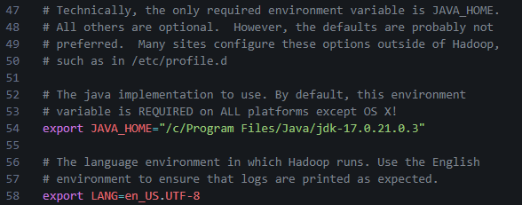

#### Pembahasan

---

### 8. Jalankan daemon untuk HDFS

Untuk menjalankan daemon untuk HDFS dapat menggunakan perintah:

```bash
start-dfs.sh
```


#### Pembahasan

---

Pemantauan bisa dilakukan menggunakan Web **_http://localhost:9870/dfshealth.html#tab-overview_**

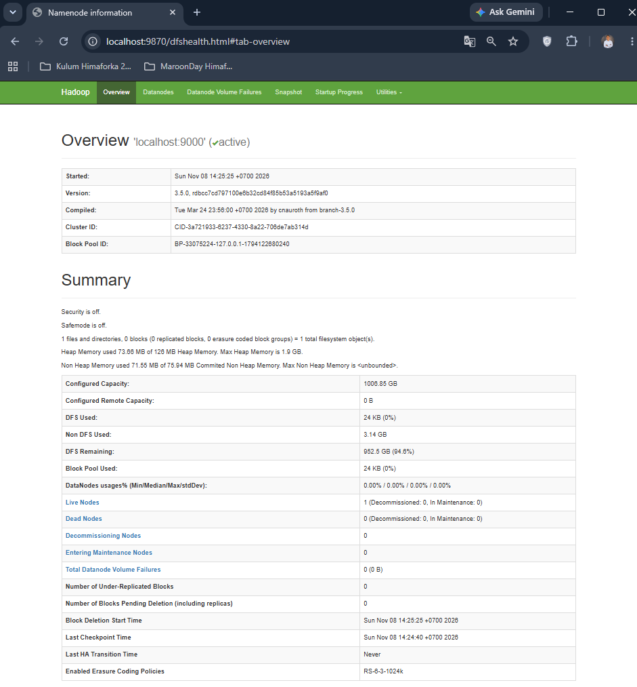

#### Pembahasan

---

### 9. Selesai


#### Pembahasan

---

Untuk menghentikan HDFS gunakan perintah:

```bash
stop-dfs.sh
```

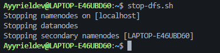

#### Pembahasan

---

# 📜 PEMBAHASAN TUGAS

### 1. Buat direktori di HDFS

Untuk membuat direkori gunakan perintah

```bash
hdfs dfs -mkdir -p /user/Ayyrieldev/datasets
```


#### Pembahasan

---

### 2. Cari 3 file .csv di Internet dan kemudian copykan 3 file tersebut ke direktori yang baru saja dibuat pada tugas 1.

Unduh 3 file CSV menggunakan perintah:

```bash
curl -o iris.csv https://raw.githubusercontent.com/mwaskom/seaborn-data/master/iris.csv
curl -o titanic.csv https://raw.githubusercontent.com/datasciencedojo/datasets/master/titanic.csv
curl -o housing.csv https://raw.githubusercontent.com/selva86/datasets/master/BostonHousing.csv
```

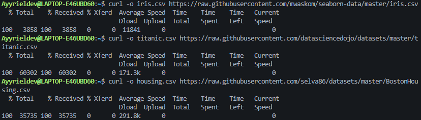

#### Pembahasan

---

Kemudian menyalin 3 file CSV ke HDFS dengan perintah:

```bash
hdfs dfs -put iris.csv titanic.csv housing.csv /user/Ayyrieldev/datasets/
```


#### Pembahasan

---

Lalu memverifikasi isi folder HDFS dengan perintah:

```bash
hdfs dfs -ls /user/Ayyrieldev/datasets
```

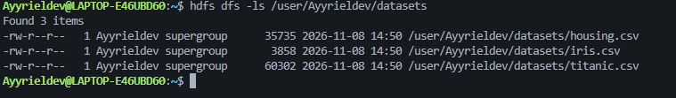

#### Pembahasan

---

Lalu cek hasilnya di web **_http://localhost:9870_**, kemudian klik menu **_Utilities_**, lalu pilih **_Browse the file system_**

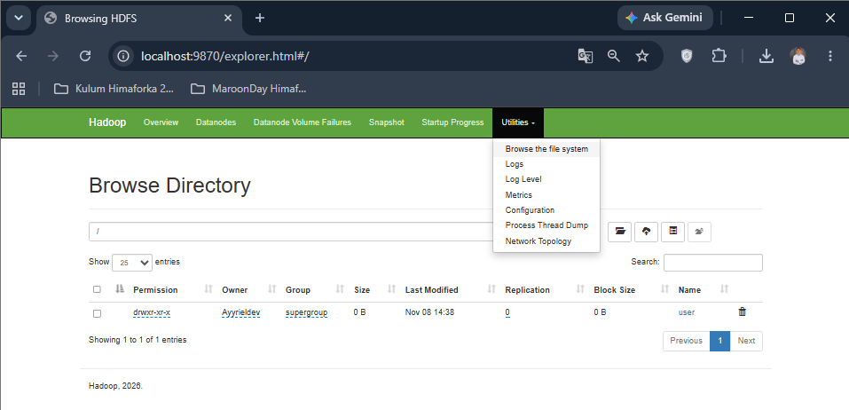

#### Pembahasan

---

Pada kolom isian lokasi direktori (Path), ketik:

```
/user/Ayyrieldev/datasets
```

dan klik Go

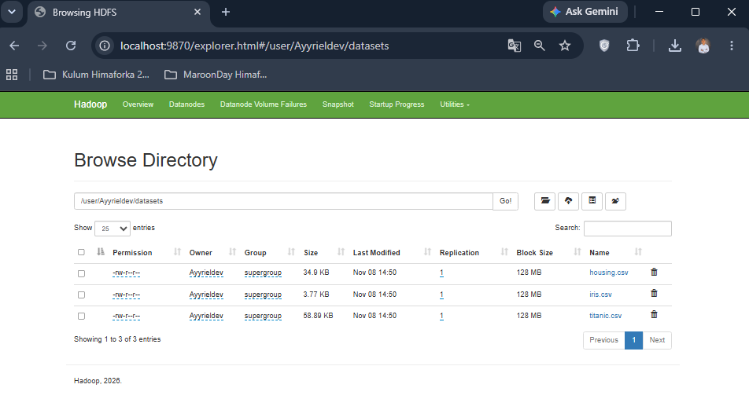

#### Pembahasan

---

## 📝 Kesimpulan

---

## 🗒️ Referensi
