# Praktikum Minggu 07 - Cloud Computing

<p align="justify"><strong>Mata Kuliah:</strong> Praktikum Sistem Terdistribusi dan Terdesentralisasi</p>

<p align="justify"><strong>Topik:</strong> Cloud Computing</p>

---

## 🎯 Tujuan Praktikum

1. Memahami konsep Cloud Computing dan model layanan XaaS (SaaS, PaaS, IaaS) beserta contoh penerapannya di dunia nyata.
2. Memahami posisi containerized app sebagai salah satu penyusun layanan cloud.
3. Mampu menyiapkan aplikasi web Flask (blog tutorial) beserta environment Python yang terisolasi.
4. Mampu mengemas aplikasi tersebut menjadi image container menggunakan Dockerfile.
5. Mampu menjalankan hasil containerisasi dengan Docker dan Podman, termasuk pemetaan port ke host.
6. Membandingkan karakteristik Docker dan Podman berdasarkan pengalaman langsung saat praktikum.

---

## 📚 Dasar Teori

### Cloud Computing dan XaaS

<p align="justify">Cloud Computing adalah cara menyediakan sumber daya komputasi (server, storage, jaringan, bahkan aplikasi) sebagai layanan yang bisa dipakai lewat jaringan tanpa harus memiliki perangkatnya sendiri. Istilah yang sering dipakai adalah XaaS atau <em>Everything as a Service</em>: penyedia (provider) mengurus bagian teknisnya, sedangkan pengguna cukup memakai sesuai kebutuhan dan biasanya membayar sesuai pemakaian.</p>

### SaaS, PaaS, dan IaaS

<p align="justify">Pembagian yang paling umum ada tiga lapisan. IaaS berada paling bawah dan menyediakan infrastruktur mentah seperti mesin virtual, jaringan, dan penyimpanan — pengguna masih mengelola sistem operasi ke atas. PaaS berada di tengah dan menambahkan runtime, middleware, serta alat deployment, sehingga pengembang hanya fokus pada kode aplikasi. SaaS berada paling atas dan langsung berupa aplikasi siap pakai, misalnya surel atau aplikasi kantor berbasis web. Semakin ke atas, semakin banyak tanggung jawab yang berpindah dari pengguna ke provider.</p>

### Container dan Containerized App

<p align="justify">Container adalah cara mengemas aplikasi bersama seluruh dependensinya (library, konfigurasi, runtime) sehingga bisa berjalan sama di mesin mana pun. Berbeda dengan mesin virtual yang memvirtualisasi perangkat keras dan menjalankan sistem operasi penuh, container berbagi kernel host sehingga jauh lebih ringan dan cepat dinyalakan. Containerized app (CA) dibangun dari image yang tersusun atas beberapa layer; setiap instruksi pada Dockerfile menghasilkan satu layer, dan layer yang tidak berubah bisa dipakai ulang dari cache.</p>

### Docker dan Podman

<p align="justify">Docker adalah container engine yang paling banyak dipakai. Cara kerjanya bergantung pada daemon (<code>dockerd</code>) yang berjalan di latar belakang, dan pengguna biasanya berkomunikasi dengan daemon itu melalui perintah <code>docker</code>. Podman menawarkan fungsi serupa tetapi tanpa daemon (<em>daemonless</em>) dan bisa dijalankan tanpa hak root (<em>rootless</em>), sehingga sering dianggap lebih aman untuk lingkungan pribadi. Keduanya sama-sama memakai format image OCI, jadi Dockerfile yang sama dapat dipakai untuk membangun image di keduanya. Di Windows, Podman tidak bisa berjalan langsung karena butuh kernel Linux, sehingga dipakai <code>podman machine</code>, yaitu mesin virtual kecil yang menjalankan container engine di dalamnya.</p>

### Aplikasi Flask dan Pemetaan Port

<p align="justify">Aplikasi yang dipakai adalah <code>flaskr</code>, blog sederhana dari tutorial resmi Flask. Aplikasinya memakai SQLite sebagai basis data, sehingga perlu langkah <code>init-db</code> untuk membuat tabel dari <code>schema.sql</code> sebelum dijalankan. Server pengembangan Flask secara bawaan hanya mendengarkan di <code>127.0.0.1:5000</code>. Di dalam container, alamat itu harus diganti menjadi <code>0.0.0.0</code> agar bisa diakses dari luar container. Akses dari host dilakukan lewat pemetaan port dengan format <code>-p port_host:port_container</code>, misalnya <code>-p 5001:5000</code> berarti port 5001 di komputer kita diteruskan ke port 5000 di dalam container.</p>

---

## 📜 Pembahasan Tugas

### 0. Pengantar

**1. Carilah berbagai contoh vendor/komunitas SaaS, PaaS, dan laaS masing-masing 1 saja**

#### Pembahasan

<p align="justify">Contoh vendor atau komunitas SaaS, PaaS, dan laaS:</p>

- SaaS (Software as a Service): Nextcloud (Komunitas Open Source) atau Google Workspace (Vendor Komersial).

- PaaS (Platform as a Service): Heroku (Salesforce) atau Dokku (Komunitas Open Source).

- IaaS (Infrastructure as a Service): Amazon Web Services (AWS) atau OpenStack (Komunitas Open Source).

---

**2. Uraikan apa yang menjadi service dari berbagai vendor untuk berbagai kategori XaaS tersebut**

#### Pembahasan

- **_SaaS - Google Workspace_**
  - **Layanan Utama**: Menyediakan paket aplikasi produktivitas dan kolaborasi berbasis cloud yang siap pakai langsung melalui browser tanpa perlu instalasi atau pemeliharaan server oleh pengguna (seperti Gmail, Google Docs, Google Drive, dan Google Meet).
  - **Cakupan Pengelolaan**: Seluruh lapisan sistem, mulai dari infrastruktur fisik, sistem operasi, keamanan data, pembaruan fitur hingga antarmuka aplikasi dikelola sepenuhnya oleh pihak Google.

- **_PaaS — Heroku_**
  - **Layanan Utama**: Menyediakan lingkungan runtime dan platform deployment aplikasi yang terkelola (seperti dukungan bahasa Python, Node.js, Go, layanan database PostgreSQL terkelola, serta integrasi Git push otomatis).
  - **Cakupan Pengelolaan**: Heroku mengelola infrastruktur server, jaringan, sistem operasi, container runtime (Dyno), dan middleware.

- **_IaaS — Amazon Web Services (AWS EC2 & VPC)_**
  - **Layanan Utama**: Menyediakan sumber daya infrastruktur komputasi dasar secara virtual melalui internet, meliputi mesin virtual (Amazon EC2), penyimpanan blok dan objek (Amazon EBS / S3), serta jaringan virtual (Amazon VPC).
  - **Cakupan Pengelolaan**: AWS bertanggung jawab atas pusat data fisik, perangkat keras server, jaringan fisik, dan lapisan virtualisasi (hypervisor).

---

**3. Jelaskan secara umum arsitektur dari XaaS tersebut dalam bentuk visualisasi gambar.**

<p align="center">
  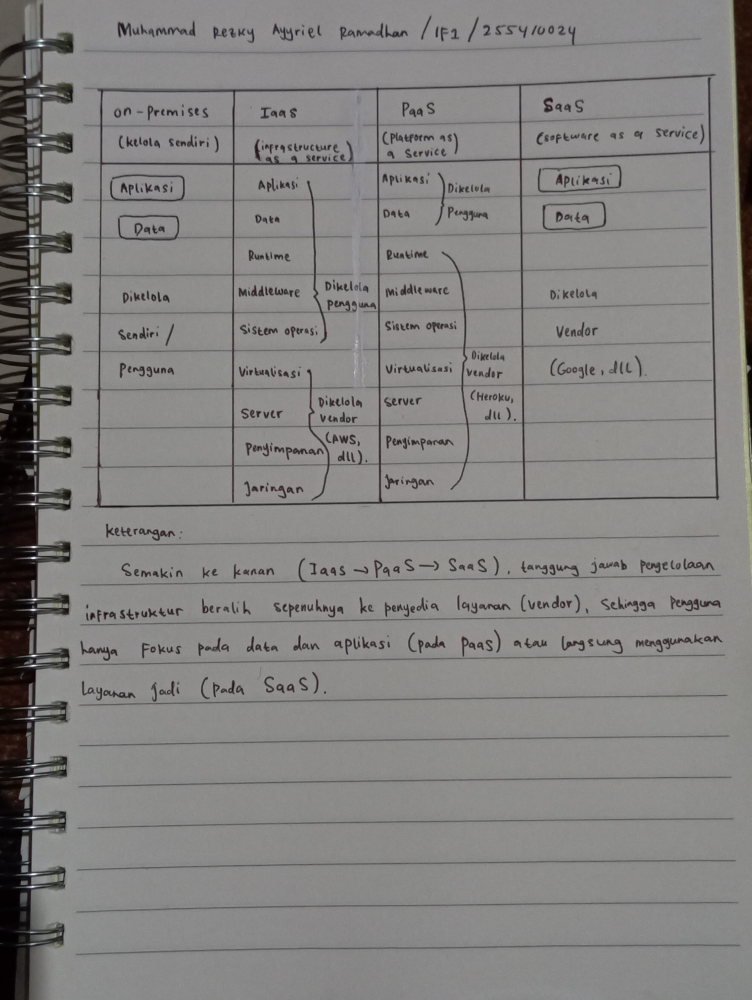
  <br>
  <em>Gambar 1. Visualisasi arsitektur XaaS: lapisan IaaS, PaaS, dan SaaS beserta pembagian tanggung jawabnya.</em>
</p>

#### Pembahasan

<p align="justify">Gambar tersebut memvisualisasikan tiga lapisan XaaS sebagai tingkatan tanggung jawab. Di lapisan bawah ada IaaS yang menyediakan infrastruktur dasar seperti server dan jaringan, lalu di tengah PaaS yang menambahkan runtime dan alat pengembangan, dan di lapisan atas SaaS yang langsung berupa aplikasi jadi. Inti gambar ini sebenarnya semakin tinggi lapisan yang dipakai, semakin sedikit bagian yang harus kita urus sendiri, karena pengelolaan sistem operasi, middleware, sampai pemeliharaan aplikasi berpindah ke pihak provider.</p>

---

## ⏩ Pembahasan Praktikum

<p align="justify">Selanjutnya mengclone repository github <a href="https://github.com/pallets/flask">https://github.com/pallets/flask</a></p>

<p align="justify">Gunakan perintah</p>

```bash
git clone https://github.com/pallets/flask
```

<p align="center">
  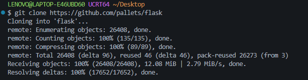
  <br>
  <em>Gambar 2. Proses clone repository Flask dari GitHub.</em>
</p>

#### Pembahasan

<p align="justify">Repository Flask di-clone karena di dalamnya sudah tersedia kode contoh yang dibutuhkan, termasuk <code>examples/tutorial</code>. Proses clone menarik sekitar 26 ribu object dengan total ±11,7 MiB, yang wajar karena satu repository memuat seluruh riwayat perubahan. Dengan cara ini kita tidak perlu menulis ulang aplikasi dari nol, sekaligus memastikan kode yang dipakai benar-benar versi resmi dari pengembang Flask.</p>

---

<p align="justify">Kemudian mengcopy direktori ke direktori tertentu</p>

```bash
cp -R ~/Desktop/flask/examples/tutorial flask-app
```

<p align="center">
  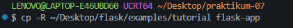
  <br>
  <em>Gambar 3. Menyalin direktori contoh tutorial ke flask-app.</em>
</p>

#### Pembahasan

<p align="justify">Setelah clone selesai, hanya direktori <code>examples/tutorial</code> yang disalin ke <code>flask-app</code> memakai <code>cp -R</code>. Opsi <code>-R</code> penting karena direktori tutorial punya subdirektori seperti <code>flaskr</code>, <code>templates</code>, dan <code>tests</code> yang harus ikut tersalin. Memisahkan diri dari repository aslinya juga membuat folder kerja jadi lebih rapi dan aman, jadi kalau ada kesalahan saat eksperimen, kode sumber asli tetap utuh.</p>

---

<p align="justify">Selanjutnya cek isi file pada direktori dengan perintah</p>

```bash
ls -la
```

<p align="center">
  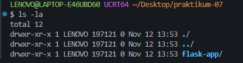
  <br>
  <em>Gambar 4. Pemeriksaan direktori kerja menggunakan ls -la.</em>
</p>

#### Pembahasan

<p align="justify">Pemeriksaan dengan <code>ls -la</code> dilakukan untuk memastikan direktori <code>flask-app</code> benar-benar terbentuk di lokasi yang kita inginkan. Perintah ini menampilkan isi direktori beserta izin akses dan waktu modifikasinya, sehingga kalau ada yang salah lokasi atau salah nama, langsung kelihatan sebelum langkah berikutnya dijalankan.</p>

---

### 1. Membuat env Python 3.14.4

<p align="justify">Buat env untuk keperluan mata kuliah pertemuan ini. Python yang digunakan adalah Python versi 3.14.4.</p>

<p align="justify">Gunakan perintah</p>

```bash
uv venv --python 3.14.4
```

<p align="center">
  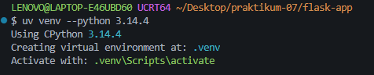
  <br>
  <em>Gambar 5. Pembuatan virtual environment Python 3.14.4 dengan uv.</em>
</p>

#### Pembahasan

<p align="justify">Environment Python dibuat dengan <code>uv venv --python 3.14.4</code> agar dependensi proyek ini tidak bercampur dengan Python sistem. Isolasi ini terasa manfaatnya ketika ada dua proyek yang butuh versi library berbeda, karena masing-masing punya <code>.venv</code> sendiri. <code>uv</code> dipakai karena proses pembuatan environment dan pemasangan paketnya jauh lebih cepat dibanding cara konvensional.</p>

---

<p align="justify">Lalu mengaktifkan virtual environment</p>

```bash
source .venv/Scripts/activate
```

<p align="center">
  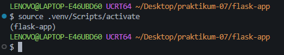
  <br>
  <em>Gambar 6. Mengaktifkan virtual environment pada shell.</em>
</p>

#### Pembahasan

<p align="justify">Virtual environment kemudian diaktifkan dengan <code>source .venv/Scripts/activate</code>. Di Windows, folder yang dipakai adalah <code>Scripts</code>, berbeda dengan Linux yang memakai <code>bin</code>. Setelah aktif, biasanya muncul penanda <code>(.venv)</code> di depan prompt, dan mulai dari titik ini perintah <code>python</code>, <code>flask</code>, maupun <code>uv</code> akan mengarah ke environment proyek, bukan ke Python global.</p>

---

<p align="justify">Kemudian memeriksa isi folder</p>

```bash
ls -la
```

<p align="center">
  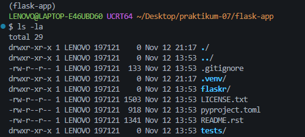
  <br>
  <em>Gambar 7. Struktur proyek Flask tutorial setelah environment aktif.</em>
</p>

#### Pembahasan

<p align="justify">Isi folder diperiksa sekali lagi setelah environment aktif. Di sini terlihat struktur proyek tutorial seperti <code>flaskr/</code>, <code>tests/</code>, <code>pyproject.toml</code>, dan folder <code>.venv</code> yang baru dibuat. Pemeriksaan ini sederhana, tapi cukup penting untuk memastikan <code>pyproject.toml</code> ada di lokasi yang benar, karena file itulah yang dibaca saat proses instalasi paket nanti.</p>

---

### 2. Install Paket yang Diperlukan

<p align="justify">Install paket yang diperlukan terlebih dahulu menggunakan perintah</p>

```bash
uv pip install -e .
```

<p align="center">
  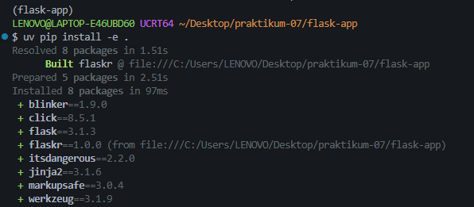
  <br>
  <em>Gambar 8. Pemasangan paket proyek dengan uv pip install -e .</em>
</p>

#### Pembahasan

<p align="justify">Instalasi dilakukan dengan <code>uv pip install -e .</code>, dan tanda titik di akhir berarti “proyek di direktori saat ini”. Opsi <code>-e</code> (editable) membuat paket <code>flaskr</code> dipasang sebagai tautan ke folder sumber, jadi kalau kode diubah, perubahannya langsung terpakai tanpa perlu install ulang. Dari proses ini terlihat dependensi Flask ikut terpasang, seperti Jinja2, Werkzeug, Click, itsdangerous, blinker, dan MarkupSafe.</p>

---

<p align="justify">Kemudian lakukan inisialisasi database aplikasi dengan perintah</p>

```bash
flask --app flaskr init-db
```

<p align="center">
  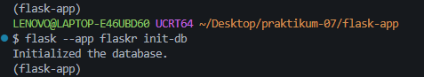
  <br>
  <em>Gambar 9. Inisialisasi basis data SQLite aplikasi flaskr.</em>
</p>

#### Pembahasan

<p align="justify">Sebelum aplikasi dijalankan, basis data harus dibuat dulu dengan <code>flask --app flaskr init-db</code>. Perintah ini menjalankan <code>schema.sql</code> untuk membentuk tabel <code>user</code> dan <code>post</code> di file SQLite. Kalau langkah ini dilewati, halaman web akan tampil tetapi operasi yang menyentuh basis data akan gagal karena tabelnya belum ada.</p>

---

<p align="justify">Lalu menjalankan server web Flask dengan perintah</p>

```bash
flask --app flaskr run
```

<p align="center">
  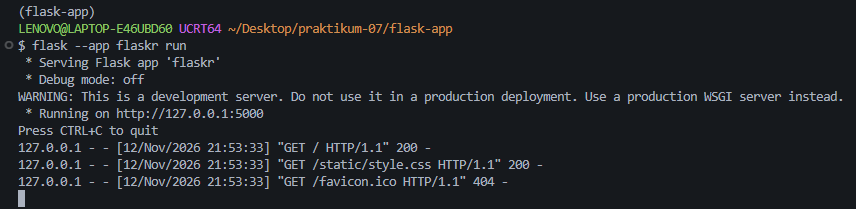
  <br>
  <em>Gambar 10. Server pengembangan Flask berjalan di 127.0.0.1:5000.</em>
</p>

<p align="justify">Kita bisa melihat aplikasi yang berjalan pada browser:</p>

<p align="center">
  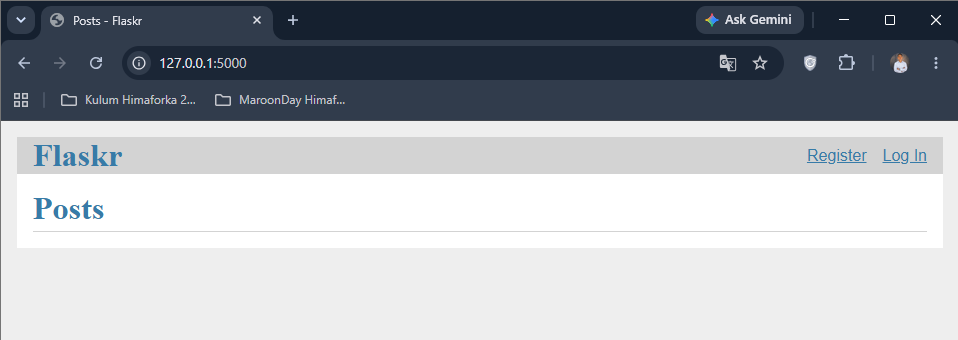
  <br>
  <em>Gambar 11. Halaman utama aplikasi saat diakses dari browser.</em>
</p>

#### Pembahasan

<p align="justify">Aplikasi dijalankan dengan <code>flask --app flaskr run</code>, dan server pengembangan Flask langsung mendengarkan di <code>http://127.0.0.1:5000</code>. Mode ini memang ditujukan untuk pengembangan, bukan produksi, karena belum menangani banyak koneksi secara serius dan menampilkan informasi debug. Meski begitu, untuk keperluan praktikum ini sudah lebih dari cukup.</p>

---

<p align="justify">Untuk mencoba, pilih “Register” kemudian “Log In”</p>

<p align="center">
  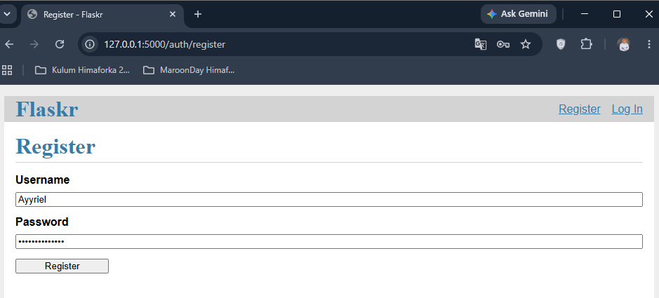
  <br>
  <em>Gambar 12. Halaman registrasi pengguna baru.</em>
</p>

<p align="justify">Kemudian Login dan masukan data yang telah didaftarkan sebelumnya</p>

<p align="center">
  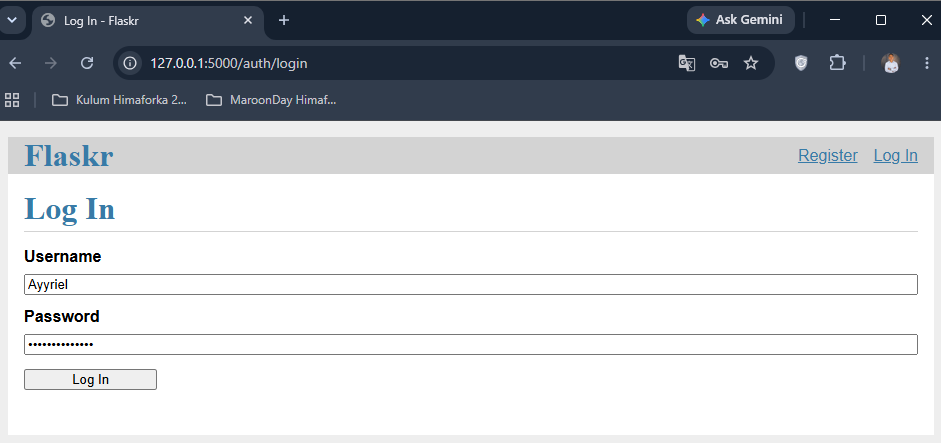
  <br>
  <em>Gambar 13. Formulir login dengan data pengguna terdaftar.</em>
</p>

<p align="justify">Setelah login tampilan nya akan berubah menjadi seperti ini</p>

<p align="center">
  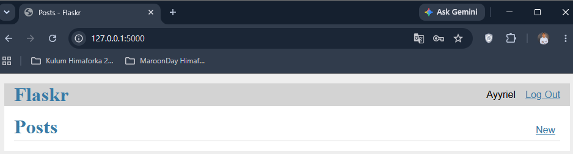
  <br>
  <em>Gambar 14. Tampilan aplikasi setelah berhasil login.</em>
</p>

#### Pembahasan

<p align="justify">Halaman utama aplikasi menampilkan daftar post kosong dengan tautan Register dan Log In, tanda bahwa aplikasi benar-benar berjalan. Setelah mendaftar lalu masuk, tampilan berubah dan muncul menu untuk menambah post dan tombol Log Out. Perubahan ini menunjukkan bahwa sesi login tersimpan dan aplikasi sudah bisa membedakan pengguna yang belum dan sudah terautentikasi.</p>

---

### 3. Buat Aplikasi Menjadi CA - Docker

<p align="justify">Buat File DockerFile terlebih dahulu pada direktori flask-app dengan perintah</p>

```bash
touch Dockerfile
```

<p align="center">
  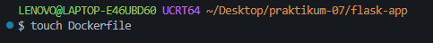
  <br>
  <em>Gambar 15. Pembuatan file Dockerfile di direktori aplikasi.</em>
</p>

#### Pembahasan

<p align="justify">Langkah pertama containerisasi adalah membuat file <code>Dockerfile</code> di direktori utama aplikasi. File ini harus berada satu level dengan <code>pyproject.toml</code>, karena instruksi <code>ADD . /app/</code> akan menyalin seluruh isi direktori tempat build dijalankan. Kalau posisinya salah, isi image bisa tidak lengkap walaupun proses build tetap berhasil.</p>

---

<p align="justify">Kemudian isi file DockerFile dengan kode</p>

```
FROM python:3.14
RUN mkdir /app
WORKDIR /app
ADD . /app/
RUN pip install -e .
RUN flask --app flaskr init-db
EXPOSE 5000
CMD ["flask", "--app", "flaskr", "run", "--host=0.0.0.0", "--port=5000"]
```

<p align="center">
  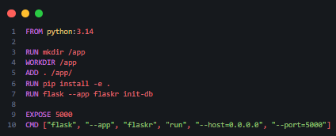
  <br>
  <em>Gambar 16. Isi Dockerfile untuk membangun image flaskr.</em>
</p>

#### Pembahasan

<p align="justify">Isi Dockerfile-nya cukup singkat, memakai image dasar <code>python:3.14</code>, membuat direktori kerja <code>/app</code>, menyalin seluruh kode ke sana, lalu memasang paket dengan <code>pip install -e .</code>. Ada dua detail yang menentukan. Pertama, <code>flask --app flaskr init-db</code> dijalankan saat build, artinya file basis data ikut tertanam di dalam image sehingga container langsung siap pakai. Kedua, opsi <code>--host=0.0.0.0</code> wajib ada, karena tanpa itu server hanya mendengarkan di dalam container dan tidak bisa diakses dari luar. Untuk kebutuhan produksi, init-db sebaiknya dipindah ke saat runtime dan datanya ditaruh di volume, supaya data tidak hilang saat container dibuat ulang.</p>

---

<p align="justify">Lalu Build Docker Image gunakan perintah</p>

```bash
docker build -f Dockerfile -t flaskr:1.0.0 .
```

<p align="center">
  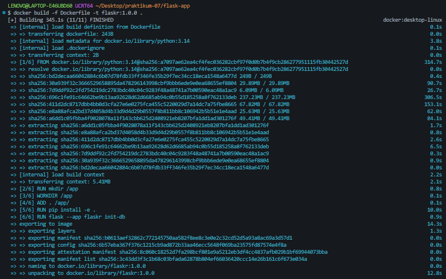
  <br>
  <em>Gambar 17. Proses docker build hingga image selesai dibuat.</em>
</p>

#### Pembahasan

<p align="justify">Sebelum build, service <code>dockerd</code> harus aktif lebih dulu karena semua perintah Docker berjalan lewat daemon itu. Build dijalankan dengan <code>docker build -f Dockerfile -t flaskr:1.0.0 .</code>, di mana <code>-t</code> memberi nama dan tag pada image agar mudah dirujuk, sedangkan titik di akhir menentukan build context. Prosesnya berjalan per layer, dan layer yang tidak berubah akan diambil dari cache sehingga build berikutnya bisa jauh lebih cepat.</p>

---

<p align="justify">Kemudian periksa daftar Docker Image dengan perintah</p>

```bash
docker image ls
```

<p align="center">
  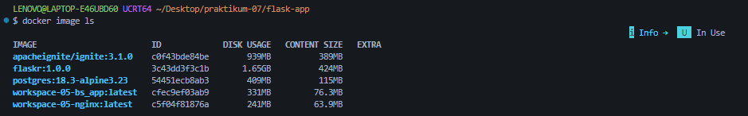
  <br>
  <em>Gambar 18. Daftar image Docker hasil build dengan docker image ls.</em>
</p>

#### Pembahasan

<p align="justify">Daftar image diperiksa dengan <code>docker image ls</code>. Dari situ terlihat nama image, tag, ukuran, dan image ID. Ukurannya cukup besar karena di dalamnya sudah ada sistem operasi dasar plus Python beserta seluruh dependensinya. Image ID inilah yang nanti dipakai kalau image tersebut ingin dihapus.</p>

---

<p align="justify">jika ada banyak image container di node, hapus yang tidak digunakan lagi dengan mengacu pada ID dari image tersebut dengan perintah</p>

```bash
docker rmi <ID_IMAGE>
```

<p align="justify">Contoh:</p>

<p align="center">
  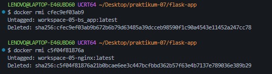
  <br>
  <em>Gambar 19. Penghapusan image yang tidak dipakai dengan docker rmi.</em>
</p>

#### Pembahasan

<p align="justify">Image yang sudah tidak dipakai dibersihkan dengan <code>docker rmi &lt;ID_IMAGE&gt;</code>. Langkah ini berguna karena setiap proses build meninggalkan layer dan image lama yang lama-lama memakan ruang disk. Satu catatan penting yaitu image yang masih dipakai container tidak bisa dihapus begitu saja, container-nya harus dihentikan dan dihapus lebih dulu.</p>

---

<p align="justify">Kemudian tampilkan daftar docker image after dilakukan beberapa penghapusan</p>

<p align="center">
  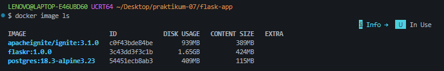
  <br>
  <em>Gambar 20. Daftar image setelah pembersihan.</em>
</p>

#### Pembahasan

<p align="justify">Setelah beberapa image dihapus, daftar image jadi lebih pendek dan hanya menyisakan yang benar-benar dibutuhkan, yaitu <code>flaskr:1.0.0</code> beserta image dasar yang masih terpakai. Ini memperlihatkan bahwa pengelolaan image bukan sekadar urusan build, tetapi juga soal merawat lingkungan kerja agar tidak menumpuk sampah.</p>

---

### 4. Menjalankan Image

<p align="justify">Jalankan dengan memetakan port 5000 pada aplikasi di container ke port 5001 di localhost:</p>

<p align="justify">Gunakan perintah</p>

```bash
docker run -p 5001:5000 flaskr:1.0.0
```

<p align="center">
  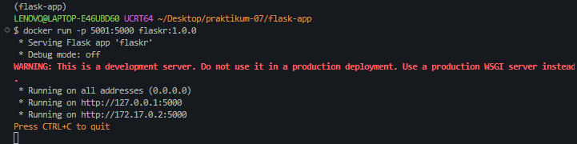
  <br>
  <em>Gambar 21. Menjalankan container dengan pemetaan port 5001:5000.</em>
</p>

#### Pembahasan

<p align="justify">Image dijalankan dengan <code>docker run -p 5001:5000 flaskr:1.0.0</code>. Format pemetaan port dibaca dari kiri ke kanan sebagai <code>host:container</code>, jadi port 5001 di komputer kita diteruskan ke port 5000 di dalam container. Angka 5001 dipilih agar tidak bentrok dengan server Flask lokal yang mungkin masih berjalan di port 5000. Container berjalan di foreground, sehingga log-nya langsung terlihat dan bisa dihentikan dengan Ctrl+C.</p>

---

<p align="justify">Kemudian akses web browser pada <a href="http://localhost:5001">http://localhost:5001</a></p>

<p align="center">
  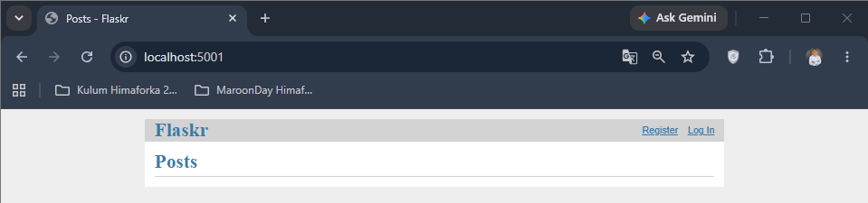
  <br>
  <em>Gambar 22. Aplikasi diakses melalui http://localhost:5001.</em>
</p>

#### Pembahasan

<p align="justify">Halaman yang tampil di <code>http://localhost:5001</code> sama persis dengan versi yang dijalankan langsung tanpa container. Ini bukti bahwa pemetaan port bekerja melalui permintaan dari browser masuk ke host, diteruskan ke dalam container, lalu dijawab oleh aplikasi Flask di sana. Dari sisi pengguna tidak ada bedanya sama sekali, dan justru itulah tujuan containerisasi.</p>

---

<p align="justify">Lalu di terminal tempat menjalankan Tugas akan muncul</p>

<p align="center">
  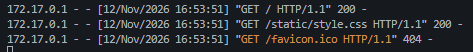
  <br>
  <em>Gambar 23. Log permintaan HTTP yang tercatat di terminal container.</em>
</p>

#### Pembahasan

<p align="justify">Di terminal tempat container dijalankan muncul catatan akses seperti <code>GET / HTTP/1.1</code> beserta kode statusnya setiap kali browser membuka halaman. Log ini menunjukkan bahwa seluruh keluaran aplikasi tetap bisa dipantau walaupun aplikasinya berada di dalam container. Untuk keperluan debugging, kebiasaan melihat log seperti ini cukup membantu karena kita bisa tahu apakah permintaan benar-benar sampai atau justru gagal di tengah jalan.</p>

---

### 5. Buat Aplikasi Menjadi CA - Podman

<p align="justify">Jika menggunakan Podman, maka dockerd tidak perlu diaktifkan. Jika dockerd aktif, matikan service-nya terlebih dahulu</p>

<p align="justify">Kemudian install Podman terlebih dahulu dengan perintah</p>

```bash
winget install RedHat.Podman
```

<p align="center">
  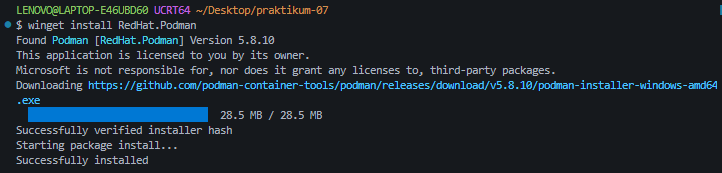
  <br>
  <em>Gambar 24. Instalasi Podman di Windows melalui winget.</em>
</p>

#### Pembahasan

<p align="justify">Bagian berikutnya mengulang hal yang sama dengan Podman, yang dipasang di Windows memakai <code>winget install RedHat.Podman</code>. Podman dipilih sebagai pembanding karena cara kerjanya berbeda yaitu tanpa daemon dan bisa berjalan tanpa hak root. Karena Windows tidak punya kernel Linux, Podman di sini tetap membutuhkan mesin virtual sebagai tempat menjalankan container.</p>

---

<p align="justify">Kemudian nyalakan mesin Podman dengan cara memanggil lokasi instalasi bawaan Podman dengan perintah</p>

```bash
"/c/Program Files/RedHat/Podman/podman.exe" machine init
```

<p align="center">
  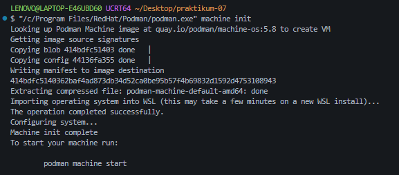
  <br>
  <em>Gambar 25. Pembuatan mesin virtual Podman dengan podman machine init.</em>
</p>

<p align="justify">dan</p>

```bash
"/c/Program Files/RedHat/Podman/podman.exe" machine start
```

<p align="center">
  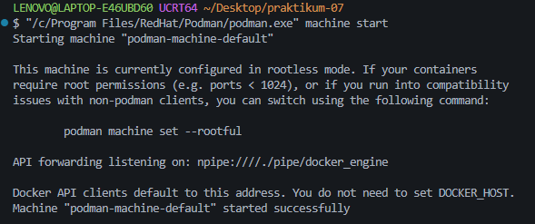
  <br>
  <em>Gambar 26. Menyalakan mesin virtual Podman dengan podman machine start.</em>
</p>

#### Pembahasan

<p align="justify">Mesin virtual Podman dibuat dengan <code>podman machine init</code>, lalu dinyalakan dengan <code>podman machine start</code>. Perintah <code>init</code> menyiapkan VM kecil lengkap dengan container engine di dalamnya, sedangkan <code>start</code> menghidupkannya agar perintah Podman berikutnya bisa dipakai. Karena lokasi instalasi Podman di Windows tidak otomatis masuk ke <code>PATH</code>, keduanya dipanggil dengan menuliskan path lengkap ke <code>podman.exe</code>. Kalau VM belum menyala, <code>podman build</code> maupun <code>podman run</code> akan gagal karena tidak ada engine yang bisa dihubungi.</p>

---

<p align="justify">Lalu membangun image dengan perintah</p>

```bash
podman build -f Dockerfile -t flaskr:1.0.0 .
```

<p align="center">
  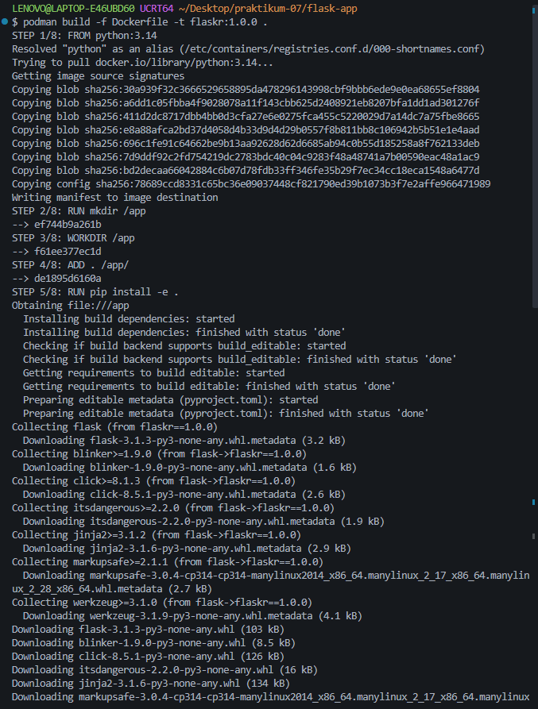
  <br>
  <em>Gambar 27. Proses podman build memakai Dockerfile yang sama.</em>
</p>

<p align="center">
  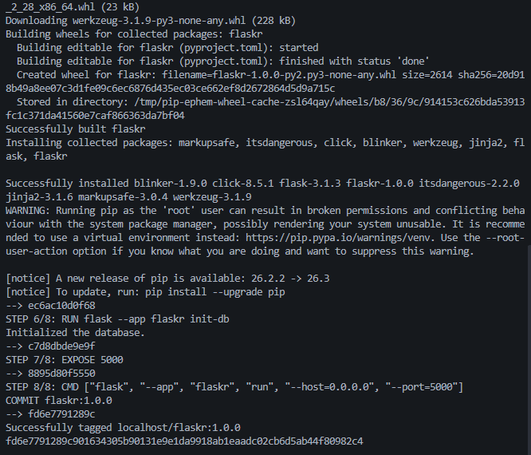
  <br>
  <em>Gambar 28. Kelanjutan proses build hingga image selesai.</em>
</p>

#### Pembahasan

<p align="justify">Image dibangun dengan <code>podman build -f Dockerfile -t flaskr:1.0.0 .</code>, memakai Dockerfile yang sama persis seperti sebelumnya. Ini memperlihatkan bahwa Dockerfile pada dasarnya hanyalah resep, dan resep yang sama bisa dijalankan oleh engine yang berbeda. Bedanya, Podman menamai image hasil build sebagai <code>localhost/flaskr:1.0.0</code> karena image tersebut memang tersimpan di registry lokal, bukan di Docker Hub.</p>

---

<p align="justify">Kemudian periksa daftar image podman</p>

<p align="center">
  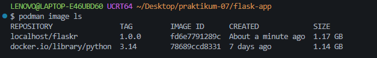
  <br>
  <em>Gambar 29. Daftar image pada Podman.</em>
</p>

#### Pembahasan

<p align="justify">Daftar image Podman diperiksa untuk memastikan hasil build benar-benar ada. Perlu dicatat bahwa daftar ini terpisah dari daftar image Docker, karena keduanya menyimpan image di tempat yang berbeda walaupun formatnya sama. Jadi wajar kalau image yang sudah ada di Docker tidak otomatis muncul di Podman.</p>

---

<p align="justify">Lalu Jalankan Podman pada port 5001 dengan perintah</p>

```bash
podman run -p 5001:5000 flaskr:1.0.0
```

<p align="center">
  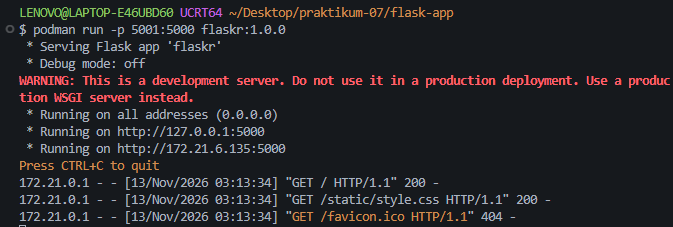
  <br>
  <em>Gambar 30. Menjalankan container Podman dengan pemetaan port 5001:5000.</em>
</p>

#### Pembahasan

<p align="justify">Container dijalankan dengan <code>podman run -p 5001:5000 flaskr:1.0.0</code>, sama seperti sebelumnya. Karena Podman di Windows berjalan di dalam VM, pemetaan port sebenarnya diteruskan dua kali yaitu dari host ke VM, lalu dari VM ke container. Meskipun jalurnya lebih panjang, hasilnya tetap sama dan pengguna tidak merasakan perbedaan apa pun.</p>

---

<p align="justify">Kemudian cek hasil nya pada <a href="http://127.0.0.1:5001">http://127.0.0.1:5001</a> di browser</p>

<p align="center">
  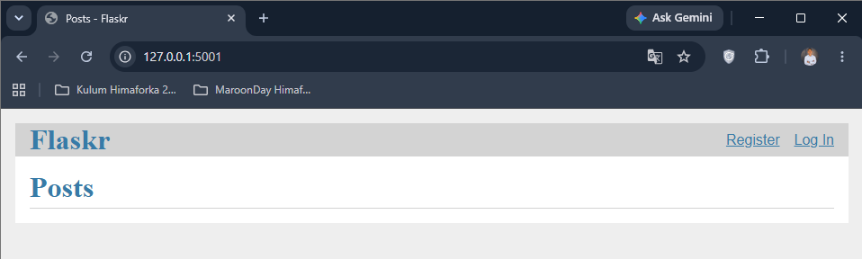
  <br>
  <em>Gambar 31. Aplikasi hasil containerisasi diakses dari browser.</em>
</p>

#### Pembahasan

<p align="justify">Halaman di <code>http://127.0.0.1:5001</code> tampil sama seperti saat dijalankan dengan Docker. Hasil ini menegaskan bahwa image container bersifat portabel aplikasi yang sama dapat dijalankan di engine yang berbeda tanpa mengubah kode maupun Dockerfile. Dari sini terlihat jelas bahwa yang membuat aplikasi “cloud ready” bukanlah Docker atau Podman secara khusus, melainkan cara kita mengemasnya.</p>

---

## 📝 Kesimpulan

<p align="justify">Dari praktikum ini terlihat bahwa Cloud Computing pada dasarnya adalah soal pembagian tanggung jawab. Model XaaS membuat garis itu makin jelas, IaaS menyisakan hampir semua pekerjaan teknis di tangan pengguna, PaaS memangkasnya sampai tinggal kode aplikasi, dan SaaS menghilangkannya sama sekali karena yang dipakai hanyalah aplikasinya. Di lapisan mana kita berada menentukan seberapa besar kendali yang kita miliki sekaligus seberapa besar pekerjaan yang harus ditanggung sendiri.</p>

<p align="justify">Proses mengubah aplikasi Flask menjadi containerized app menunjukkan bagaimana sebuah aplikasi disiapkan agar bisa dijalankan di mana saja. Kuncinya ada pada Dockerfile yang mendokumentasikan seluruh kebutuhan aplikasi, mulai dari image dasar, dependensi, inisialisasi basis data, sampai perintah menjalankannya. Setelah menjadi image, aplikasi tidak lagi bergantung pada kondisi komputer tempat ia dikembangkan.</p>

<p align="justify">Perbandingan Docker dan Podman memperlihatkan bahwa keduanya bisa menyelesaikan pekerjaan yang sama dengan cara yang berbeda. Docker bergantung pada daemon yang berjalan di latar belakang, sedangkan Podman berjalan tanpa daemon dan bisa dipakai tanpa hak root. Karena sama-sama memakai standar image OCI, Dockerfile yang sama bisa dipakai di keduanya, dan hasil akhirnya identik di browser. Satu hal yang perlu diingat untuk penggunaan nyata yaitu basis data sebaiknya tidak ikut ditanam di dalam image, melainkan disimpan di volume terpisah agar datanya tidak hilang ketika container dibuat ulang.</p>

---

## 🗒️ Referensi

1. Bambang Purnomosidi D. P. _Modul 7: Cloud Computing_. Praktikum Sistem Terdistribusi dan Terdesentralisasi, Prodi Informatika, Universitas Teknologi Digital Indonesia.
2. Pallets Projects. _Flask Tutorial_. https://flask.palletsprojects.com/en/stable/tutorial/
3. Pallets Projects. _Contoh Kode Tutorial Flask (v3.1.3)_. https://github.com/pallets/flask/tree/3.1.3/examples/tutorial
4. Docker Inc. _Dockerfile Reference_. https://docs.docker.com/reference/dockerfile/
5. Podman. _Podman Documentation_. https://podman.io/docs
6. Astral. _uv Documentation_. https://docs.astral.sh/uv/
7. NEO-X-School. _Catatan Penggunaan uv_. https://github.com/NEO-X-School/notes/tree/main/uv
8. Open Container Initiative. _OCI Image Format Specification_. https://opencontainers.org/
