# Praktikum Minggu 06 - Distributed File System - HDFS

<p align="justify"><strong>Mata Kuliah:</strong> Praktikum Sistem Terdistribusi dan Terdesentralisasi</p>

<p align="justify"><strong>Topik:</strong> Distributed File System - HDFS</p>

---

## 🎯 Tujuan Praktikum

---

## 📚 Dasar Teori

---

## 📜 PEMBAHASAN TUGAS

### 0. Pengantar

**1. Carilah berbagai contoh vendor/komunitas SaaS, PaaS, dan laaS masing-masing 1 saja**

#### Pembahasan

Contoh vendor atau komunitas SaaS, PaaS, dan laaS:

- SaaS (Software as a Service): Nextcloud (Komunitas Open Source) atau Google Workspace (Vendor Komersial).

- PaaS (Platform as a Service): Heroku (Salesforce) atau Dokku (Komunitas Open Source).

- IaaS (Infrastructure as a Service): Amazon Web Services (AWS) atau OpenStack (Komunitas Open Source).

---

**2. Uraikan apa yang menjadi service dari berbagai vendor untuk berbagai kategori XaaS tersebut**

#### Pembahasan

- **_SaaS - Google Workspace_**
  - **Layanan Utama**: Menyediakan paket aplikasi produktivitas dan kolaborasi berbasis cloud yang siap pakai langsung melalui browser tanpa perlu instalasi atau pemeliharaan server oleh pengguna (seperti Gmail, Google Docs, Google Drive, dan Google Meet).
  - **Cakupan Pengelolaan**: Seluruh lapisan sistem, mulai dari infrastruktur fisik, sistem operasi, keamanan data, pembaruan fitur hingga antarmuka aplikasi dikelola sepenuhnya oleh pihak Google.

- **_PaaS — Heroku_**
  - **Layanan Utama**: Menyediakan lingkungan runtime dan platform deployment aplikasi yang terkelola (seperti dukungan bahasa Python, Node.js, Go, layanan database PostgreSQL terkelola, serta integrasi Git push otomatis).
  - **Cakupan Pengelolaan**: Heroku mengelola infrastruktur server, jaringan, sistem operasi, container runtime (Dyno), dan middleware.

- **_IaaS — Amazon Web Services (AWS EC2 & VPC)_**
  - **Layanan Utama**: Menyediakan sumber daya infrastruktur komputasi dasar secara virtual melalui internet, meliputi mesin virtual (Amazon EC2), penyimpanan blok dan objek (Amazon EBS / S3), serta jaringan virtual (Amazon VPC).
  - **Cakupan Pengelolaan**: AWS bertanggung jawab atas pusat data fisik, perangkat keras server, jaringan fisik, dan lapisan virtualisasi (hypervisor).

---

**3. Jelaskan secara umum arsitektur dari XaaS tersebut dalam bentuk visualisasi gambar.**

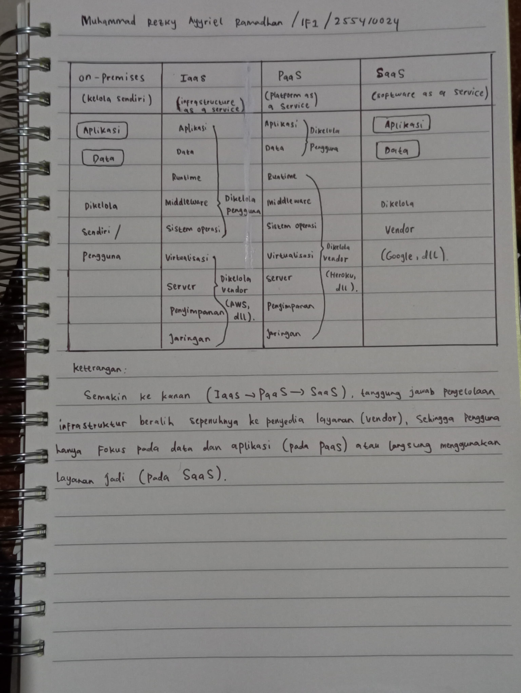

#### Pembahasan

---

Selanjutnya mengclone repository github https://github.com/pallets/flask

Gunakan perintah

```bash
git clone https://github.com/pallets/flask
```

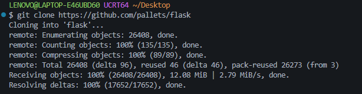

#### Pembahasan

---

Kemudian mengcopy direktori ke direktori tertentu

```bash
cp -R ~/Desktop/flask/examples/tutorial flask-app
```

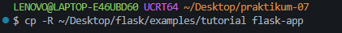

#### Pembahasan

---

Selanjutnya cek isi file pada direktori dengan perintah

```bash
ls -la
```

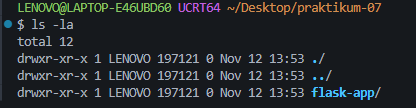

#### Pembahasan

---

## ⏩ PEMBAHASAN PRAKTIKUM

### 1. Membuat env Python 3.14.4

Buat env untuk keperluan mata kuliah pertemuan ini. Python yang digunakan adalah Python versi 3.14.4.

Gunakan perintah

```bash
uv venv --python 3.14.4
```

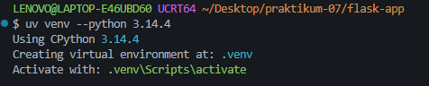

#### Pembahasan

---

Lalu mengaktifkan virtual environment

```bash
source .venv/Scripts/activate
```

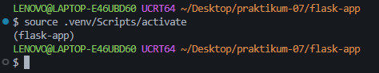

#### Pembahasan

---

Kemudian memeriksa isi folder

```bash
ls -la
```

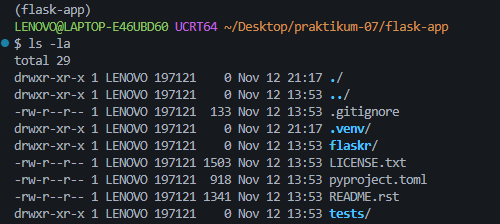

#### Pembahasan

---

### 2. Install Paket yang Diperlukan

Install paket yang diperlukan terlebih dahulu menggunakan perintah

```bash
uv pip install -e .
```

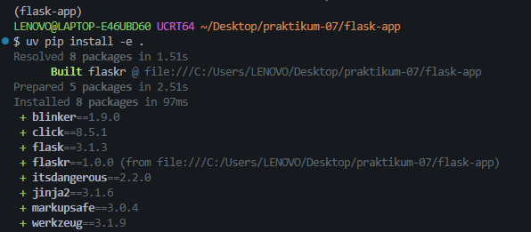

#### Pembahasan

---

Kemudian lakukan inisialisasi database aplikasi dengan perintah

```bash
flask --app flaskr init-db
```

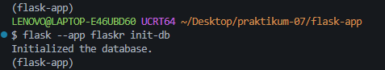

#### Pembahasan

---

Lalu menjalankan server web Flask dengan perintah

```bash
flask --app flaskr run
```

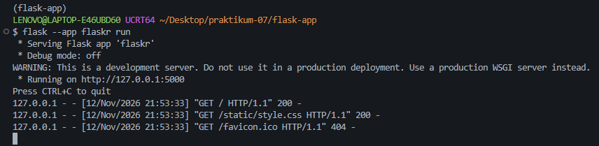

Kita bisa melihat aplikasi yang berjalan pada browser:

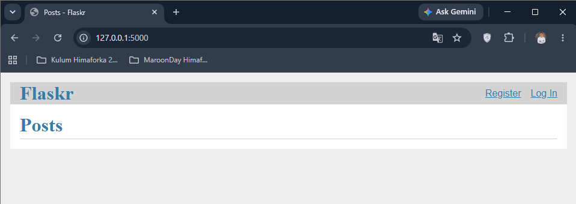

#### Pembahasan

---

Untuk mencoba, pilih “Register” kemudian “Log In”

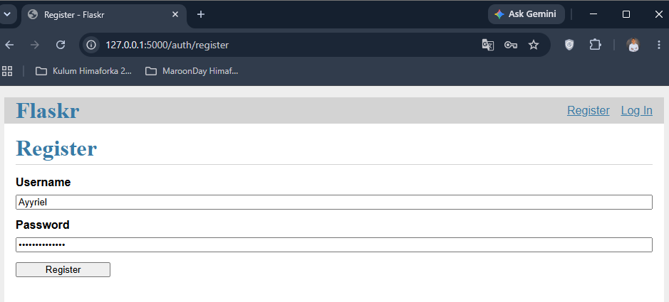

Kemudian Login dan masukan data yang telah didaftarkan sebelumnya

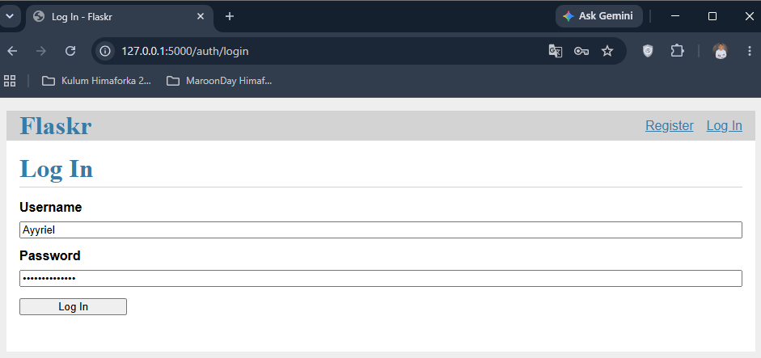

Setelah login tampilan nya akan berubah menjadi seperti ini

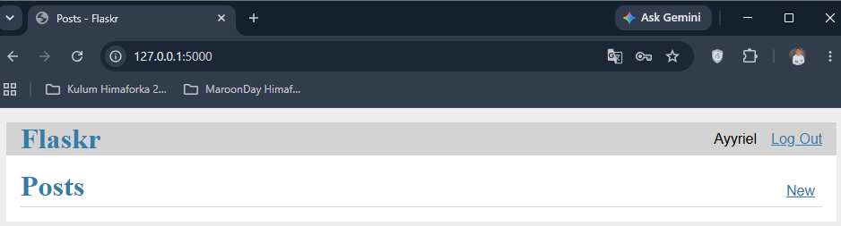

#### Pembahasan

---

### 3. Buat Aplikasi Menjadi CA - Docker

Buat File DockerFile terlebih dahulu pada direktori flask-app dengan perintah

```bash
touch Dockerfile
```

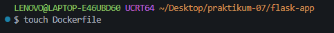

#### Pembahasan

---

Kemudian isi file DockerFile dengan kode

```
FROM python:3.14
RUN mkdir /app
WORKDIR /app
ADD . /app/
RUN pip install -e .
RUN flask --app flaskr init-db
EXPOSE 5000
CMD ["flask", "--app", "flaskr", "run", "--host=0.0.0.0", "--port=5000"]
```

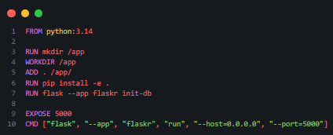

#### Pembahasan

---

Lalu Build Docker Image gunakan perintah

```bash
docker build -f Dockerfile -t flaskr:1.0.0 .
```

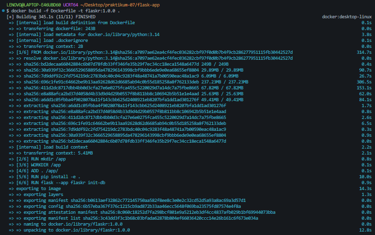

#### Pembahasan

---

Kemudian periksa daftar Docker Image dengan perintah

```bash
docker image ls
```

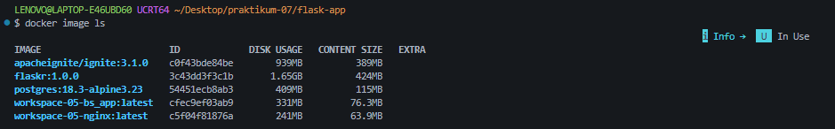

#### Pembahasan

---

jika ada banyak image container di node, hapus yang tidak digunakan lagi dengan mengacu pada ID dari image tersebut dengan perintah

```bash
docker rmi <ID_IMAGE>
```

Contoh:

 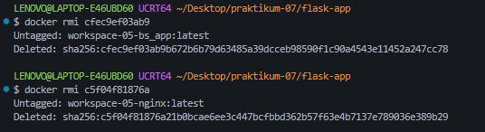

#### Pembahasan

---

Kemudian tampilkan daftar docker image after dilakukan beberapa penghapusan

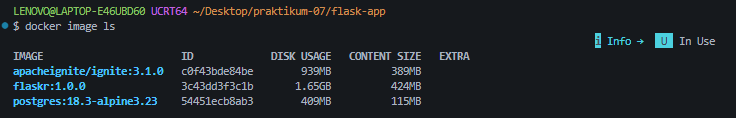

#### Pembahasan

---

### 4. Menjalankan Image

Jalankan dengan memetakan port 5000 pada aplikasi di container ke port 5001 di localhost:

Gunakan perintah

```bash
docker run -p 5001:5000 flaskr:1.0.0
```

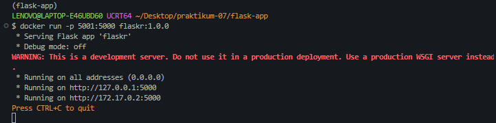

#### Pembahasan

---

Kemudian akses web browser pada http://localhost:5001

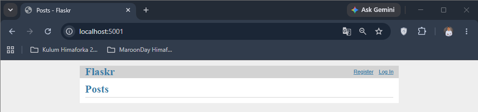

#### Pembahasan

---

Lalu di terminal tempat menjalankan Tugas akan muncul

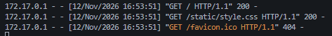

#### Pembahasan

---

### 4. Buat Aplikasi Menjadi CA - Podman

Jika menggunakan Podman, maka dockerd tidak perlu diaktifkan. Jika dockerd aktif, matikan service-nya terlebih dahulu

Kemudian install Podman terlebih dahulu dengan perintah

```bash
winget install RedHat.Podman
```

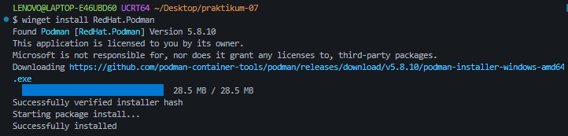

#### Pembahasan

---

Kemudian nyalakan mesin Podman dengan cara memanggil lokasi instalasi bawaan Podman dengan perintah

```bash
"/c/Program Files/RedHat/Podman/podman.exe" machine init
```

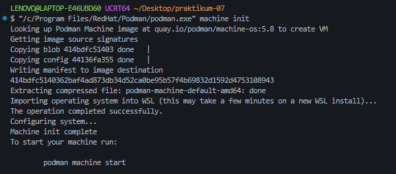

dan

```bash
"/c/Program Files/RedHat/Podman/podman.exe" machine start
```

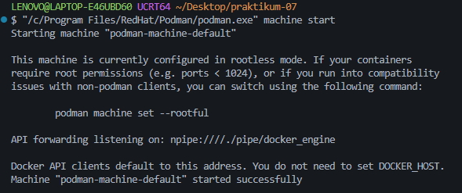

#### Pembahasan

---

Lalu membangun image dengan perintah

```bash
podman build -f Dockerfile -t flaskr:1.0.0 .
```

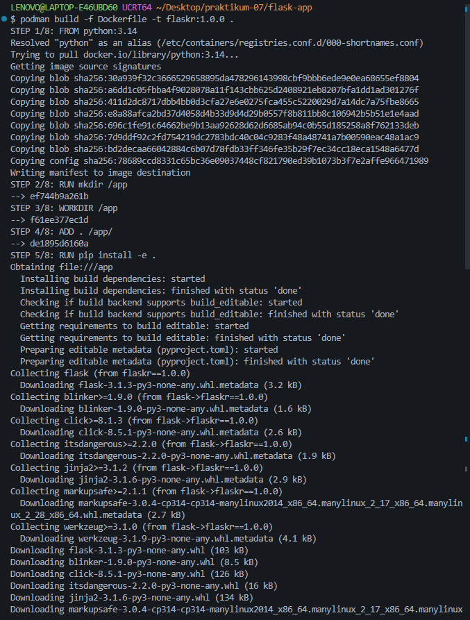

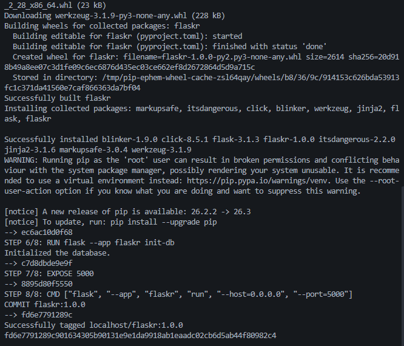

#### Pembahasan

---

Kemudian periksa daftar image podman

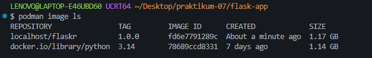

#### Pembahasan

---

Lalu Jalankan Podman pada port 5001 dengan perintah

```bash
podman run -p 5001:5000 flaskr:1.0.0
```

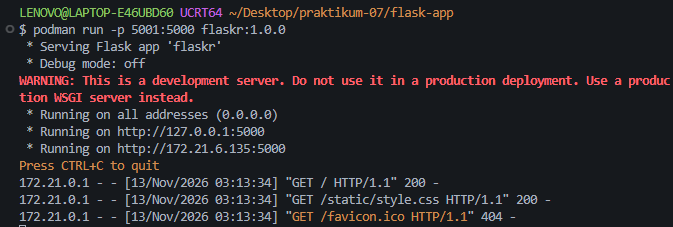

#### Pembahasan

---

Kemudian cek hasil nya pada http://127.0.0.1:5001 di browser

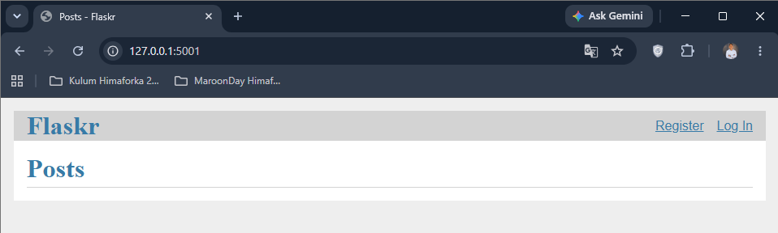

#### Pembahasan

---

## 📝 Kesimpulan

---

## 🗒️ Referensi
