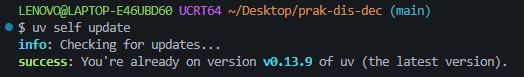
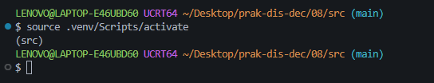
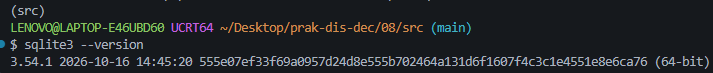
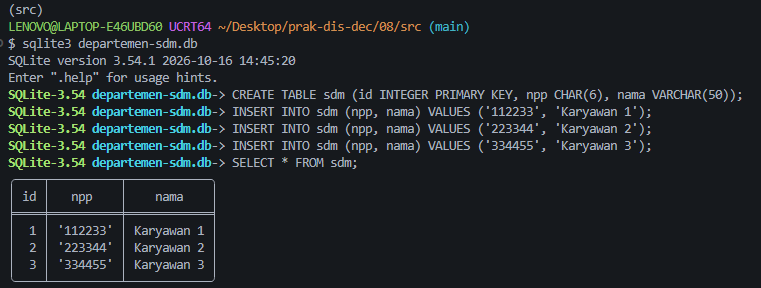
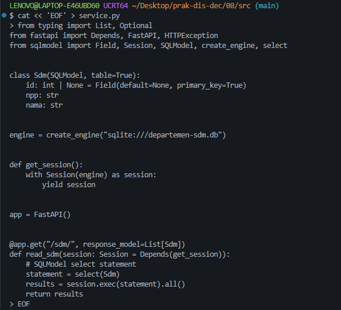
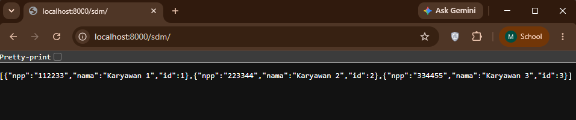
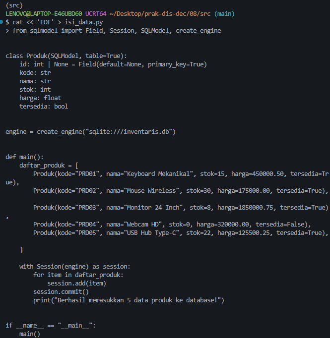
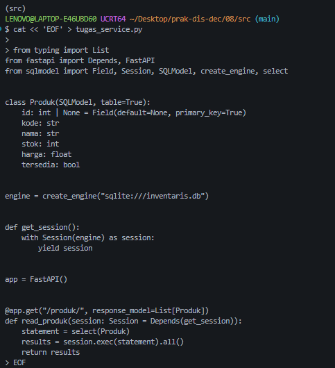
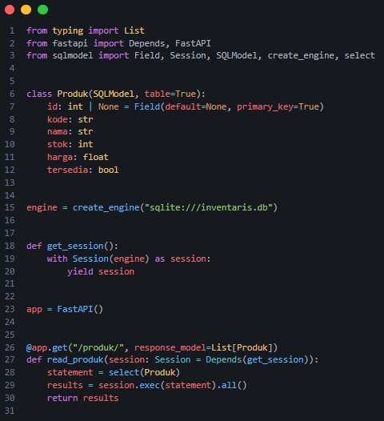
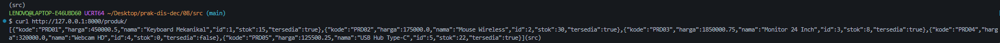

# Praktikum Minggu 08 - Arsitektur Microservices untuk Sistem Terdistribusi

<p align="justify"><strong>Mata Kuliah:</strong> Praktikum Sistem Terdistribusi dan Terdesentralisasi</p>

<p align="justify"><strong>Topik:</strong> Arsitektur Microservices untuk Sistem Terdistribusi</p>

---

## 🎯 Tujuan Praktikum

1. Memahami konsep <em>microservices</em> sebagai salah satu arsitektur pada sistem terdistribusi.
2. Memahami peran REST API sebagai penghubung antara frontend dan layanan backend.
3. Mampu menyiapkan <em>environment</em> Python terisolasi menggunakan <code>uv</code> beserta FastAPI dan SQLModel.
4. Mampu membuat database SQLite beserta tabelnya secara langsung melalui <code>sqlite3</code>.
5. Mampu membangun <em>endpoint</em> RESTful dengan FastAPI dan SQLModel untuk membaca data dari database.
6. Mampu menguji <em>endpoint</em> yang dibuat melalui peramban dan <em>headless tool</em> seperti <code>curl</code>.

---

## 📚 Dasar Teori

### Microservices dalam Sistem Terdistribusi

<p align="justify"><em>Microservices</em> memecah aplikasi menjadi layanan-layanan kecil yang berjalan sendiri dan saling bicara lewat jaringan. Frontend hanya perlu tahu alamat layanan yang dibutuhkan, sedangkan tiap layanan mengurus datanya sendiri. Ini berbeda dari aplikasi monolit yang menumpuk semua fitur dalam satu proses, sehingga satu bagian bermasalah bisa menyeret semuanya. Konsekuensinya, batas antarlayanan harus jelas, dan di praktikum ini batas itu diambil dari <em>REST API</em>.</p>

### REST API sebagai Antarmuka Layanan

<p align="justify">REST API memakai protokol HTTP apa adanya: alamat sebagai penunjuk sumber daya, metode seperti <code>GET</code> dan <code>POST</code> sebagai kata kerja, serta JSON sebagai format pertukaran data. Karena hanya bergantung pada HTTP, layanan bisa diakses dari peramban, <code>curl</code>, atau aplikasi lain tanpa pustaka khusus. Pilihan lain seperti GraphQL dan gRPC menawarkan hal yang berbeda: GraphQL lebih luwes dalam memilih <em>field</em>, sedangkan gRPC lebih hemat untuk komunikasi antar-<em>service</em>. Untuk latihan kali ini, REST sudah cukup karena paling mudah diamati hasilnya.</p>

### FastAPI

<p align="justify">FastAPI adalah <em>framework</em> Python yang menyusun <em>endpoint</em> dari anotasi tipe. Fungsi biasa diberi dekorator seperti <code>@app.get</code>, lalu parameter dan nilai baliknya dipakai untuk validasi sekaligus dokumentasi otomatis di <code>/docs</code>. Karena berjalan di atas ASGI, permintaan bisa ditangani secara asinkron. Bagi pemula, keuntungan terbesarnya sederhana: kode yang ditulis hampir sama dengan penjelasan alurnya, sehingga mudah dibaca ulang.</p>

### SQLModel dan ORM

<p align="justify">ORM menjembatani tabel di database dengan <em>class</em> di Python. SQLModel menggabungkan Pydantic untuk validasi dan SQLAlchemy untuk akses database, jadi satu <em>class</em> bisa dipakai sebagai model tabel sekaligus bentuk respons API. Atribut seperti <code>id: int | None = Field(default=None, primary_key=True)</code> langsung diterjemahkan menjadi kolom dengan <strong>primary key</strong>. Dengan cara ini tidak perlu menulis SQL untuk operasi sehari-hari, meski SQL tetap dipakai saat memeriksa data secara langsung.</p>

### SQLite

<p align="justify">SQLite menyimpan seluruh database dalam satu file, tanpa server terpisah. Cocok untuk praktikum karena tidak ada konfigurasi dan file <code>.db</code> bisa dibuka langsung dengan perintah <code>sqlite3</code>. Tipe kolomnya juga longgar: <code>CHAR</code> dan <code>VARCHAR</code> disimpan sebagai <code>TEXT</code>, sehingga yang benar-benar ditegakkan lebih pada jumlah kolom dan <em>constraint</em>. Karena itu pengecekan struktur tabel perlu dilakukan, bukan sekadar dipercaya dari perintah <code>CREATE</code>.</p>

### Dependency Injection dan Session

<p align="justify">Setiap permintaan ke API butuh koneksi database yang dibuka dan ditutup rapi. FastAPI menyelesaikan ini lewat <code>Depends</code>: fungsi <code>get_session</code> membuka <code>Session</code>, menyerahkannya ke <em>endpoint</em>, lalu menutupnya setelah respons selesai. Pola ini membuat <em>endpoint</em> tidak perlu mengurus siklus hidup koneksi, cukup meminta <em>session</em> sebagai parameter. Efek sampingnya, kode <em>endpoint</em> jadi pendek dan fokus pada <em>query</em>.</p>

---

## ⏩ Pembahasan Praktikum

### 1. Prasyarat

<p align="justify">Sebelum menyiapkan proyek, <code>uv</code> diperbarui lebih dulu dengan <code>uv self update</code>. Langkah ini singkat, tetapi menghindari masalah versi yang sebenarnya sudah diperbaiki di rilis terbaru. Di mesin ini <code>uv</code> sudah berada di versi 0.13.9, jadi tidak ada yang perlu diunduh. Setelah dipastikan mutakhir, barulah versi Python ditentukan.</p>

<p align="center">
  
  <br>
  <em>Gambar 1. Pembaruan uv sebelum memulai praktikum.</em>
</p>

#### Pembahasan

<p align="justify">Pembaruan <code>uv</code> dipakai sebagai titik awal karena seluruh perkakas praktikum ini bergantung padanya, mulai dari pemasangan Python sampai pembuatan <em>virtual environment</em>. Perintah <code>uv self update</code> memeriksa rilis terbaru lalu memasangnya bila perlu, dan di sini hasilnya menunjukkan versi 0.13.9 sudah yang terbaru. Dengan begitu tidak ada perbedaan perilaku perintah antara contoh modul dan yang dijalankan di mesin ini.</p>

---

<p align="justify">Instalasi Python menggunakan <code>uv</code> dengan versi 3.14.4. Sebelum itu, daftar versi Python yang sudah dikenal <code>uv</code> dicek lebih dulu memakai perintah berikut.</p>

```bash
uv python list
```

```
LENOVO@LAPTOP-E46UBD60 UCRT64 ~/Desktop/prak-dis-dec/08 (main)
$ uv python list
cpython-3.16.0a2-windows-x86_64-none                 <download available>
cpython-3.16.0a2+freethreaded-windows-x86_64-none    <download available>
cpython-3.15.2-windows-x86_64-none                   <download available>
cpython-3.15.2+freethreaded-windows-x86_64-none      <download available>
cpython-3.14.10-windows-x86_64-none                  <download available>
cpython-3.14.10+freethreaded-windows-x86_64-none     <download available>
cpython-3.14.8-windows-x86_64-none                   C:\Users\LENOVO\AppData\Roaming\uv\python\cpython-3.14.8-windows-x86_64-none\python.exe
cpython-3.14.8-windows-x86_64-none                   C:\Users\LENOVO\.local\bin\python3.14.exe
cpython-3.14.8-windows-x86_64-none                   C:\Users\LENOVO\AppData\Roaming\uv\python\cpython-3.14-windows-x86_64-none\python.exe
cpython-3.14.4-windows-x86_64-none                   C:\Users\LENOVO\AppData\Roaming\uv\python\cpython-3.14.4-windows-x86_64-none\python.exe
cpython-3.13.18-windows-x86_64-none                  <download available>
cpython-3.13.18+freethreaded-windows-x86_64-none     <download available>
cpython-3.12.16-windows-x86_64-none                  <download available>
cpython-3.11.18-windows-x86_64-none                  <download available>
cpython-3.11.9-windows-x86_64-none                   C:\Users\LENOVO\AppData\Local\Microsoft\WindowsApps\python3.exe
cpython-3.11.9-windows-x86_64-none                   C:\Users\LENOVO\AppData\Local\Microsoft\WindowsApps\python3.11.exe
cpython-3.11.9-windows-x86_64-none                   C:\Users\LENOVO\AppData\Local\Microsoft\WindowsApps\python.exe
cpython-3.11.9-windows-x86_64-none                   C:\Users\LENOVO\AppData\Local\Microsoft\WindowsApps\PythonSoftwareFoundation.Python.3.11_qbz5n2kfra8p0\python.exe
cpython-3.10.22-windows-x86_64-none                  <download available>
cpython-3.10.6-windows-x86_64-none                   C:\laragon\bin\python\python-3.10\python.exe
cpython-3.9.25-windows-x86_64-none                   <download available>
cpython-3.8.20-windows-x86_64-none                   <download available>
pypy-3.12.15-windows-x86_64-none                     <download available>
pypy-3.11.17-windows-x86_64-none                     <download available>
pypy-3.10.16-windows-x86_64-none                     <download available>
pypy-3.9.19-windows-x86_64-none                      <download available>
pypy-3.8.16-windows-x86_64-none                      <download available>
graalpy-3.13.0-windows-x86_64-none                   <download available>
graalpy-3.12.0-windows-x86_64-none                   <download available>
graalpy-3.11.0-windows-x86_64-none                   <download available>
graalpy-3.10.0-windows-x86_64-none                   <download available>
```

#### Pembahasan

<p align="justify">Perintah <code>uv python list</code> dipakai untuk melihat versi Python apa saja yang sudah dikenali <code>uv</code>. Dari daftar itu terlihat Python 3.14.4 sudah terpasang di mesin ini, sehingga tidak perlu mengunduh ulang. Kalau belum ada, <code>uv python install 3.14.4</code> akan mengunduhnya. Informasi ini penting karena modul mematok versi tersebut agar perilaku kode sama dengan contoh.</p>

---

<p align="justify">Selanjutnya Python 3.14.4 dipin dengan perintah berikut.</p>

```bash
uv python pin 3.14.4
```

<p align="center">
  
  <br>
  <em>Gambar 2. Penguncian versi Python 3.14.4 pada proyek.</em>
</p>

#### Pembahasan

<p align="justify">Pin ini menuliskan versi ke file <code>.python-version</code>, sehingga <code>uv</code> selalu memakai versi yang sama setiap kali perintah dijalankan di folder proyek. Tanpa pin, <code>uv</code> bisa memilih versi lain yang kebetulan tersedia di mesin. Isi file itu sederhana, hanya <code>3.14.4</code>, tetapi cukup untuk mengunci lingkungan kerja. Dari sini proyek punya patokan versi yang bisa diulang di komputer lain.</p>

---

<p align="justify">Virtual <em>environment</em> kemudian dibuat dengan perintah berikut.</p>

```bash
uv venv
```

<p align="center">
  
  <br>
  <em>Gambar 3. Pembuatan virtual environment proyek.</em>
</p>

#### Pembahasan

<p align="justify">Tujuan <code>uv venv</code> adalah memisahkan pustaka proyek dari Python sistem. Dengan cara ini, paket FastAPI dan SQLModel yang dipasang nanti tidak mengganggu proyek lain di komputer yang sama. <code>uv</code> membuat folder <code>.venv</code> beserta salinan <em>interpreter</em> sesuai pin sebelumnya. Sejak titik ini, semua instalasi diarahkan ke folder tersebut.</p>

---

<p align="justify">Environment baru bisa dipakai setelah diaktifkan dengan perintah berikut.</p>

```bash
source .venv/Scripts/activate
```

<p align="center">
  
  <br>
  <em>Gambar 4. Aktivasi virtual environment pada shell.</em>
</p>

#### Pembahasan

<p align="justify">Aktivasi mengubah <code>PATH</code> shell sehingga perintah <code>python</code> dan <code>pip</code> menunjuk ke dalam <code>.venv</code>, bukan ke Python global. Tanda <code>(src)</code> di depan prompt menjadi penanda bahwa environment sudah aktif. Kalau tanda itu belum muncul, instalasi berikutnya berisiko masuk ke Python sistem dan tidak terbaca saat service dijalankan. Karena itu urutan aktivasi tidak boleh dilewati.</p>

---

<p align="justify">Paket FastAPI dan SQLModel dipasang dengan perintah berikut.</p>

```bash
uv pip install "fastapi[standard]" sqlmodel
```

```
(src)
LENOVO@LAPTOP-E46UBD60 UCRT64 ~/Desktop/prak-dis-dec/08/src (main)
$ uv pip install "fastapi[standard]" sqlmodel
Resolved 61 packages in 7.19s
Prepared 61 packages in 7.17s
Installed 61 packages in 570ms
 + agent-detector==2.0.0
 + annotated-doc==0.0.7
 + annotated-types==0.8.0
 + anyio==4.16.0
 + certifi==2026.10.23
 + charset-normalizer==3.5.2
 + click==8.5.1
 + colorama==0.4.6
 + detect-installer==0.2.1
 + dnspython==2.9.2
 + email-validator==2.4.0
 + fastapi==0.165.0
 + fastapi-cli==0.0.34
 + fastapi-cloud-cli==0.28.0
 + fastar==0.12.0
 + googleapis-common-protos==1.76.0
 + h11==0.16.0
 + httpcore==1.0.9
 + httpcore2==2.16.2
 + httptools==0.9.0
 + httpx==0.28.1
 + httpx2==2.16.2
 + idna==3.20
 + jinja2==3.1.6
 + markdown-it-py==4.3.0
 + markupsafe==3.0.4
 + mdurl==0.1.2
 + opentelemetry-api==1.45.2
 + opentelemetry-exporter-http-transport==0.66b2
 + opentelemetry-exporter-otlp-common==0.66b2
 + opentelemetry-exporter-otlp-proto-common==1.45.2
 + opentelemetry-exporter-otlp-proto-http==1.45.2
 + opentelemetry-proto==1.45.2
 + opentelemetry-sdk==1.45.2
 + opentelemetry-semantic-conventions==0.66b2
 + protobuf==7.36.2
 + pydantic==2.14.3
 + pydantic-core==2.50.4
 + pydantic-extra-types==2.11.1
 + pydantic-settings==2.16.3
 + pygments==2.21.0
 + python-dotenv==1.2.4
 + python-multipart==0.0.34
 + pyyaml==6.0.3
 + requests==2.34.2
 + rich==15.0.0
 + rich-toolkit==0.20.6
 + rignore==0.8.1
 + sentry-sdk==2.75.0
 + shellingham==1.5.4
 + sqlalchemy==2.1.9
 + sqlmodel==0.0.50
 + starlette==1.10.0
 + truststore==0.10.5
 + typer==0.29.2
 + typing-extensions==4.16.0
 + typing-inspection==0.4.5
 + urllib3==2.8.0
 + uvicorn==0.54.0
 + watchfiles==1.3.0
 + websockets==17.4
```

#### Pembahasan

<p align="justify">Pemasangan dilakukan di dalam <code>.venv</code> supaya versi pustaka praktikum ini tidak bercampur dengan proyek lain. Prosesnya menarik 61 paket, dan jumlah itu wajar karena FastAPI membawa <em>server</em> ASGI, validasi Pydantic, serta SQLAlchemy yang jadi lapisan dasar SQLModel. Pilihan <code>"fastapi[standard]"</code> menambahkan Uvicorn dan <em>command line</em> FastAPI sekaligus, jadi tidak perlu memasang server secara terpisah. Setelah tahap ini selesai, folder <code>.venv</code> sudah cukup untuk menjalankan service.</p>

---

<p align="justify">SQLite dicek keberadaannya dengan perintah berikut.</p>

```bash
sqlite3 --version
```

<p align="center">
  
  <br>
  <em>Gambar 5. Versi SQLite yang terpasang pada sistem.</em>
</p>

#### Pembahasan

<p align="justify">Pengecekan versi terdengar sepele, tetapi menentukan: kalau perintah <code>sqlite3</code> tidak dikenali, langkah membuat database akan gagal dengan pesan yang membingungkan. Di mesin ini keluar versi 3.54.1, jadi tidak ada instalasi tambahan yang diperlukan. Versi tersebut juga mendukung semua tipe kolom yang akan dipakai pada tugas. Karena alatnya sudah siap, praktikum bisa langsung masuk ke pembuatan database.</p>

---

<p align="justify">Jika SQLite belum terpasang, berkas unduhannya tersedia di situs resmi berikut.</p>

<p align="center">
  
  <br>
  <em>Gambar 6. Halaman unduh resmi SQLite.</em>
</p>

#### Pembahasan

<p align="justify">Halaman <code>sqlite.org/download.html</code> menyediakan <em>binary</em> untuk berbagai sistem operasi. Di Windows, paket yang relevan adalah <code>sqlite-dll-win-x64</code> yang di dalamnya ada <code>sqlite3.exe</code>. Halaman itu berguna kalau suatu saat praktikum dikerjakan di komputer tanpa SQLite. Untuk sesi ini langkah tersebut tidak dijalankan karena versi yang terpasang sudah memadai.</p>

---

<p align="justify">Database <code>departemen-sdm.db</code> dibuat dengan membuka <code>sqlite3</code> lalu menjalankan perintah SQL secara langsung.</p>

```bash
sqlite3 departemen-sdm.db
```

```sql
CREATE TABLE sdm (id INTEGER PRIMARY KEY, npp CHAR(6), nama VARCHAR(50));
INSERT INTO sdm (npp, nama) VALUES ('112233', 'Karyawan 1');
INSERT INTO sdm (npp, nama) VALUES ('223344', 'Karyawan 2');
INSERT INTO sdm (npp, nama) VALUES ('334455', 'Karyawan 3');
SELECT * FROM sdm;
```

<p align="center">
  
  <br>
  <em>Gambar 7. Pembuatan database dan pengisian awal tabel <code>sdm</code>.</em>
</p>

<p align="justify">Hasil pengecekan isi tabel ditampilkan pada gambar berikut.</p>

<p align="center">
  
  <br>
  <em>Gambar 8. Hasil <code>SELECT * FROM sdm</code>.</em>
</p>

#### Pembahasan

<p align="justify">Tabel <code>sdm</code> diberi tiga kolom: <code>id</code> sebagai <strong>primary key</strong>, <code>npp</code> bertipe <code>CHAR(6)</code>, dan <code>nama</code> bertipe <code>VARCHAR(50)</code>. Tiga baris data dimasukkan agar <em>endpoint</em> nanti punya sesuatu untuk ditampilkan, sehingga hasilnya bisa langsung dinilai benar atau salah. <code>SELECT * FROM sdm</code> kemudian memastikan data benar-benar tersimpan, bukan hanya diterima tanpa error. Database yang sudah berisi inilah yang akan dibaca oleh service pada langkah berikutnya.</p>

---

### 2. Source Code

<p align="justify">File <code>service.py</code> dibuat di dalam folder <code>src</code> dengan isi sebagai berikut.</p>

```bash
cat << 'EOF' > service.py
from typing import List, Optional
from fastapi import Depends, FastAPI, HTTPException
from sqlmodel import Field, Session, SQLModel, create_engine, select


class Sdm(SQLModel, table=True):
    id: int | None = Field(default=None, primary_key=True)
    npp: str
    nama: str


engine = create_engine("sqlite:///departemen-sdm.db")


def get_session():
    with Session(engine) as session:
        yield session


app = FastAPI()


@app.get("/sdm/", response_model=List[Sdm])
def read_sdm(session: Session = Depends(get_session)):
    # SQLModel select statement
    statement = select(Sdm)
    results = session.exec(statement).all()
    return results
EOF
```

<p align="center">
  
  <br>
  <em>Gambar 9. Pembuatan file <code>service.py</code>.</em>
</p>

<p align="center">
  
  <br>
  <em>Gambar 10. Isi lengkap <code>service.py</code>.</em>
</p>

#### Pembahasan

<p align="justify">File ini berisi tiga bagian yang saling terkait: model <code>Sdm</code>, <code>engine</code> yang menunjuk ke <code>departemen-sdm.db</code>, dan <em>endpoint</em> <code>GET /sdm/</code>. Model mendefinisikan bentuk data, <code>engine</code> membuka koneksi, sedangkan <code>get_session</code> memastikan koneksi ditutup setelah dipakai. <em>Endpoint</em>-nya hanya menjalankan <code>select(Sdm)</code> lalu mengembalikan seluruh hasil. Tambahan <code>response_model=List[Sdm]</code> membuat FastAPI merapikan keluaran sesuai bentuk model, sehingga nama field konsisten dengan yang didefinisikan.</p>

---

### 3. Menjalankan Source Code

<p align="justify">Service dijalankan dari folder <code>src</code> dengan perintah berikut.</p>

```bash
uvicorn service:app --reload
```

<p align="center">
  
  <br>
  <em>Gambar 11. Menjalankan <code>service.py</code> dengan Uvicorn.</em>
</p>

#### Pembahasan

<p align="justify">Bagian <code>service:app</code> berarti Uvicorn mengimpor file <code>service.py</code> lalu mengambil objek <code>app</code> di dalamnya. Opsi <code>--reload</code> memantau perubahan file dan menyalakan ulang server otomatis, jadi kode bisa diperbaiki tanpa menghentikan proses. Server mendengarkan di <code>127.0.0.1:8000</code>, alamat yang sama dengan contoh modul. Selama proses ini berjalan, terminal tidak boleh ditutup karena server hidup di dalamnya.</p>

---

<p align="justify">Untuk memeriksa hasilnya, <em>endpoint</em> diakses dari peramban pada alamat <code>http://localhost:8000/sdm/</code>.</p>

<p align="center">
  
  <br>
  <em>Gambar 12. Hasil akses <code>/sdm/</code> melalui peramban.</em>
</p>

#### Pembahasan

<p align="justify">Halaman tersebut menampilkan tiga data <code>sdm</code> dalam bentuk JSON. Tampilan ini membuktikan seluruh rantai bekerja: FastAPI menerima permintaan, <em>session</em> membuka database, <em>query</em> dijalankan, dan hasilnya dikembalikan. Karena <em>endpoint</em> hanya membaca, tidak ada perubahan data yang terjadi. Bentuk JSON-nya juga mengikuti field pada model, yaitu <code>id</code>, <code>npp</code>, dan <code>nama</code>.</p>

---

<p align="justify">Pemeriksaan yang sama diulang lewat <em>headless tool</em> dengan perintah berikut, tanpa mematikan server.</p>

```bash
curl http://localhost:8000/sdm/
```

<p align="center">
  
  <br>
  <em>Gambar 13. Hasil akses <code>/sdm/</code> melalui <code>curl</code>.</em>
</p>

#### Pembahasan

<p align="justify">Hasil <code>curl</code> identik dengan peramban karena keduanya memanggil <em>endpoint</em> yang sama. Bedanya, <code>curl</code> menunjukkan respons mentah tanpa bantuan tampilan, sehingga bentuk asli JSON terlihat apa adanya. Cara ini lebih dekat dengan bagaimana service lain akan mengonsumsi API nanti. Kalau nanti ada layanan frontend, pola pemanggilan seperti inilah yang dipakai.</p>

---

## 📜 Tugas

### 1. Buat satu tabel baru menggunakan SQLite, tabel berbeda dari yang ada pada contoh. Tabel tersebut mempunyai 1 primary key dan setidaknya berisi data dengan tipe INT, CHAR, VARCHAR, BOOLEAN, dan FLOAT.

<p align="justify">Database baru bernama <code>inventaris.db</code> dibuat agar data tugas tidak menumpang pada tabel contoh.</p>

```bash
sqlite3 inventaris.db
```

<p align="center">
  
  <br>
  <em>Gambar 14. Pembuatan database <code>inventaris.db</code>.</em>
</p>

#### Pembahasan

<p align="justify">Memisahkan file database membuat pemeriksaan lebih mudah: isi <code>departemen-sdm.db</code> tetap seperti semula, sedangkan <code>inventaris.db</code> khusus menampung tabel tugas. File <code>.db</code> terbentuk begitu perintah pertama dijalankan, dan sejak itu semua perintah SQL diarahkan ke file tersebut. Pemisahan ini juga meniru kebiasaan nyata, di mana satu layanan biasanya punya datanya sendiri.</p>

---

<p align="justify">Di dalam database tersebut dibuat tabel <code>produk</code> dengan perintah berikut.</p>

```sql
CREATE TABLE produk (
    id INTEGER PRIMARY KEY,
    kode CHAR(5),
    nama VARCHAR(100),
    stok INT,
    harga FLOAT,
    tersedia BOOLEAN
);
```

<p align="center">
  
  <br>
  <em>Gambar 15. Pembuatan tabel <code>produk</code>.</em>
</p>

#### Pembahasan

<p align="justify">Keenam kolom dipilih agar semua tipe yang diminta modul terwakili: <code>id</code> sebagai <strong>primary key</strong> bertipe <code>INTEGER</code>, <code>kode</code> bertipe <code>CHAR(5)</code>, <code>nama</code> bertipe <code>VARCHAR(100)</code>, <code>stok</code> bertipe <code>INT</code>, <code>harga</code> bertipe <code>FLOAT</code>, dan <code>tersedia</code> bertipe <code>BOOLEAN</code>. Susunan ini sengaja dibuat menyerupai data inventaris sungguhan supaya tiap tipe punya alasan keberadaannya, bukan sekadar memenuhi syarat. <strong>Primary key</strong> tunggal di <code>id</code> juga cukup karena satu produk diwakili satu baris.</p>

---

<p align="justify">Struktur tabel kemudian dipastikan dengan perintah berikut.</p>

```bash
.schema produk
```

<p align="center">
  
  <br>
  <em>Gambar 16. Pemeriksaan struktur tabel dengan <code>.schema</code>.</em>
</p>

#### Pembahasan

<p align="justify"><code>.schema produk</code> menampilkan kembali DDL yang tersimpan, sehingga bisa dibandingkan langsung dengan perintah <code>CREATE</code> yang tadi diketik. Kalau ada kolom yang salah nama atau salah tipe, kesalahannya terlihat di sini. Pemeriksaan seperti ini murah dilakukan dan menghindarkan <em>debugging</em> yang lebih rumit saat data sudah masuk. Karena itu langkah ini dikerjakan sebelum pengisian data.</p>

---

<p align="justify">Pemeriksaan dilanjutkan dengan perintah berikut untuk melihat detail tiap kolom.</p>

```sql
PRAGMA table_info(produk);
```

<p align="center">
  
  <br>
  <em>Gambar 17. Hasil <code>PRAGMA table_info(produk)</code>.</em>
</p>

#### Pembahasan

<p align="justify"><code>PRAGMA table_info</code> menampilkan struktur tabel dalam bentuk tabel: nama kolom, tipe, status <code>notnull</code>, nilai <em>default</em>, dan penanda <strong>primary key</strong>. Dari keluaran itu terlihat kolom <code>id</code> memiliki <code>pk = 1</code>, sedangkan kolom lain bernilai 0. Perlu dicatat, SQLite menyimpan <code>CHAR</code> dan <code>VARCHAR</code> sebagai <code>TEXT</code>, jadi tipe aslinya hanya terjaga di definisi. Karena itu dua cara pemeriksaan ini saling melengkapi.</p>

---

### 2. Isikan 5 data menggunakan script Python

<p align="justify">Data diisi lewat script Python bernama <code>isi_data.py</code> di dalam folder <code>src</code>.</p>

```bash
cat << 'EOF' > isi_data.py
from sqlmodel import Field, Session, SQLModel, create_engine


class Produk(SQLModel, table=True):
    id: int | None = Field(default=None, primary_key=True)
    kode: str
    nama: str
    stok: int
    harga: float
    tersedia: bool


engine = create_engine("sqlite:///inventaris.db")


def main():
    daftar_produk = [
        Produk(kode="PRD01", nama="Keyboard Mekanikal", stok=15, harga=450000.50, tersedia=True),
        Produk(kode="PRD02", nama="Mouse Wireless", stok=30, harga=175000.00, tersedia=True),
        Produk(kode="PRD03", nama="Monitor 24 Inch", stok=8, harga=1850000.75, tersedia=True),
        Produk(kode="PRD04", nama="Webcam HD", stok=0, harga=320000.00, tersedia=False),
        Produk(kode="PRD05", nama="USB Hub Type-C", stok=22, harga=125500.25, tersedia=True),
    ]

    with Session(engine) as session:
        for item in daftar_produk:
            session.add(item)
        session.commit()
        print("Berhasil memasukkan 5 data produk ke database!")


if __name__ == "__main__":
    main()
EOF
```

<p align="center">
  
  <br>
  <em>Gambar 18. Pembuatan script <code>isi_data.py</code>.</em>
</p>

<p align="center">
  
  <br>
  <em>Gambar 19. Isi lengkap <code>isi_data.py</code>.</em>
</p>

#### Pembahasan

<p align="justify">Script ini mendefinisikan model <code>Produk</code> dengan field yang sama seperti tabel, lalu menyiapkan lima objek dalam sebuah <em>list</em>. Semua objek dimasukkan dengan <code>session.add</code> di dalam satu <code>Session</code>, kemudian <code>session.commit</code> menyimpannya sekaligus. Model dan <code>engine</code> diarahkan ke <code>inventaris.db</code> supaya penulisan masuk ke database yang benar. Dengan begitu, penambahan data cukup mengubah isi <em>list</em> tanpa menyentuh SQL.</p>

---

<p align="justify">Script dijalankan di dalam environment yang sama dengan perintah berikut.</p>

```bash
python isi_data.py
```

<p align="center">
  
  <br>
  <em>Gambar 20. Menjalankan <code>isi_data.py</code>.</em>
</p>

#### Pembahasan

<p align="justify">Pesan <em>Berhasil memasukkan 5 data produk ke database!</em> menjadi tanda bahwa <code>commit</code> selesai tanpa error. Karena kelima data dikirim dalam satu transaksi, kegagalan di tengah proses akan membatalkan semuanya, bukan menyisakan data setengah jadi. Sifat ini penting saat mengisi data dalam jumlah banyak. Setelah ini, isi database perlu dipastikan lagi dari sisi SQLite.</p>

---

<p align="justify">Verifikasi dilakukan langsung pada database dengan perintah berikut.</p>

```bash
sqlite3 inventaris.db "SELECT * FROM produk;"
```

<p align="center">
  
  <br>
  <em>Gambar 21. Verifikasi lima data produk di SQLite.</em>
</p>

#### Pembahasan

<p align="justify">Kelima baris muncul lengkap dengan <code>id</code> 1 sampai 5. Kolom <code>tersedia</code> tampil sebagai 1 dan 0 karena SQLite tidak punya tipe <em>boolean</em> khusus, sedangkan nilai <code>harga</code> tersimpan sebagai bilangan pecahan, termasuk 1850000.75 yang tidak dibulatkan. Kalau ada baris yang hilang atau nilai yang aneh, kesalahannya bisa dilacak sebelum API dibuat. Pemeriksaan dari sisi database ini jadi pembanding bagi hasil <em>endpoint</em> nanti.</p>

---

### 3. Buat RESTful API endpoint untuk menampilkan semua data yang telah diisikan

<p align="justify"><em>Endpoint</em> untuk tugas dibuat di file terpisah, <code>tugas_service.py</code>, dengan pola yang sama seperti <code>service.py</code>.</p>

```bash
cat << 'EOF' > tugas_service.py
from typing import List
from fastapi import Depends, FastAPI
from sqlmodel import Field, Session, SQLModel, create_engine, select


class Produk(SQLModel, table=True):
    id: int | None = Field(default=None, primary_key=True)
    kode: str
    nama: str
    stok: int
    harga: float
    tersedia: bool


engine = create_engine("sqlite:///inventaris.db")


def get_session():
    with Session(engine) as session:
        yield session


app = FastAPI()


@app.get("/produk/", response_model=List[Produk])
def read_produk(session: Session = Depends(get_session)):
    statement = select(Produk)
    results = session.exec(statement).all()
    return results
EOF
```

<p align="center">
  
  <br>
  <em>Gambar 22. Pembuatan file <code>tugas_service.py</code>.</em>
</p>

<p align="center">
  
  <br>
  <em>Gambar 23. Isi lengkap <code>tugas_service.py</code>.</em>
</p>

#### Pembahasan

<p align="justify">Bedanya dengan contoh hanya pada model dan database yang dipakai: <code>Produk</code> dan <code>inventaris.db</code>, dengan rute <code>GET /produk/</code>. Pemisahan file menjaga contoh praktikum tetap utuh sekaligus memperlihatkan bahwa satu service idealnya menangani satu urusan. Isinya pun cukup satu <em>endpoint</em> baca karena tugas hanya meminta data ditampilkan. Struktur yang hampir identik ini juga menegaskan bahwa pola FastAPI dan SQLModel bisa dipakai berulang untuk data apa pun.</p>

---

<p align="justify">Server dijalankan dari folder <code>src</code> dengan perintah berikut.</p>

```bash
uvicorn tugas_service:app --reload
```

<p align="center">
  
  <br>
  <em>Gambar 24. Menjalankan <code>tugas_service.py</code> dengan Uvicorn.</em>
</p>

#### Pembahasan

<p align="justify">Nama modulnya berubah menjadi <code>tugas_service</code>, tetapi mekanismenya sama: Uvicorn mencari objek <code>app</code> di file tersebut. Karena port 8000 hanya bisa dipakai satu service pada satu waktu, service sebelumnya harus dihentikan lebih dulu. Setelah server hidup, <em>endpoint</em> <code>/produk/</code> siap diakses. Kesalahan seperti salah nama modul akan langsung terlihat di terminal pada tahap ini.</p>

---

<p align="justify">Hasilnya dicek lewat peramban pada alamat <code>http://127.0.0.1:8000/produk/</code>.</p>

<p align="center">
  
  <br>
  <em>Gambar 25. Hasil akses <code>/produk/</code> melalui peramban.</em>
</p>

#### Pembahasan

<p align="justify">Halaman tersebut menampilkan lima produk dalam format JSON, masing-masing memuat <code>kode</code>, <code>nama</code>, <code>stok</code>, <code>harga</code>, dan <code>tersedia</code>. Nilai <em>boolean</em> tampil sebagai <code>true</code> dan <code>false</code>, berbeda dari 1 dan 0 yang terlihat di SQLite, karena FastAPI mengonversinya sesuai tipe Python. Perbedaan ini justru menunjukkan bahwa model berhasil membaca data dengan tipe yang benar. Isinya pun cocok dengan hasil <code>SELECT</code> sebelumnya, hanya formatnya lebih rapi.</p>

---

### 4. Tampilkan hasil RESTful API endpoint tersebut menggunakan curl

<p align="justify">Selama server masih berjalan, <em>endpoint</em> diuji lewat <em>headless tool</em> dengan perintah berikut.</p>

```bash
curl http://127.0.0.1:8000/produk/
```

<p align="center">
  
  <br>
  <em>Gambar 26. Hasil akses <code>/produk/</code> melalui <code>curl</code>.</em>
</p>

#### Pembahasan

<p align="justify">Responsnya satu baris JSON berisi kelima produk, cukup untuk membuktikan <em>endpoint</em> bekerja tanpa peramban. Cara ini juga yang biasanya dipakai saat service lain perlu mengambil data secara otomatis. Karena tidak ada antarmuka yang membantu, keluaran <code>curl</code> memperlihatkan persis apa yang dikirim server. Dengan begitu, seluruh rangkaian tugas mulai dari tabel, pengisian data, <em>endpoint</em>, sampai pengujian sudah tertutup.</p>

---

## 📝 Kesimpulan

1. <em>Microservices</em> membagi aplikasi menjadi layanan kecil yang berdiri sendiri, dan REST API menjadi cara paling sederhana untuk menghubungkannya.
2. FastAPI memungkinkan <em>endpoint</em> dibuat dari fungsi Python biasa dengan bantuan anotasi tipe, sehingga kode mudah dibaca dan langsung tervalidasi.
3. SQLModel menyatukan model tabel dan model respons dalam satu <em>class</em>, sehingga tabel SQLite bisa diakses tanpa menulis SQL untuk operasi rutin.
4. Pola <code>Depends</code> dan <code>get_session</code> membuat pengelolaan koneksi database tetap rapi meski <em>endpoint</em> hanya berisi beberapa baris.
5. SQLite cocok untuk praktikum karena berbasis satu file, tetapi tipenya longgar sehingga struktur tabel tetap perlu diperiksa lewat <code>.schema</code> dan <code>PRAGMA table_info</code>.
6. Pengujian berlapis dari database, peramban, sampai <code>curl</code> membantu memastikan kesalahan benar-benar ketahuan di lapisan mana.

---

## 🗒️ Referensi

1. Modul 8 - Arsitektur Microservices untuk Sistem Terdistribusi, Praktikum Sistem Terdistribusi dan Terdesentralisasi, Universitas Teknologi Digital Indonesia.
2. Dokumentasi FastAPI. <https://fastapi.tiangolo.com/>
3. Dokumentasi SQLModel. <https://sqlmodel.tiangolo.com/>
4. Dokumentasi SQLite. <https://sqlite.org/docs.html>
5. Dokumentasi uv. <https://docs.astral.sh/uv/>
