# Praktikum Minggu 08 - Arsitektur Microservices untuk Sistem Terdistribusi

<p align="justify"><strong>Mata Kuliah:</strong> Praktikum Sistem Terdistribusi dan Terdesentralisasi</p>

<p align="justify"><strong>Topik:</strong> Arsitektur Microservices untuk Sistem Terdistribusi</p>

---

## 🎯 Tujuan Praktikum

---

## 📚 Dasar Teori

---

## ⏩ Pembahasan Praktikum

### 1. Prasyarat

Install UV, karena sudah menginstall UV pada praktikum sebelumnya, cukup update saja.


#### Pembahasan

---

Instalasi Python menggunakan uv - Python 3.14.4. Sebelum itu kita cek terlebih dahulu daftar versi python sudah terpasang dengan perintah

```bash
uv python list
```

```
LENOVO@LAPTOP-E46UBD60 UCRT64 ~/Desktop/prak-dis-dec/08 (main)
$ uv python list
cpython-3.16.0a2-windows-x86_64-none                 <download available>
cpython-3.16.0a2+freethreaded-windows-x86_64-none    <download available>
cpython-3.15.2-windows-x86_64-none                   <download available>
cpython-3.15.2+freethreaded-windows-x86_64-none      <download available>
cpython-3.14.10-windows-x86_64-none                  <download available>
cpython-3.14.10+freethreaded-windows-x86_64-none     <download available>
cpython-3.14.8-windows-x86_64-none                   C:\Users\LENOVO\AppData\Roaming\uv\python\cpython-3.14.8-windows-x86_64-none\python.exe
cpython-3.14.8-windows-x86_64-none                   C:\Users\LENOVO\.local\bin\python3.14.exe
cpython-3.14.8-windows-x86_64-none                   C:\Users\LENOVO\AppData\Roaming\uv\python\cpython-3.14-windows-x86_64-none\python.exe
cpython-3.14.4-windows-x86_64-none                   C:\Users\LENOVO\AppData\Roaming\uv\python\cpython-3.14.4-windows-x86_64-none\python.exe
cpython-3.13.18-windows-x86_64-none                  <download available>
cpython-3.13.18+freethreaded-windows-x86_64-none     <download available>
cpython-3.12.16-windows-x86_64-none                  <download available>
cpython-3.11.18-windows-x86_64-none                  <download available>
cpython-3.11.9-windows-x86_64-none                   C:\Users\LENOVO\AppData\Local\Microsoft\WindowsApps\python3.exe
cpython-3.11.9-windows-x86_64-none                   C:\Users\LENOVO\AppData\Local\Microsoft\WindowsApps\python3.11.exe
cpython-3.11.9-windows-x86_64-none                   C:\Users\LENOVO\AppData\Local\Microsoft\WindowsApps\python.exe
cpython-3.11.9-windows-x86_64-none                   C:\Users\LENOVO\AppData\Local\Microsoft\WindowsApps\PythonSoftwareFoundation.Python.3.11_qbz5n2kfra8p0\python.exe
cpython-3.10.22-windows-x86_64-none                  <download available>
cpython-3.10.6-windows-x86_64-none                   C:\laragon\bin\python\python-3.10\python.exe
cpython-3.9.25-windows-x86_64-none                   <download available>
cpython-3.8.20-windows-x86_64-none                   <download available>
pypy-3.12.15-windows-x86_64-none                     <download available>
pypy-3.11.17-windows-x86_64-none                     <download available>
pypy-3.10.16-windows-x86_64-none                     <download available>
pypy-3.9.19-windows-x86_64-none                      <download available>
pypy-3.8.16-windows-x86_64-none                      <download available>
graalpy-3.13.0-windows-x86_64-none                   <download available>
graalpy-3.12.0-windows-x86_64-none                   <download available>
graalpy-3.11.0-windows-x86_64-none                   <download available>
graalpy-3.10.0-windows-x86_64-none                   <download available>
```

#### Pembahasan

---

Karena pada perangkat sudah terdapat python versi 3.14.4 jadi tidak perlu menginstall lagi, namun jika belum menginstall dapat menginstall dengan perintah

```bash
uv python install 3.14.4
```

#### Pembahasan

---

Selanjutnya pin Python 3.14.4 dengan perintah

```bash
uv python pin 3.14.4
```

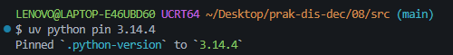

#### Pembahasan

---

Buat Virtual Environment (.venv) dengan perintah

```bash
uv venv
```

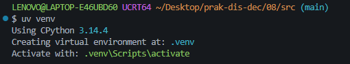

#### Pembahasan

---

Lalu mengaktifkan Virtual Environment (.venv) dengan perintah

```bash
source .venv/Scripts/activate
```


#### Pembahasan

---

Install paket FastAPI dan SQLModel dengan perintah

```bash
uv pip install "fastapi[standard]" sqlmodel
```

```
(src)
LENOVO@LAPTOP-E46UBD60 UCRT64 ~/Desktop/prak-dis-dec/08/src (main)
$ uv pip install "fastapi[standard]" sqlmodel
Resolved 61 packages in 7.19s
Prepared 61 packages in 7.17s
Installed 61 packages in 570ms
 + agent-detector==2.0.0
 + annotated-doc==0.0.7
 + annotated-types==0.8.0
 + anyio==4.16.0
 + certifi==2026.10.23
 + charset-normalizer==3.5.2
 + click==8.5.1
 + colorama==0.4.6
 + detect-installer==0.2.1
 + dnspython==2.9.2
 + email-validator==2.4.0
 + fastapi==0.165.0
 + fastapi-cli==0.0.34
 + fastapi-cloud-cli==0.28.0
 + fastar==0.12.0
 + googleapis-common-protos==1.76.0
 + h11==0.16.0
 + httpcore==1.0.9
 + httpcore2==2.16.2
 + httptools==0.9.0
 + httpx==0.28.1
 + httpx2==2.16.2
 + idna==3.20
 + jinja2==3.1.6
 + markdown-it-py==4.3.0
 + markupsafe==3.0.4
 + mdurl==0.1.2
 + opentelemetry-api==1.45.2
 + opentelemetry-exporter-http-transport==0.66b2
 + opentelemetry-exporter-otlp-common==0.66b2
 + opentelemetry-exporter-otlp-proto-common==1.45.2
 + opentelemetry-exporter-otlp-proto-http==1.45.2
 + opentelemetry-proto==1.45.2
 + opentelemetry-sdk==1.45.2
 + opentelemetry-semantic-conventions==0.66b2
 + protobuf==7.36.2
 + pydantic==2.14.3
 + pydantic-core==2.50.4
 + pydantic-extra-types==2.11.1
 + pydantic-settings==2.16.3
 + pygments==2.21.0
 + python-dotenv==1.2.4
 + python-multipart==0.0.34
 + pyyaml==6.0.3
 + requests==2.34.2
 + rich==15.0.0
 + rich-toolkit==0.20.6
 + rignore==0.8.1
 + sentry-sdk==2.75.0
 + shellingham==1.5.4
 + sqlalchemy==2.1.9
 + sqlmodel==0.0.50
 + starlette==1.10.0
 + truststore==0.10.5
 + typer==0.29.2
 + typing-extensions==4.16.0
 + typing-inspection==0.4.5
 + urllib3==2.8.0
 + uvicorn==0.54.0
 + watchfiles==1.3.0
 + websockets==17.4
```

#### Pembahasan

---

Install SQLite jika belum ada di OS yang digunakan, karena sudah terpasang cukup cek dengan perintah

```bash
sqlite3 --version
```


#### Pembahasan

---

Jika belum menginstall dapat menginstall di web resmi nya https://sqlite.org/download.html

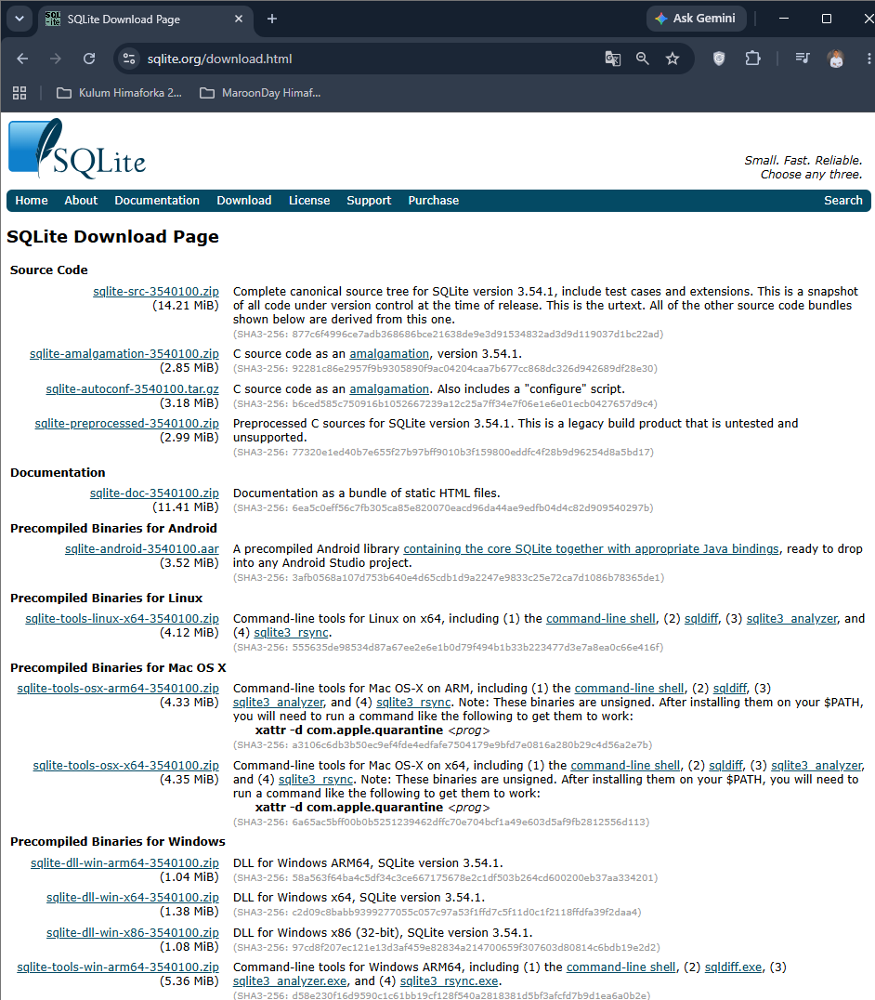

#### Pembahasan

---

Buat database dengan nama departemen-sdm.db dengan perintah

```bash
sqlite3 departemen-sdm.db
```

Kemudian isi dengan perintah berikut untuk membuat tabel dan isi 3 data awal

```bash
CREATE TABLE sdm (id INTEGER PRIMARY KEY, npp CHAR(6), nama VARCHAR(50));
INSERT INTO sdm (npp, nama) VALUES ('112233', 'Karyawan 1');
INSERT INTO sdm (npp, nama) VALUES ('223344', 'Karyawan 2');
INSERT INTO sdm (npp, nama) VALUES ('334455', 'Karyawan 3');
SELECT * FROM sdm;
```


Hasil:

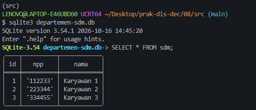

#### Pembahasan

---

### 2. Source Code

Buat file **_service.py_** di Folder src dengan perintah

```bash
cat << 'EOF' > service.py
from typing import List, Optional
from fastapi import Depends, FastAPI, HTTPException
from sqlmodel import Field, Session, SQLModel, create_engine, select


class Sdm(SQLModel, table=True):
    id: int | None = Field(default=None, primary_key=True)
    npp: str
    nama: str


engine = create_engine("sqlite:///departemen-sdm.db")


def get_session():
    with Session(engine) as session:
        yield session


app = FastAPI()


@app.get("/sdm/", response_model=List[Sdm])
def read_sdm(session: Session = Depends(get_session)):
    # SQLModel select statement
    statement = select(Sdm)
    results = session.exec(statement).all()
    return results
EOF
```


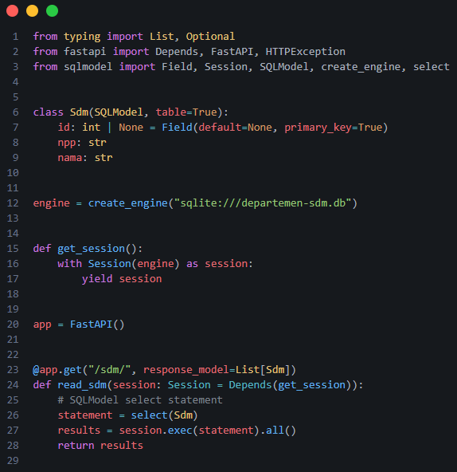

#### Pembahasan

---

### 3. Menjalankan Source Code

```bash
uvicorn service:app --reload
```

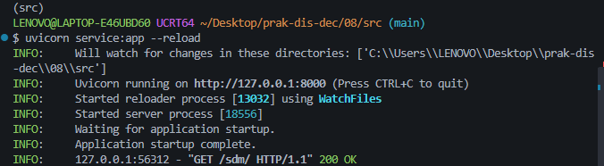

#### Pembahasan

---

Untuk memeriksa, akses dari browser atau dari headless tool (curl atau wget)

Browser: akses pada link http://localhost:8000/sdm/


Kemudian jangan dimatikan terlebih dahulu, lalu mencoba cek perintah melalui Headless tool curl dengan perintah

```bash
curl http://localhost:8000/sdm/
```

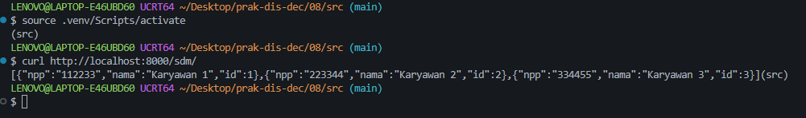

#### Pembahasan

---

## 📜 Tugas

### 1. Buat satu tabel baru menggunakan SQLite, tabel berbeda dari yang ada pada contoh. Tabel tersebut mempunyai 1 primary key dan setidaknya berisi data dengan tipe INT, CHAR, VARCHAR, BOOLEAN, dan FLOAT.

Buat file database baru bernama **_inventaris.db_** dengan perintah

```bash
sqlite3 inventaris.db
```

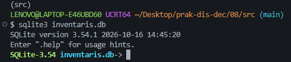

#### Pembahasan

---

Kemudian buat tabel produk

```bash
CREATE TABLE produk (
    id INTEGER PRIMARY KEY,
    kode CHAR(5),
    nama VARCHAR(100),
    stok INT,
    harga FLOAT,
    tersedia BOOLEAN
);
```

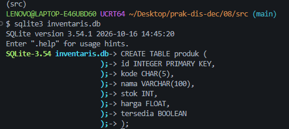

#### Pembahasan

---

Cek struktur tabel untuk memastikan kolom dan tipe datanya sudah sesuai dengan perintah

```bash
.schema produk
```


atau

```bash
PRAGMA table_info(produk);
```

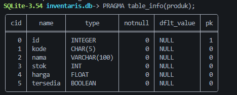

#### Pembahasan

---

### 2. Isikan 5 data menggunakan script Python

Buat file script atau Source Code Python bernama **_isi_data.py_** di dalam folder src

```bash
cat << 'EOF' > isi_data.py
from sqlmodel import Field, Session, SQLModel, create_engine


class Produk(SQLModel, table=True):
    id: int | None = Field(default=None, primary_key=True)
    kode: str
    nama: str
    stok: int
    harga: float
    tersedia: bool


engine = create_engine("sqlite:///inventaris.db")


def main():
    daftar_produk = [
        Produk(kode="PRD01", nama="Keyboard Mekanikal", stok=15, harga=450000.50, tersedia=True),
        Produk(kode="PRD02", nama="Mouse Wireless", stok=30, harga=175000.00, tersedia=True),
        Produk(kode="PRD03", nama="Monitor 24 Inch", stok=8, harga=1850000.75, tersedia=True),
        Produk(kode="PRD04", nama="Webcam HD", stok=0, harga=320000.00, tersedia=False),
        Produk(kode="PRD05", nama="USB Hub Type-C", stok=22, harga=125500.25, tersedia=True),
    ]

    with Session(engine) as session:
        for item in daftar_produk:
            session.add(item)
        session.commit()
        print("Berhasil memasukkan 5 data produk ke database!")


if __name__ == "__main__":
    main()
EOF
```


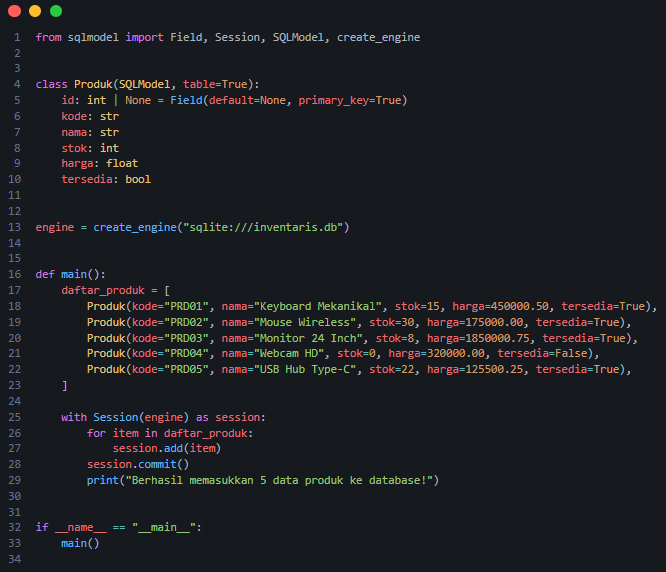

#### Pembahasan

---

Jalankan script tersebut untuk mengisi database dengan perintah

```bash
python isi_data.py
```

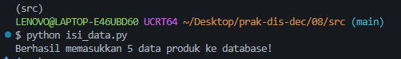

#### Pembahasan

---

Verifikasi data sudah masuk ke SQLite dengan perintah

```bash
sqlite3 inventaris.db "SELECT * FROM produk;"
```

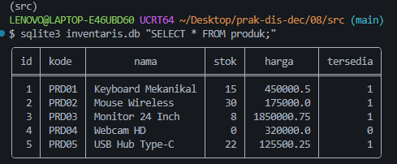

#### Pembahasan

---

### 3. Buat RESTful API endpoint untuk menampilkan semua data yang telah diisikan

Buat file baru bernama **_tugas_service.py_** di dalam folder src

```bash
cat << 'EOF' > tugas_service.py
from typing import List
from fastapi import Depends, FastAPI
from sqlmodel import Field, Session, SQLModel, create_engine, select


class Produk(SQLModel, table=True):
    id: int | None = Field(default=None, primary_key=True)
    kode: str
    nama: str
    stok: int
    harga: float
    tersedia: bool


engine = create_engine("sqlite:///inventaris.db")


def get_session():
    with Session(engine) as session:
        yield session


app = FastAPI()


@app.get("/produk/", response_model=List[Produk])
def read_produk(session: Session = Depends(get_session)):
    statement = select(Produk)
    results = session.exec(statement).all()
    return results
EOF
```


#### Pembahasan

---

Jalankan server Univcorn untuk file **_tugas_service.py_** dengan perintah

```bash
uvicorn tugas_service:app --reload
```

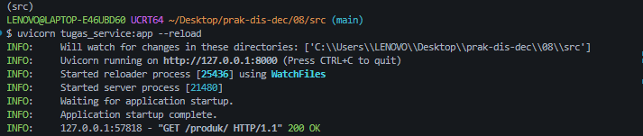

#### Pembahasan

---

Cek hasil pada browser dapat melalui link http://127.0.0.1:8000/produk/

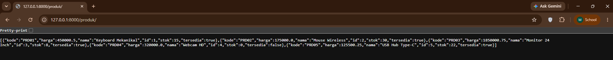

#### Pembahasan

---

### 4. Tampilkan hasil RESTful API endpoint tersebut menggunakan curl.

Kemudian jangan dimatikan terlebih dahulu Uvicorn nya, lalu mencoba cek perintah melalui Headless tool curl dengan perintah

```bash
curl http://127.0.0.1:8000/produk/
```


#### Pembahasan

---

## 📝 Kesimpulan

---

## 🗒️ Referensi
